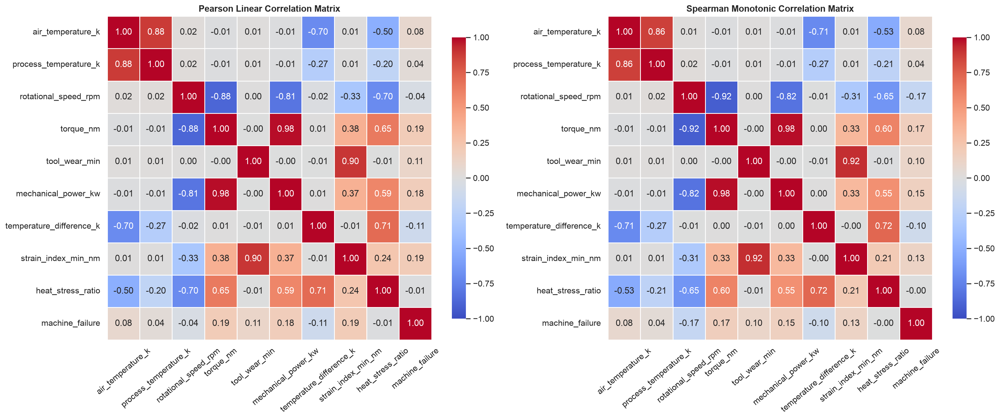
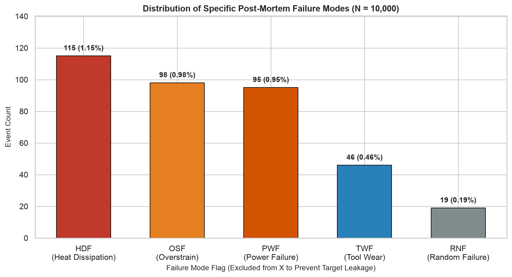
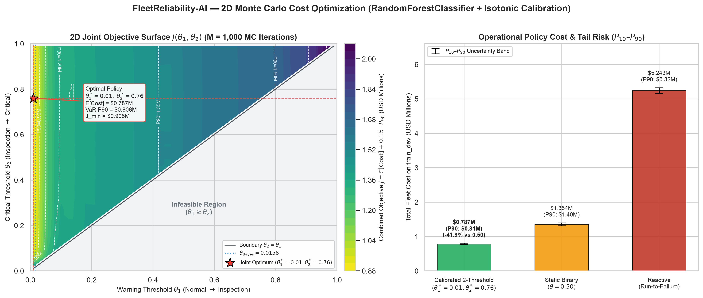
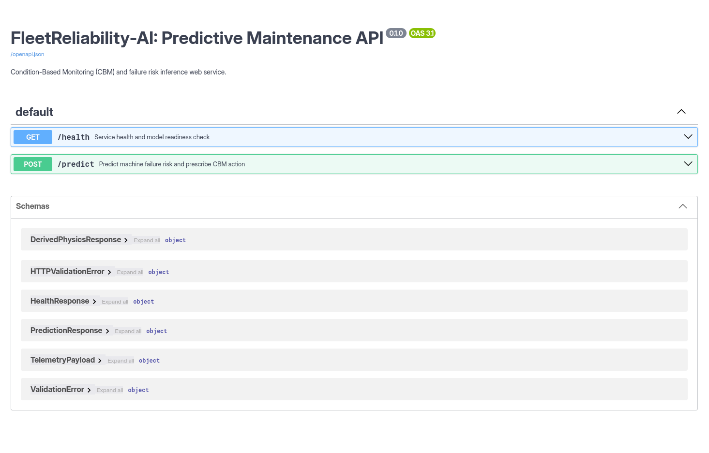

# FleetReliability-AI

**Predictive Maintenance & Condition-Based Monitoring (CBM) System for Heavy Industrial & Mining Equipment**  
*Machine Learning Zoomcamp — Mid-Term Project*

[](https://github.com/mpueblarivera/fleetreliability-ai/actions/workflows/ci.yml)
[](https://fleetreliability-ai.onrender.com/docs)
[](Dockerfile)
[](pyproject.toml)
[](https://fleetreliability-ai.onrender.com/docs)
[](uv.lock)

---

## 1. Executive Summary & Business Problem

Unplanned downtime in critical mining and industrial machinery (e.g., SAG mill pumps, crushers, haulage systems) leads to severe operational bottlenecks and financial losses exceeding tens of thousands of dollars per hour. However, relying on naive binary classification models (`0` vs `1` at an arbitrary `0.5` threshold) is operationally unfeasible in production environments, as false alarms can trigger costly, unnecessary shutdowns.

**FleetReliability-AI** bridges the gap between statistical machine learning and real-world Asset Management (RCM / CBM):
- **Physics-Informed Feature Engineering:** Incorporates thermodynamic and mechanical domain laws (mechanical power $P_{\text{mech}}$, thermal dissipation gradients $\Delta T$, and cumulative overstrain indices) derived from real-time sensor telemetry.
- **Stochastic Cost Optimization (Monte Carlo Simulation):** Replaces static threshold rules with a Monte Carlo simulation of uncertain repair times ($\text{MTTR} \sim \text{LogNormal}$), asset criticality tiers ($L, M, H$), and non-destructive inspection costs ($C_{\text{FP}} \sim \text{Normal}$), minimizing both Expected Operational Loss and tail risk ($P_{90}$ Value-at-Risk).
- **Multi-Threshold Operational Action Policy:** Exposes a calibrated continuous risk score via a **FastAPI** microservice that maps predictions into actionable maintenance tiers:
  1. `NORMAL` ($p < \theta_1^*$): Standard continuous operation.
  2. `INSPECTION_REQUIRED` ($\theta_1^* \le p < \theta_2^*$): Triggers a low-cost preventive CBM work order (thermography/vibration check) at the next shift change.
  3. `CRITICAL_INTERVENTION` ($p \ge \theta_2^*$): Recommends immediate load derating and scheduled maintenance intervention.

---

## 2. Project Structure

```text
fleetreliability-ai/
├── .github/workflows/       # Automated CI pipeline with astral-sh/setup-uv
├── data/
│   ├── raw/                 # Original UCI AI4I 2020 dataset
│   └── processed/           # Processed & split datasets
├── docs/
│   ├── PLAN.md              # Master Architecture & Execution Plan
│   └── course_guidelines/   # ML Zoomcamp rubrics & reference guides
├── notebooks/               # Exploratory Data Analysis (EDA) & Model Tuning
├── src/                     # Production source code (features, train, predict)
├── tests/                   # Pytest unit & API integration tests
├── Dockerfile               # Production container definition (uv-powered)
├── docker-compose.yml       # Local container orchestration
├── pyproject.toml           # Standard PEP 621 / PEP 735 dependency declaration
├── uv.lock                  # Deterministic Astral uv lockfile
├── requirements.txt         # Exported dependencies for universal reproducibility
└── README.md                # Project documentation
```

---

## 3. Environment Setup & Installation

This project uses **Python 3.11** and **Astral `uv`** for lightning-fast, deterministic dependency management (with an exported `requirements.txt` for universal compatibility).

### Option A: Using `uv` (Recommended — 10x to 100x Faster)
```bash
# 1. Clone the repository
git clone https://github.com/mpueblarivera/fleetreliability-ai.git
cd fleetreliability-ai

# 2. Sync all dependencies and create the .venv automatically
uv sync --all-groups

# 3. Activate the virtual environment (or prefix commands with `uv run`)
source .venv/bin/activate
```

### Option B: Using Standard `venv` + `pip` (Peer Review Fallback)
```bash
python3.11 -m venv .venv
source .venv/bin/activate
pip install -r requirements.txt

# Optional: install dev tools to run tests or the EDA notebook without `uv`
pip install jupyter pytest httpx
```

---

## 4. Running the Application & Docker

### Local Execution (once `src/train.py` and `src/predict.py` are implemented)
```bash
# Train the model and generate artifacts
uv run python -m src.train

# Start the FastAPI inference service on port 9696
uv run uvicorn src.predict:app --host 0.0.0.0 --port 9696 --reload
```

### Containerized Execution with Docker
```bash
# Build the image and start the container via Docker Compose
docker compose up --build -d

# Or using standard Docker CLI
docker build -t fleetreliability-ai .
docker run -it --rm -p 9696:9696 fleetreliability-ai
```

Interactive Swagger UI documentation will be available at:
- `http://localhost:9696/docs`
- `http://localhost:9696/health`

---

## 5. Architecture & Execution Roadmap

See [`docs/PLAN.md`](docs/PLAN.md) for the complete architecture diagram, physics-informed equations, Monte Carlo threshold formulation, and milestone schedule.

---

## 6. Phase 1: Data Ingestion, Physics Feature Engineering & EDA

> [!NOTE]
> **Phase Status:** `COMPLETED` — All structural audits, leakage-free stratified splits, vectorized physics features, exploratory visualizations, and 5-Fold Stratified CV baseline benchmarks (`LogisticRegression`) have been executed and verified.

### 6.1 Industrial Mining Context & Dataset Overview (UCI AI4I 2020)

In heavy mining and industrial operations (SAG mills, centrifugal slurry pumps, haulage equipment, and CNC machining centers), unplanned downtime imposes severe asymmetric costs—exceeding \$10,000 USD/hr in critical plant bottlenecks (with typical unplanned outages ranging from \$1,500–\$3,750 USD/hr plus secondary component damage), compared to approximately \$350 USD for a non-destructive preventive Condition-Based Maintenance (CBM) inspection.

The project benchmarks telemetry from the **UCI AI4I 2020 Predictive Maintenance Dataset** ($N = 10{,}000$ observations, $14$ base columns, zero missing values, UTF-8 BOM handled via `encoding="utf-8-sig"`). The target `Machine failure` exhibits a strong class imbalance of **3.39%** ($339$ failure events vs. $9{,}661$ normal operations; imbalance ratio **$28.50 : 1$**).

#### Post-Mortem Failure Modes Breakdown ($N = 10{,}000$)

| Failure Mode | Mechanism | Count | % of Dataset | % of Failures ($n = 339$) |
| :--- | :--- | ---: | ---: | ---: |
| `HDF` | Heat Dissipation Failure (`ΔT < 8.6 K` and `ω < 1380 rpm`) | 115 | 1.15% | 33.92% |
| `OSF` | Overstrain Failure (`Tool wear × Torque > variant limit`) | 98 | 0.98% | 28.91% |
| `PWF` | Power Failure (`P_mech ∉ [3.5, 9.0] kW`) | 95 | 0.95% | 28.02% |
| `TWF` | Tool Wear Failure (cutting-edge wear within 200–240 min) | 46 | 0.46% | 13.57% |
| `RNF` | Random Failure (uncorrelated stochastic event) | 19 | 0.19% | 5.60% |

Additional empirical findings from [`notebooks/notebook.ipynb`](notebooks/notebook.ipynb):
- **Dataset Multi-Mode & Label Quirks:** $24$ rows exhibit simultaneous multi-mode failures, $18$ rows have `RNF == 1` with `Machine failure == 0`, and $9$ rows have `Machine failure == 1` with all five diagnostic mode flags equal to `0`.
- **Conditional Risk by Asset Variant (`machine_type`):** Failure rate is highest for `L` assets at **3.92%** ($235 / 6{,}000$; $60.00\%$ of fleet), followed by `M` at **2.77%** ($83 / 2{,}997$; $29.97\%$ of fleet), and `H` at **2.09%** ($21 / 1{,}003$; $10.03\%$ of fleet).
- **Leakage-Free Stratified Split (`random_state=42`):** Identifiers (`UDI`, `Product ID`) and post-mortem diagnostic flags (`TWF`, `HDF`, `PWF`, `OSF`, `RNF`) are strictly excluded before splitting into `data/processed/train_dev.csv` ($8{,}000$ rows, $271$ failures, $3.388\%$) and the locked `data/processed/test_holdout.csv` ($2{,}000$ rows, $68$ failures, $3.400\%$).

### 6.2 Physics-Informed Feature Engineering (`src/features.py`)

Four domain-informed features are computed via 100% vectorized NumPy/Pandas operations inside `PhysicalFeatureTransformer`:

| Derived Feature | KaTeX Formulation | Unit | Pearson $r$ | Spearman $\rho$ | Mutual Info | Causal Failure Validation |
| :--- | :--- | :---: | ---: | ---: | ---: | :--- |
| `mechanical_power_kw` | $P_{\text{mech}} = \tau \cdot \omega_{\text{rpm}} \cdot \frac{2\pi}{60\,000}$ | $\text{kW}$ | 0.1760 | 0.1540 | 0.0446 | `95/95` (`100%`) `PWF=1` cases fall outside $[3.5, 9.0]\text{ kW}$ |
| `temperature_difference_k` | $\Delta T = T_{\text{process}} - T_{\text{air}}$ | $\text{K}$ | -0.1117 | -0.1018 | 0.0118 | `115/115` (`100%`) `HDF=1` cases satisfy $\Delta T < 8.6\text{ K} \land \omega < 1380\text{ rpm}$ |
| `strain_index_min_nm` | $\text{Strain Index} = \text{Tool wear} \times \tau$ | $\text{min}\cdot\text{Nm}$ | 0.1904 | 0.1282 | 0.0342 | `98/98` (`100%`) `OSF=1` cases exceed $L/M/H$ limits ($11\text{k}/12\text{k}/13\text{k}$) |
| `heat_stress_ratio` | $\text{HSR} = \frac{\Delta T}{\max(\omega_{\text{rpm}}, \epsilon)} \times 1000$ | $\frac{\text{K}\cdot\text{min}}{\text{rev}} \times 10^3$ | -0.0095 | -0.0001 | 0.0140 | Captures thermal density at low rotational speeds |

> [!WARNING]
> **Multicollinearity & Non-Linearity:** Strong expected physical collinearity exists between `air_temperature_k` and `process_temperature_k` (Pearson $r = 0.8761$) and an inverse hyperbolic trade-off between `rotational_speed_rpm` and `torque_nm` (Pearson $r = -0.8750$, Spearman $\rho = -0.9165$). Because `Machine failure` stems from rectangular/hyperbolic physical boundaries, `Accuracy` ($96.61\%$ for a trivial all-zero classifier) is operationally invalid; Phase 2 optimization is governed by **PR-AUC** and **$F_2$-Score** ($\beta = 2$, weighting Recall $4\times$ higher than Precision).

### 6.3 Phase 1 Baseline Metrics (`LogisticRegression`, 5-Fold Stratified CV on `train_dev`)

Evaluated strictly on `data/processed/train_dev.csv` ($N = 8{,}000$, $271$ failures) with `StandardScaler` + `OneHotEncoder(drop="first")` fitted inside each fold (`StratifiedKFold(n_splits=5, shuffle=True, random_state=42)`), predicting at threshold $0.50$:

| Baseline Model | CV ROC-AUC (mean $\pm$ std) | CV PR-AUC (mean $\pm$ std) | CV F1 (mean $\pm$ std) | CV F2 (mean $\pm$ std) | OOF ROC-AUC | OOF PR-AUC | OOF F1 | OOF F2 |
| :--- | :---: | :---: | :---: | :---: | ---: | ---: | ---: | ---: |
| `LogisticRegression` (`class_weight=None`) | 0.9144 $\pm$ 0.0158 | 0.5011 $\pm$ 0.0309 | 0.3784 $\pm$ 0.0478 | 0.2901 $\pm$ 0.0392 | 0.9136 | 0.4961 | 0.3788 | 0.2901 |
| `LogisticRegression` (`class_weight='balanced'`) | 0.9273 $\pm$ 0.0135 | 0.4741 $\pm$ 0.0358 | 0.2850 $\pm$ 0.0170 | 0.4707 $\pm$ 0.0263 | 0.9263 | 0.4715 | 0.2846 | 0.4706 |

While linear `LogisticRegression` achieves strong global ranking (`ROC-AUC` $\approx 0.914$–$0.927$), its moderate `PR-AUC` ($\approx 0.472$–$0.496$) and low `F2-Score` ($0.2901$ default / $0.4706$ balanced) confirm the need for non-linear tree ensembles (`RandomForest`, `LightGBM`, `XGBoost`) and Monte Carlo cost-calibrated thresholds $(\theta_1^*, \theta_2^*)$ in Phase 2.

### 6.4 Exploratory Data Analysis Visuals (`reports/figures/`)

| Artifact | Description | Preview |
| :--- | :--- | :--- |
| [`01_target_imbalance.png`](reports/figures/01_target_imbalance.png) | Target class imbalance ($28.5:1$) and conditional failure rate across asset variants (`L`, `M`, `H`) |  |
| [`02_correlation_matrix.png`](reports/figures/02_correlation_matrix.png) | Side-by-side Pearson ($r$) and Spearman ($\rho$) correlation heatmaps across raw and physical features |  |
| [`03_failure_modes_distribution.png`](reports/figures/03_failure_modes_distribution.png) | Distribution of the five post-mortem failure modes (`HDF`, `OSF`, `PWF`, `TWF`, `RNF`) |  |
| [`04_physics_features_separation.png`](reports/figures/04_physics_features_separation.png) | Experimental validation of $P_{\text{mech}}$, $\Delta T$ vs. RPM quadrant, $\text{Strain Index}$ hyperbolas, and `heat_stress_ratio` |  |

### 6.5 Phase 1 Reproducibility Commands (`uv run`)

```bash
# 1. Idempotently download and validate the raw UCI AI4I 2020 dataset (10,000 x 14)
uv run python -m src.data_loader

# 2. Verify code formatting and import ordering
uv run black --check src tests
uv run isort --check-only src tests

# 3. Run the unit test suite (ingestion, UTF-8 BOM, vectorized physics, anti-leakage split)
uv run pytest tests/ -v

# 4. Launch Jupyter to inspect or re-execute notebooks/notebook.ipynb end-to-end
uv run jupyter notebook notebooks/notebook.ipynb
```

---

## 7. Phase 2: Multi-Model Benchmarking, Calibration & 2D Monte Carlo Cost Optimization

> [!NOTE]
> **Phase Status:** `COMPLETED` — Multi-model hyperparameter tuning (4 algorithm families under zero-leakage 5-Fold Stratified CV), post-hoc probability calibration, 2D joint Monte Carlo threshold optimization, single-pass locked Holdout Test evaluation, and compressed artifact serialization ([`models/best_model.bin`](models/best_model.bin)) have been executed and verified.

### 7.1 Multi-Model Benchmarking on `train_dev` ($N = 8{,}000$, 5-Fold Stratified CV)

All four candidate families were tuned strictly on [`data/processed/train_dev.csv`](data/processed/train_dev.csv) ($8{,}000$ rows, $271$ failures) inside a leakage-free `ColumnTransformer` (`StandardScaler` + `OneHotEncoder(drop="first")`) using `StratifiedKFold(n_splits=5, shuffle=True, random_state=42)` and optimizing `scoring="average_precision"` (`PR-AUC`):

| Model | Family | PR-AUC (CV Mean $\pm$ Std) | OOF PR-AUC | $F_2$-Score (CV Mean $\pm$ Std) | OOF $F_2$ (@`0.50`) | ROC-AUC (CV Mean $\pm$ Std) | OOF ROC-AUC | OOF Brier Score |
| :--- | :--- | :---: | ---: | :---: | ---: | :---: | ---: | ---: |
| **`RandomForestClassifier` (Champion)** | **Bagging Ensemble** | **0.9073 $\pm$ 0.0207** | **0.9066** | **0.8439 $\pm$ 0.0307** | **0.8442** | 0.9789 $\pm$ 0.0125 | 0.9774 | **0.0064** |
| `LGBMClassifier` | Gradient Boosting (Leaf-wise) | 0.8898 $\pm$ 0.0271 | 0.8860 | 0.8024 $\pm$ 0.0612 | 0.8029 | 0.9813 $\pm$ 0.0143 | 0.9799 | 0.0086 |
| `XGBClassifier` | Gradient Boosting (Hessian) | 0.8876 $\pm$ 0.0250 | 0.8875 | 0.7778 $\pm$ 0.0337 | 0.7772 | **0.9819 $\pm$ 0.0127** | **0.9806** | 0.0224 |
| `LogisticRegression` | Linear Baseline | 0.5039 $\pm$ 0.0287 | 0.4994 | 0.2976 $\pm$ 0.0384 | 0.2979 | 0.9181 $\pm$ 0.0156 | 0.9173 | 0.0228 |

- **Champion Base Pipeline:** `RandomForestClassifier` (`n_estimators=100`, `max_depth=10`, `min_samples_split=5`, `min_samples_leaf=1`, `max_features=0.5`, `class_weight=None`) achieved the highest **CV PR-AUC (`0.9073` $\pm$ `0.0207`)**, highest **OOF PR-AUC (`0.9066`)**, highest **OOF $F_2$-Score (`0.8442`)**, and lowest **OOF Brier Score (`0.0064`)** across all four families.

> [!NOTE]
> **Methodological Caveat (Synthetic Benchmark vs. Real-World Telemetry):** While the engineered physical features (`mechanical_power_kw`, `temperature_difference_k`, `strain_index_min_nm`, `heat_stress_ratio`) are valid and grounded in thermodynamic and mechanical domain laws, the near-perfect separation observed in this benchmark largely stems from UCI AI4I 2020 being a synthetic dataset governed by deterministic failure rules (`HDF`, `PWF`, `OSF`). Because the decision boundaries become predominantly orthogonal once those physics terms are exposed, bagging decision trees (`RandomForestClassifier`) achieve top performance cleanly; however, on real-world industrial SCADA/sensor telemetry—characterized by higher noise, non-stationary drift, and complex non-linear interactions—gradient boosting models (`LightGBM`, `XGBoost`) are generally expected to outperform bagging by capturing subtler non-linear error structures.

### 7.2 Post-Hoc Probability Calibration (`Isotonic` vs `Sigmoid`) & Feature Importance (MDI vs PFI)

#### Post-Hoc Calibration (`CalibratedClassifierCV`, `cv=5` OOF)
Because Monte Carlo decision optimization requires reliable probability estimates $\hat{p}(x) = P(Y=1 \mid X=x)$, `CalibratedClassifierCV` was evaluated out-of-fold on `train_dev` comparing non-parametric `isotonic` regression against parametric `sigmoid` (Platt) scaling:

| Calibration Method | OOF Brier Score | OOF PR-AUC | OOF ROC-AUC | OOF $F_2$-Score (@`0.50`) | Selection Decision |
| :--- | ---: | ---: | ---: | ---: | :--- |
| Uncalibrated Base (`RandomForestClassifier`) | 0.00641 | 0.90656 | 0.97744 | **0.84416** | Baseline reference |
| **Calibrated (`isotonic`, `cv=5`)** | **0.00619** | **0.90833** | **0.97935** | 0.83969 | **Selected (lowest OOF Brier Score)** |
| Calibrated (`sigmoid`, `cv=5`) | 0.00626 | 0.90827 | 0.97672 | 0.83844 | Slightly higher Brier and lower ROC-AUC |

#### Feature Importance: Mean Decrease in Impurity (MDI) vs. Out-of-Fold Permutation Feature Importance (PFI)
Evaluated across the 5 CV folds on the champion `RandomForestClassifier` (`scoring="average_precision"`, `n_repeats=10` for OOF PFI):

| Feature | MDI (Mean $\pm$ Std) | MDI Share (%) | OOF PFI ($\Delta\text{PR-AUC}$ Mean $\pm$ Std) | OOF PFI Share (%) |
| :--- | :---: | ---: | :---: | ---: |
| `rotational_speed_rpm` | 0.1622 $\pm$ 0.0053 | 16.22% | **0.2640 $\pm$ 0.0442** | **27.35%** |
| `strain_index_min_nm` | **0.2365 $\pm$ 0.0165** | **23.65%** | 0.2227 $\pm$ 0.0445 | 23.07% |
| `mechanical_power_kw` | 0.2209 $\pm$ 0.0052 | 22.09% | 0.1793 $\pm$ 0.0413 | 18.57% |
| `temperature_difference_k` | 0.0956 $\pm$ 0.0076 | 9.56% | 0.1637 $\pm$ 0.0412 | 16.96% |
| `machine_type` | 0.0377 $\pm$ 0.0058 | 3.77% | 0.0549 $\pm$ 0.0242 | 5.68% |
| `tool_wear_min` | 0.0366 $\pm$ 0.0030 | 3.66% | 0.0384 $\pm$ 0.0132 | 3.98% |
| `heat_stress_ratio` | 0.0739 $\pm$ 0.0070 | 7.39% | 0.0223 $\pm$ 0.0057 | 2.31% |
| `torque_nm` | 0.1032 $\pm$ 0.0039 | 10.32% | 0.0127 $\pm$ 0.0058 | 1.32% |
| `process_temperature_k` | 0.0169 $\pm$ 0.0015 | 1.69% | 0.0038 $\pm$ 0.0051 | 0.40% |
| `air_temperature_k` | 0.0165 $\pm$ 0.0019 | 1.65% | 0.0036 $\pm$ 0.0040 | 0.38% |

Notice how `rotational_speed_rpm` and the three physics-derived features (`strain_index_min_nm`, `mechanical_power_kw`, `temperature_difference_k`) jointly contribute **85.94%** of total OOF Permutation Feature Importance (vs. **71.52%** in MDI), whereas collinear raw variables (`torque_nm`, `air_temperature_k`, `process_temperature_k`) drop sharply under out-of-fold permutation.

### 7.3 2D Joint Monte Carlo Cost Optimization (`M = 1,000`, `λ_risk = 0.15`)

Using `src.montecarlo.optimize_dual_thresholds_mc` on the isotonic-calibrated OOF probabilities (`N = 8,000`) with `M = 1,000` stochastic iterations (`MTTR ~ LogNormal(μ = 8 h, σ = 2 h)`, asset criticality `K_Type ∈ {1.0, 1.5, 2.5}`, `C_FP ~ Normal(USD 350, USD 50)`, `C_TP ~ Normal(USD 1,200, USD 200)`, `C_damage ~ Normal(USD 5,000, USD 1,000)`, downtime rate `USD 1,500/hr`), we minimize the risk-adjusted objective over `θ₁ < θ₂`:

$$J(\theta_1, \theta_2) = \mathbb{E}[\text{Cost}(\theta_1, \theta_2)] + \lambda_{\text{risk}} \cdot \text{VaR}_{90}(\theta_1, \theta_2), \quad \lambda_{\text{risk}} = 0.15$$

- **Joint 2D Optimal Thresholds:** `θ₁* = 0.0100` (`theta_warning`), `θ₂* = 0.7600` (`theta_critical`)
- **Analytical Bayes Theoretical Reference:** `θ_Bayes = 0.0158` (`0.015801`)

| Operational Policy (`train_dev`, `N = 8,000`) | `E[Cost]` (USD) | Cost Std (USD) | `P₁₀` Cost (USD) | `P₉₀` VaR (USD) | `P₉₅` Cost (USD) | Objective `J` (USD) | Savings vs. Static `0.50` | Savings vs. Reactive |
| :--- | ---: | ---: | ---: | ---: | ---: | ---: | ---: | ---: |
| **Calibrated 2-Threshold `(0.01, 0.76)`** | **$787,325.35** | $13,937.42 | $770,325.93 | **$805,807.53** | $811,345.92 | **$908,196.48** | **41.86%** | **84.98%** |
| Static Binary Threshold (`0.50`) | $1,354,105.08 | $31,292.31 | $1,312,910.84 | $1,395,209.86 | $1,408,380.85 | $1,563,386.56 | 0.00% | 74.17% |
| Reactive Run-to-Failure | $5,243,113.66 | $62,432.40 | $5,165,436.44 | $5,324,576.01 | $5,343,202.68 | $6,041,800.06 | -287.20% | 0.00% |


*Figure: Left — 2D joint objective surface contour map / heatmap `J(θ₁, θ₂) = E[Cost] + 0.15 · P₉₀` across `M = 1,000` Monte Carlo realizations over the feasible region (`θ₁ < θ₂`), pinpointing the joint optimum `(θ₁* = 0.01, θ₂* = 0.76)` (`J_min = USD 0.908M`, `E[Cost] = USD 0.787M`, `VaR P₉₀ = USD 0.806M`) alongside the analytical Bayes reference `θ_Bayes = 0.0158`. Right — Total fleet cost and `P₁₀–P₉₀` uncertainty bands on `train_dev` comparing the calibrated dual-threshold policy against static binary (`0.50`) and reactive run-to-failure baselines.*

### 7.4 Single Final Evaluation on Locked Holdout Test (`2,000` Rows) & Artifact Export

With all modeling, calibration, and dual-threshold decisions frozen, [`data/processed/test_holdout.csv`](data/processed/test_holdout.csv) ($N = 2{,}000$, $68$ failure events) was evaluated **once**:

| Holdout Metric / Operational Breakdown | Measured Value |
| :--- | ---: |
| **PR-AUC (Average Precision)** | **0.9047** (`0.90472`) |
| **ROC-AUC** | **0.9815** (`0.98154`) |
| **Brier Score (Calibrated)** | **0.00638** |
| **$F_2$-Score @ `theta_warning` (`0.01`)** | 0.6179 |
| **$F_2$-Score @ `theta_critical` (`0.76`)** | 0.8129 |
| **$F_2$-Score @ Static (`0.50`)** | 0.8485 |

| Holdout Action Zone | Assets | Share (%) | Actual Failures |
| :--- | ---: | ---: | ---: |
| `NORMAL` ($p < 0.01$) | 1,746 | 87.3% | 3 |
| `INSPECTION_REQUIRED` ($0.01 \le p < 0.76$) | 200 | 10.0% | 12 |
| `CRITICAL_INTERVENTION` ($p \ge 0.76$) | 54 | 2.7% | 53 |

| Holdout Operational Policy (`N = 2,000`, `M = 1,000`) | `E[Cost]` (USD) | Cost Std (USD) | `P₁₀` Cost (USD) | `P₉₀` VaR (USD) | `P₉₅` Cost (USD) | Objective `J` (USD) | Savings vs. Static `0.50` | Savings vs. Reactive |
| :--- | ---: | ---: | ---: | ---: | ---: | ---: | ---: | ---: |
| **Calibrated 2-Threshold `(0.01, 0.76)`** | **$205,883.49** | $6,712.02 | $197,476.89 | **$214,705.45** | $217,983.57 | **$238,089.30** | **38.21%** | **85.23%** |
| Static Binary Threshold (`0.50`) | $333,211.18 | $15,799.30 | $313,558.78 | $354,121.31 | $360,070.09 | $386,329.38 | 0.00% | 76.10% |
| Reactive Run-to-Failure | $1,394,166.18 | $34,332.11 | $1,351,950.88 | $1,439,596.11 | $1,451,371.29 | $1,610,105.59 | -318.40% | 0.00% |

The calibrated pipeline, canonical feature schema, operational thresholds (`θ₁* = 0.01, θ₂* = 0.76`), CV/holdout metrics, and Monte Carlo cost parameters are packaged in [`models/best_model.bin`](models/best_model.bin) (`823.8 KB`, `RandomForestClassifier_Calibrated_Isotonic`, `model_version="0.1.0"`).

---

## 8. Phase 3: Production Modularization, FastAPI Service & Stochastic Fleet Simulator

> [!NOTE]
> **Phase Status:** `COMPLETED` — Production feature engineering ([`src/features.py`](src/features.py)), autonomous CLI training with locked holdout governance ([`src/train.py`](src/train.py)), FastAPI REST inference service with Pydantic v2 physical validation and tri-threshold CBM policy ([`src/predict.py`](src/predict.py)), stochastic Wiener/Random-Walk fleet simulator ([`src/fleet_simulator.py`](src/fleet_simulator.py)), and the 91-test `pytest` suite including the CI/CD Golden Dataset ([`tests/golden_dataset.json`](tests/golden_dataset.json)) have been implemented and verified.

### 8.1 Reproducible `uv` Workflow (Training, Testing, API & Simulator)

```bash
# 1. Sync deterministic virtual environment with uv
uv sync

# 2. Re-train, calibrate (5-fold isotonic), and serialize the model artifact via CLI
#    (respects the locked 20% holdout split in data/processed/)
uv run python -m src.train --data-path data/raw/ai4i2020.csv --output-dir models/

# 3. Run the full unit, integration, and Golden Dataset test suite
uv run pytest tests/ -v

# 4. Start the FastAPI inference service in development mode (port 9696)
uv run uvicorn src.predict:app --host 0.0.0.0 --port 9696 --reload

# 5. (Operational Demo) Run the stochastic fleet simulator against the live API
uv run python -m src.fleet_simulator --api-url http://localhost:9696 --num-machines 5 --num-shifts 2
```

> [!IMPORTANT]
> **Statistical vs. Operational Validation:** Predictive metrics (`PR-AUC`, $F_2$-Score, `Brier Score`) are reported **exclusively** on real UCI AI4I 2020 data (`train_dev` CV/OOF and locked `test_holdout`). The stochastic simulator (`src/fleet_simulator.py`) validates end-to-end API latency, shift-level CBM reporting (`reports/shift_report.json`), and relative economic behavior across policies. A verified 5-machine, 2-shift run (`120` hourly observations) issued `45` preventive/critical work orders (`75` `NORMAL`, `7` `INSPECTION_REQUIRED`, `38` `CRITICAL_INTERVENTION`), yielding `$48,097.74` calibrated policy cost vs. `$509,828.80` reactive run-to-failure (`$461,731.06` net savings vs. reactive).

### 8.2 Verified REST API `curl` Examples (`localhost:9696`)

#### 1. Service Health Check (`GET /health`)
```bash
curl -s -X GET http://localhost:9696/health | jq .
```
**Verified Response (`200 OK`):**
```json
{
  "status": "HEALTHY",
  "model_loaded": true,
  "model_version": "0.1.0",
  "thresholds": {
    "theta_warning": 0.01,
    "theta_critical": 0.76
  },
  "uptime_seconds": 0.848
}
```

#### 2. Normal Operation Inference (`POST /predict` — `NORMAL`)
```bash
curl -s -X POST http://localhost:9696/predict \
  -H "Content-Type: application/json" \
  -d '{
    "machine_id": "PUMP-SAG-GOLDEN-01",
    "machine_type": "M",
    "air_temperature_k": 298.2,
    "process_temperature_k": 308.7,
    "rotational_speed_rpm": 1500.0,
    "torque_nm": 42.8,
    "tool_wear_min": 45.0
  }' | jq .
```
**Verified Response (`200 OK`):**
```json
{
  "machine_id": "PUMP-SAG-GOLDEN-01",
  "failure_risk_score": 0.0,
  "operational_status": "NORMAL",
  "recommended_cbm_action": "Continue normal operation. Maintain standard shift lubrication and routine inspection schedule.",
  "criticality_level": "LOW",
  "derived_physics": {
    "mechanical_power_kw": 6.723008278682157,
    "temperature_difference_k": 10.5,
    "strain_index_min_nm": 1925.9999999999998,
    "heat_stress_ratio": 7.0
  },
  "model_version": "0.1.0",
  "timestamp": "2026-11-16T02:12:38.634248Z"
}
```

#### 3. Preventive CBM Warning (`POST /predict` — `INSPECTION_REQUIRED`)
```bash
curl -s -X POST http://localhost:9696/predict \
  -H "Content-Type: application/json" \
  -d '{
    "machine_id": "COMPRESSOR-GOLDEN-02",
    "machine_type": "H",
    "air_temperature_k": 300.7,
    "process_temperature_k": 310.8,
    "rotational_speed_rpm": 1296.0,
    "torque_nm": 58.2,
    "tool_wear_min": 204.0
  }' | jq .
```
**Verified Response (`200 OK`):**
```json
{
  "machine_id": "COMPRESSOR-GOLDEN-02",
  "failure_risk_score": 0.3034557323541412,
  "operational_status": "INSPECTION_REQUIRED",
  "recommended_cbm_action": "Preventive CBM alert for Class H asset. Issue a non-destructive inspection work order for the next shift handover (bearing vibration analysis and component thermography).",
  "criticality_level": "HIGH",
  "derived_physics": {
    "mechanical_power_kw": 7.898717913361601,
    "temperature_difference_k": 10.100000000000023,
    "strain_index_min_nm": 11872.800000000001,
    "heat_stress_ratio": 7.793209876543227
  },
  "model_version": "0.1.0",
  "timestamp": "2026-11-16T02:12:38.888559Z"
}
```

#### 4. Critical Failure Risk (`POST /predict` — `CRITICAL_INTERVENTION`)
```bash
curl -s -X POST http://localhost:9696/predict \
  -H "Content-Type: application/json" \
  -d '{
    "machine_id": "CRUSHER-GOLDEN-03",
    "machine_type": "H",
    "air_temperature_k": 303.0,
    "process_temperature_k": 313.5,
    "rotational_speed_rpm": 1250.0,
    "torque_nm": 88.0,
    "tool_wear_min": 245.0
  }' | jq .
```
**Verified Response (`200 OK`):**
```json
{
  "machine_id": "CRUSHER-GOLDEN-03",
  "failure_risk_score": 1.0,
  "operational_status": "CRITICAL_INTERVENTION",
  "recommended_cbm_action": "IMMINENT FAILURE RISK on critical Class H asset. Execute immediate load derating (reduce RPM by 50%) and coordinate an immediate planned shutdown with the shift supervisor to prevent catastrophic damage.",
  "criticality_level": "CRITICAL",
  "derived_physics": {
    "mechanical_power_kw": 11.519173063162574,
    "temperature_difference_k": 10.5,
    "strain_index_min_nm": 21560.0,
    "heat_stress_ratio": 8.4
  },
  "model_version": "0.1.0",
  "timestamp": "2026-11-16T02:12:39.115554Z"
}
```

#### 5. Physical Range Validation Error (`POST /predict` — `422 Unprocessable Entity`)
```bash
curl -s -X POST http://localhost:9696/predict \
  -H "Content-Type: application/json" \
  -d '{
    "machine_id": "INVALID-PUMP",
    "machine_type": "INVALID_TYPE",
    "air_temperature_k": 400.0,
    "process_temperature_k": 308.7,
    "rotational_speed_rpm": 400.0,
    "torque_nm": 250.0,
    "tool_wear_min": -10.0
  }' | jq .
```
**Verified Response (`422 Unprocessable Entity`):**
```json
{
  "detail": [
    {
      "type": "literal_error",
      "loc": ["body", "machine_type"],
      "msg": "Input should be 'L', 'M' or 'H'",
      "input": "INVALID_TYPE",
      "ctx": {"expected": "'L', 'M' or 'H'"}
    },
    {
      "type": "less_than_equal",
      "loc": ["body", "air_temperature_k"],
      "msg": "Input should be less than or equal to 350",
      "input": 400.0,
      "ctx": {"le": 350.0}
    },
    {
      "type": "greater_than_equal",
      "loc": ["body", "rotational_speed_rpm"],
      "msg": "Input should be greater than or equal to 500",
      "input": 400.0,
      "ctx": {"ge": 500.0}
    },
    {
      "type": "less_than_equal",
      "loc": ["body", "torque_nm"],
      "msg": "Input should be less than or equal to 200",
      "input": 250.0,
      "ctx": {"le": 200.0}
    },
    {
      "type": "greater_than_equal",
      "loc": ["body", "tool_wear_min"],
      "msg": "Input should be greater than or equal to 0",
      "input": -10.0,
      "ctx": {"ge": 0.0}
    }
  ]
}
```

### 8.3 Automated Test Suite Summary (`tests/`)

The `pytest` suite (`91` collected tests) enforces contract, physics, calibration, and operational invariants across all modules:

| Test File | Scope & Verified Invariants |
| :--- | :--- |
| [`tests/test_features.py`](tests/test_features.py) | Pure vectorized physics equations, zero-RPM $\epsilon$ guard, `PhysicalFeatureTransformer` immutability & column checks, and leakage-free `prepare_training_matrices`. |
| [`tests/test_montecarlo.py`](tests/test_montecarlo.py) | Analytical Bayes threshold, LogNormal MTTR & criticality $K_{\text{Type}}$ cost realizations, deterministic 2D grid optimization, and tri-zone loss evaluation. |
| [`tests/test_model_artifact.py`](tests/test_model_artifact.py) | Serialized `models/best_model.bin` schema completeness, ordered finite thresholds, canonical feature contract, quality gates, and end-to-end inference. |
| [`tests/test_train.py`](tests/test_train.py) | Autonomous CLI `src/train.py` end-to-end execution with Monte Carlo calibration, explicit threshold overrides, `--no-calibrate`, and domain error handling. |
| [`tests/test_api.py`](tests/test_api.py) | FastAPI `TestClient` integration for `/health`, `503` when model is missing, all 3 operational zones on `/predict`, `422` physical/thermal validations, and `/docs` + `/redoc`. |
| [`tests/test_golden.py`](tests/test_golden.py) | CI/CD Golden Dataset regression against [`tests/golden_dataset.json`](tests/golden_dataset.json) verifying `NORMAL`, `INSPECTION_REQUIRED`, and `CRITICAL_INTERVENTION` contracts, risk bounds, and physics outputs. |
| [`tests/test_simulator.py`](tests/test_simulator.py) | Deterministic seeded Wiener/Random-Walk trajectories, `TelemetryPayload` range adherence, monotonic `tool_wear_min`, economic policy consistency, and end-to-end HTTP stub & CLI execution. |

> [!NOTE]
> **Architecture Design Note (Model Serialization Format: `joblib` `.bin` vs. `ONNX` / `skops`):** For this Python 3.11 / `scikit-learn 1.9.1` FastAPI microservice, the pipeline (`ColumnTransformer` + `CalibratedClassifierCV(RandomForestClassifier, method="isotonic", cv=5)`) is packaged via `joblib.dump(..., compress=3)` into a single self-contained artifact ([`models/best_model.bin`](models/best_model.bin), `823.8 KB`) alongside calibrated thresholds, feature contracts, and metrics, with dependency parity enforced by `uv.lock` and Docker. For larger multi-language production environments, untrusted artifact boundaries, or strict ultra-low-latency edge serving, migrating the inference graph to **ONNX (`.onnx` via `skl2onnx` + `onnxruntime`)**—paired with a sidecar metadata JSON for thresholds—or using **`skops`** is the recommended next evolution to decouple serving from Python/scikit-learn versions and eliminate pickle deserialization risk.

---

## 9. Production Containerization, Cloud Deployment & Shadow Mode Verification

The inference microservice is containerized with a multi-stage `python:3.11-slim` + `uv` [`Dockerfile`](Dockerfile) (running as a non-root user on port `9696`), orchestrated locally via [`docker-compose.yml`](docker-compose.yml), and deployed live on **Render** (`https://fleetreliability-ai.onrender.com`).

### 9.1 Public Cloud Endpoints (Render)

| Endpoint | Method | Purpose | Public URL |
| :--- | :---: | :--- | :--- |
| **Swagger UI** | `GET` | Interactive OpenAPI documentation | https://fleetreliability-ai.onrender.com/docs |
| **ReDoc** | `GET` | Alternative API reference | https://fleetreliability-ai.onrender.com/redoc |
| **Healthcheck** | `GET` | Liveness, model status, version & calibrated thresholds | https://fleetreliability-ai.onrender.com/health |
| **Inference** | `POST` | Real-time telemetry scoring & CBM action recommendation | https://fleetreliability-ai.onrender.com/predict |

> [!NOTE]
> **Render Free Tier Cold Starts:** Instances spin down after ~15 minutes of inactivity. The initial request after idle incurs a **~40–55s cold start** while the container boots and loads `models/best_model.bin` (observed `52.88s` on `GET /health`). Once warm, inference and validation endpoints respond in **`0.23s–0.75s`**.

### 9.2 Three-Tier Reproduction Guide

#### Level 1 — Zero-Install Cloud Verification
Verify the live Render deployment directly from any terminal with `curl` and `jq` (no Python or Docker required):
```bash
# Quick healthcheck
curl -s https://fleetreliability-ai.onrender.com/health | jq .

# Full automated E2E suite (Health + 3 Operational Tiers + 422 Physical Validation)
bash scripts/test_e2e_cloud.sh https://fleetreliability-ai.onrender.com
```

#### Level 2 — Local Containerized Execution (Docker)
Build and run the production image locally on port `9696`, then run the same E2E suite against `localhost`:
```bash
docker compose up --build -d
bash scripts/test_e2e_cloud.sh http://localhost:9696
```

#### Level 3 — Local `uv` Environment & Shadow Mode Simulation
Run the FastAPI service and the stochastic fleet simulator (`src/fleet_simulator.py`) against either the local server or the live cloud endpoint:
```bash
# 1. Sync environment
uv sync --all-groups

# 2. (Optional) Start local API server
uv run uvicorn src.predict:app --host 0.0.0.0 --port 9696

# 3. Run 2-shift (24h, 5 machines = 120 events) Shadow Mode against Render
PYTHONPATH=. uv run python src/fleet_simulator.py \
  --api-url https://fleetreliability-ai.onrender.com \
  --num-machines 5 \
  --shift-hours 12 \
  --num-shifts 2 \
  --interval-hours 1 \
  --seed 42 \
  --report-path reports/cloud_shadow_report.json
```

### 9.3 Methodological Separation: Statistical vs. Operational Validation

- **Statistical Generalization (Empirical Data Only):** Predictive metrics (PR-AUC, $F_2$-Score, Brier Score, ROC-AUC) are evaluated **exclusively** on the locked 20% real-world holdout split of the **UCI AI4I 2020** dataset.
- **Operational & Economic Validation (Shadow Mode):** `src/fleet_simulator.py` generates synthetic Wiener / random-walk degradation streams solely to validate end-to-end HTTP serving, CBM work-order generation, and relative economic policy behavior under uncertainty. Statistical predictive metrics are never computed or reported on simulated telemetry.

### 9.4 Verified Cloud Evidence (`https://fleetreliability-ai.onrender.com`)



#### A. Automated E2E Suite (`scripts/test_e2e_cloud.sh`)
Observed execution against `https://fleetreliability-ai.onrender.com`:

| Check | Endpoint | HTTP Status | Observed Latency | Key Verified Output |
| :--- | :---: | :---: | :---: | :--- |
| **Healthcheck** | `GET /health` | `200` | `52.881799s` *(cold start)* | `status: "HEALTHY"`, `model_loaded: true`, `model_version: "0.1.0"`, `thresholds: {"theta_warning": 0.01, "theta_critical": 0.76}` |
| **Normal Tier** | `POST /predict` | `200` | `0.751832s` | `PUMP-SAG-GOLDEN-01` → `failure_risk_score: 0.0`, `operational_status: "NORMAL"` |
| **Inspection Tier** | `POST /predict` | `200` | `0.542098s` | `COMPRESSOR-GOLDEN-02` → `failure_risk_score: 0.3034557323541412`, `operational_status: "INSPECTION_REQUIRED"` |
| **Critical Tier** | `POST /predict` | `200` | `0.548656s` | `CRUSHER-GOLDEN-03` → `failure_risk_score: 1.0`, `operational_status: "CRITICAL_INTERVENTION"` |
| **Physical Guard** | `POST /predict` | `422` | `0.225099s` | Invalid `air_temperature_k: 100.0` rejected by Pydantic v2 physical bounds |

#### B. Cloud Shadow Mode Report (`reports/cloud_shadow_report.json`)
Observed 2-shift operational simulation (`5` machines × `24` hourly steps = `120` telemetry events, `seed=42`, `45` maintenance work orders issued):

| Shift / Scope | `NORMAL` | `INSPECTION_REQUIRED` | `CRITICAL_INTERVENTION` | Total Events | Work Orders Issued |
| :--- | :---: | :---: | :---: | :---: | :---: |
| **Shift 1** (Hours 1–12) | 55 | 4 | 1 | 60 | 5 |
| **Shift 2** (Hours 13–24) | 20 | 3 | 37 | 60 | 40 |
| **Total (24h)** | **75** | **7** | **38** | **120** | **45** |

| Economic Policy Comparison (USD) | Expected Total Cost | Net Savings of Calibrated Policy |
| :--- | :---: | :---: |
| **Calibrated Multi-Threshold (`θ₁* = 0.01`, `θ₂* = 0.76`)** | **$48,097.74** | — |
| **Static Threshold (`0.50`)** | $45,642.18 | -$2,455.56 *(vs Static 0.5)* |
| **Reactive Run-to-Failure** | $509,828.80 | **+$461,731.06** *(vs Reactive)* |

> [!NOTE]
> **Why `Static (0.50)` is `$2,455.56` lower than `(0.01, 0.76)` in this 24h synthetic run:** The dual thresholds (`θ₁* = 0.01`, `θ₂* = 0.76`) were calibrated on the empirical UCI AI4I 2020 distribution (~3.4% failure rate) under a risk-averse objective (`J = E[Cost] + 0.15 · P₉₀`). In this accelerated 24h Wiener simulation (`120` events, `31.7%` critical events), `theta_warning=0.01` issues conservative early inspections (`INSPECTION_REQUIRED`, `C_FP`) and `theta_critical=0.76` routes mid-high probabilities (`0.50 ≤ p < 0.76`) through inspection before intervention (`C_FP + C_TP` on true positives), whereas `Static (0.50)` triggers immediate intervention (`C_TP`) without an inspection buffer. Even in this high-density synthetic stream, the calibrated policy reduces total maintenance cost by **90.6%** (**+$461,731.06**) relative to Reactive Run-to-Failure.
