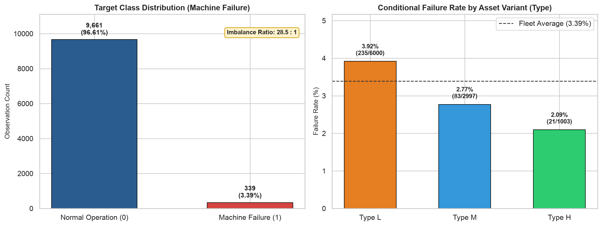
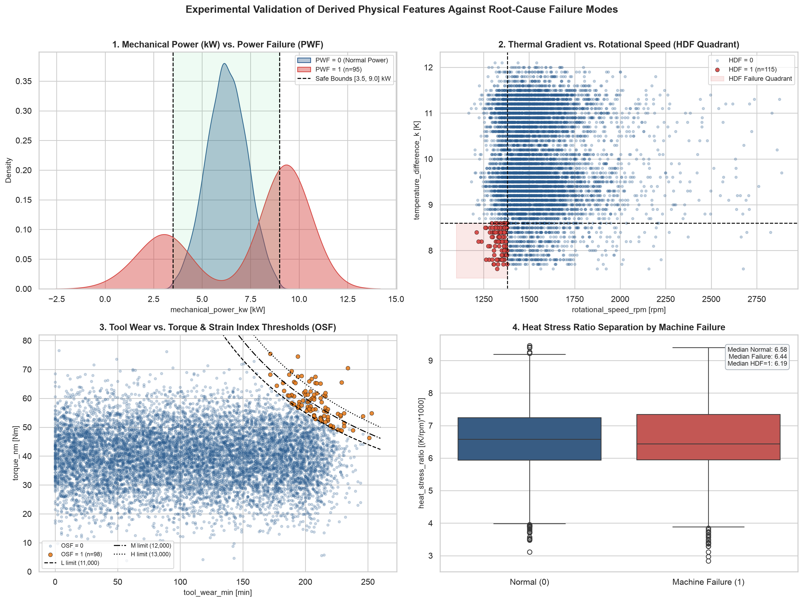

# FleetReliability-AI 🚜⚙️

**Predictive Maintenance & Condition-Based Monitoring (CBM) System for Heavy Industrial & Mining Equipment**  
*Machine Learning Zoomcamp — Mid-Term Project*

---

## 1. Executive Summary & Business Problem

Unplanned downtime in critical mining and industrial machinery (e.g., SAG mill pumps, crushers, haulage systems) leads to severe operational bottlenecks and financial losses exceeding tens of thousands of dollars per hour. However, relying on naive binary classification models (`0` vs `1` at an arbitrary `0.5` threshold) is operationally unfeasible in production environments, as false alarms can trigger costly, unnecessary shutdowns.

**FleetReliability-AI** bridges the gap between statistical machine learning and real-world Asset Management (RCM / CBM):
- **Physics-Informed Feature Engineering:** Incorporates thermodynamic and mechanical domain laws (mechanical power $P_{\text{mech}}$, thermal dissipation gradients $\Delta T$, and cumulative overstrain indices) derived from real-time sensor telemetry.
- **Stochastic Cost Optimization (Monte Carlo Simulation):** Replaces static threshold rules with a Monte Carlo simulation of uncertain repair times ($\text{MTTR} \sim \text{LogNormal}$), asset criticality tiers ($L, M, H$), and non-destructive inspection costs ($C_{\text{FP}} \sim \text{Normal}$), minimizing both Expected Operational Loss and tail risk ($P_{90}$ Value-at-Risk).
- **Multi-Threshold Operational Action Policy:** Exposes a calibrated continuous risk score via a **FastAPI** microservice that maps predictions into actionable maintenance tiers:
  1. `NORMAL` ($p < \theta_1^*$): Standard continuous operation.
  2. `INSPECTION_REQUIRED` ($\theta_1^* \le p < \theta_2^*$): Triggers a low-cost preventive CBM work order (thermography/vibration check) at the next shift change.
  3. `CRITICAL_INTERVENTION` ($p \ge \theta_2^*$): Recommends immediate load derating and scheduled maintenance intervention.

---

## 2. Project Structure

```text
fleetreliability-ai/
├── .github/workflows/       # Automated CI pipeline with astral-sh/setup-uv
├── data/
│   ├── raw/                 # Original UCI AI4I 2020 dataset
│   └── processed/           # Processed & split datasets
├── docs/
│   ├── PLAN.md              # Master Architecture & Execution Plan
│   └── course_guidelines/   # ML Zoomcamp rubrics & reference guides
├── notebooks/               # Exploratory Data Analysis (EDA) & Model Tuning
├── src/                     # Production source code (features, train, predict)
├── tests/                   # Pytest unit & API integration tests
├── Dockerfile               # Production container definition (uv-powered)
├── docker-compose.yml       # Local container orchestration
├── pyproject.toml           # Standard PEP 621 / PEP 735 dependency declaration
├── uv.lock                  # Deterministic Astral uv lockfile
├── requirements.txt         # Exported dependencies for universal reproducibility
└── README.md                # Project documentation
```

---

## 3. Environment Setup & Installation

This project uses **Python 3.11** and **Astral `uv`** for lightning-fast, deterministic dependency management (with an exported `requirements.txt` for universal compatibility).

### Option A: Using `uv` (Recommended — 10x to 100x Faster)
```bash
# 1. Clone the repository
git clone <REPO_URL>
cd fleetreliability-ai

# 2. Sync all dependencies and create the .venv automatically
uv sync --all-groups

# 3. Activate the virtual environment (or prefix commands with `uv run`)
source .venv/bin/activate
```

### Option B: Using Standard `venv` + `pip` (Peer Review Fallback)
```bash
python3.11 -m venv .venv
source .venv/bin/activate
pip install -r requirements.txt
```

---

## 4. Running the Application & Docker

### Local Execution (once `src/train.py` and `src/predict.py` are implemented)
```bash
# Train the model and generate artifacts
uv run python -m src.train

# Start the FastAPI inference service on port 9696
uv run uvicorn src.predict:app --host 0.0.0.0 --port 9696 --reload
```

### Containerized Execution with Docker
```bash
# Build the image and start the container via Docker Compose
docker compose up --build -d

# Or using standard Docker CLI
docker build -t fleetreliability-ai .
docker run -it --rm -p 9696:9696 fleetreliability-ai
```

Interactive Swagger UI documentation will be available at:
- `http://localhost:9696/docs`
- `http://localhost:9696/health`

---

## 5. Architecture & Execution Roadmap

See [`docs/PLAN.md`](docs/PLAN.md) for the complete architecture diagram, physics-informed equations, Monte Carlo threshold formulation, and milestone schedule.

---

## 6. Phase 1: Data Ingestion, Physics Feature Engineering & EDA

> [!NOTE]
> **Phase Status:** `COMPLETED` — All structural audits, leakage-free stratified splits, vectorized physics features, exploratory visualizations, and 5-Fold Stratified CV baseline benchmarks (`LogisticRegression`) have been executed and verified against [`docs/tasks/01_data_ingestion_and_eda.md`](docs/tasks/01_data_ingestion_and_eda.md).

### 6.1 Industrial Mining Context & Dataset Overview (UCI AI4I 2020)

In heavy mining and industrial operations (SAG mills, centrifugal slurry pumps, haulage equipment, and CNC machining centers), unplanned downtime imposes severe asymmetric costs—exceeding \$10,000 USD/hr in critical plant bottlenecks (with typical unplanned outages ranging from \$1,500–\$3,750 USD/hr plus secondary component damage), compared to approximately \$350 USD for a non-destructive preventive Condition-Based Maintenance (CBM) inspection.

The project benchmarks telemetry from the **UCI AI4I 2020 Predictive Maintenance Dataset** ($N = 10{,}000$ observations, $14$ base columns, zero missing values, UTF-8 BOM handled via `encoding="utf-8-sig"`). The target `Machine failure` exhibits a strong class imbalance of **3.39%** ($339$ failure events vs. $9{,}661$ normal operations; imbalance ratio **$28.50 : 1$**).

#### Post-Mortem Failure Modes Breakdown ($N = 10{,}000$)

| Failure Mode | Mechanism | Count | % of Dataset | % of Failures ($n = 339$) |
| :--- | :--- | ---: | ---: | ---: |
| `HDF` | Heat Dissipation Failure ($\Delta T < 8.6\text{ K} \land \omega < 1380\text{ rpm}$) | 115 | 1.15% | 33.92% |
| `OSF` | Overstrain Failure ($\text{Tool wear} \times \text{Torque} > \text{variant limit}$) | 98 | 0.98% | 28.91% |
| `PWF` | Power Failure ($P_{\text{mech}} \notin [3.5, 9.0]\text{ kW}$) | 95 | 0.95% | 28.02% |
| `TWF` | Tool Wear Failure (cutting-edge wear within $200$–$240\text{ min}$) | 46 | 0.46% | 13.57% |
| `RNF` | Random Failure (uncorrelated stochastic event) | 19 | 0.19% | 5.60% |

Additional empirical findings from [`notebooks/notebook.ipynb`](notebooks/notebook.ipynb):
- **Dataset Multi-Mode & Label Quirks:** $24$ rows exhibit simultaneous multi-mode failures, $18$ rows have `RNF == 1` with `Machine failure == 0`, and $9$ rows have `Machine failure == 1` with all five diagnostic mode flags equal to `0`.
- **Conditional Risk by Asset Variant (`machine_type`):** Failure rate is highest for `L` assets at **3.92%** ($235 / 6{,}000$; $60.00\%$ of fleet), followed by `M` at **2.77%** ($83 / 2{,}997$; $29.97\%$ of fleet), and `H` at **2.09%** ($21 / 1{,}003$; $10.03\%$ of fleet).
- **Leakage-Free Stratified Split (`random_state=42`):** Identifiers (`UDI`, `Product ID`) and post-mortem diagnostic flags (`TWF`, `HDF`, `PWF`, `OSF`, `RNF`) are strictly excluded before splitting into `data/processed/train_dev.csv` ($8{,}000$ rows, $271$ failures, $3.388\%$) and the locked `data/processed/test_holdout.csv` ($2{,}000$ rows, $68$ failures, $3.400\%$).

### 6.2 Physics-Informed Feature Engineering (`src/features.py`)

Four domain-informed features are computed via 100% vectorized NumPy/Pandas operations inside `PhysicalFeatureTransformer`:

| Derived Feature | KaTeX Formulation | Unit | Pearson $r$ | Spearman $\rho$ | Mutual Info | Causal Failure Validation |
| :--- | :--- | :---: | ---: | ---: | ---: | :--- |
| `mechanical_power_kw` | $P_{\text{mech}} = \tau \cdot \omega_{\text{rpm}} \cdot \frac{2\pi}{60\,000}$ | $\text{kW}$ | 0.1760 | 0.1540 | 0.0446 | `95/95` (`100%`) `PWF=1` cases fall outside $[3.5, 9.0]\text{ kW}$ |
| `temperature_difference_k` | $\Delta T = T_{\text{process}} - T_{\text{air}}$ | $\text{K}$ | -0.1117 | -0.1018 | 0.0118 | `115/115` (`100%`) `HDF=1` cases satisfy $\Delta T < 8.6\text{ K} \land \omega < 1380\text{ rpm}$ |
| `strain_index_min_nm` | $\text{Strain Index} = \text{Tool wear} \times \tau$ | $\text{min}\cdot\text{Nm}$ | 0.1904 | 0.1282 | 0.0342 | `98/98` (`100%`) `OSF=1` cases exceed $L/M/H$ limits ($11\text{k}/12\text{k}/13\text{k}$) |
| `heat_stress_ratio` | $\text{HSR} = \frac{\Delta T}{\max(\omega_{\text{rpm}}, \epsilon)} \times 1000$ | $\frac{\text{K}\cdot\text{min}}{\text{rev}} \times 10^3$ | -0.0095 | -0.0001 | 0.0140 | Captures thermal density at low rotational speeds |

> [!WARNING]
> **Multicollinearity & Non-Linearity:** Strong expected physical collinearity exists between `air_temperature_k` and `process_temperature_k` (Pearson $r = 0.8761$) and an inverse hyperbolic trade-off between `rotational_speed_rpm` and `torque_nm` (Pearson $r = -0.8750$, Spearman $\rho = -0.9165$). Because `Machine failure` stems from rectangular/hyperbolic physical boundaries, `Accuracy` ($96.61\%$ for a trivial all-zero classifier) is operationally invalid; Phase 2 optimization is governed by **PR-AUC** and **$F_2$-Score** ($\beta = 2$, weighting Recall $4\times$ higher than Precision).

### 6.3 Phase 1 Baseline Metrics (`LogisticRegression`, 5-Fold Stratified CV on `train_dev`)

Evaluated strictly on `data/processed/train_dev.csv` ($N = 8{,}000$, $271$ failures) with `StandardScaler` + `OneHotEncoder(drop="first")` fitted inside each fold (`StratifiedKFold(n_splits=5, shuffle=True, random_state=42)`), predicting at threshold $0.50$:

| Baseline Model | CV ROC-AUC (mean $\pm$ std) | CV PR-AUC (mean $\pm$ std) | CV F1 (mean $\pm$ std) | CV F2 (mean $\pm$ std) | OOF ROC-AUC | OOF PR-AUC | OOF F1 | OOF F2 |
| :--- | :---: | :---: | :---: | :---: | ---: | ---: | ---: | ---: |
| `LogisticRegression` (`class_weight=None`) | 0.9144 $\pm$ 0.0158 | 0.5011 $\pm$ 0.0309 | 0.3784 $\pm$ 0.0478 | 0.2901 $\pm$ 0.0392 | 0.9136 | 0.4961 | 0.3788 | 0.2901 |
| `LogisticRegression` (`class_weight='balanced'`) | 0.9273 $\pm$ 0.0135 | 0.4741 $\pm$ 0.0358 | 0.2850 $\pm$ 0.0170 | 0.4707 $\pm$ 0.0263 | 0.9263 | 0.4715 | 0.2846 | 0.4706 |

While linear `LogisticRegression` achieves strong global ranking (`ROC-AUC` $\approx 0.914$–$0.927$), its moderate `PR-AUC` ($\approx 0.472$–$0.496$) and low `F2-Score` ($0.2901$ default / $0.4706$ balanced) confirm the need for non-linear tree ensembles (`RandomForest`, `LightGBM`, `XGBoost`) and Monte Carlo cost-calibrated thresholds $(\theta_1^*, \theta_2^*)$ in Phase 2.

### 6.4 Exploratory Data Analysis Visuals (`reports/figures/`)

| Artifact | Description | Preview |
| :--- | :--- | :--- |
| [`01_target_imbalance.png`](reports/figures/01_target_imbalance.png) | Target class imbalance ($28.5:1$) and conditional failure rate across asset variants (`L`, `M`, `H`) |  |
| [`02_correlation_matrix.png`](reports/figures/02_correlation_matrix.png) | Side-by-side Pearson ($r$) and Spearman ($\rho$) correlation heatmaps across raw and physical features |  |
| [`03_failure_modes_distribution.png`](reports/figures/03_failure_modes_distribution.png) | Distribution of the five post-mortem failure modes (`HDF`, `OSF`, `PWF`, `TWF`, `RNF`) |  |
| [`04_physics_features_separation.png`](reports/figures/04_physics_features_separation.png) | Experimental validation of $P_{\text{mech}}$, $\Delta T$ vs. RPM quadrant, $\text{Strain Index}$ hyperbolas, and `heat_stress_ratio` |  |

### 6.5 Phase 1 Reproducibility Commands (`uv run`)

```bash
# 1. Idempotently download and validate the raw UCI AI4I 2020 dataset (10,000 x 14)
uv run python -m src.data_loader

# 2. Verify code formatting and import ordering
uv run black --check src tests
uv run isort --check-only src tests

# 3. Run the unit test suite (ingestion, UTF-8 BOM, vectorized physics, anti-leakage split)
uv run pytest tests/ -v

# 4. Launch Jupyter to inspect or re-execute notebooks/notebook.ipynb end-to-end
uv run jupyter notebook notebooks/notebook.ipynb
```
