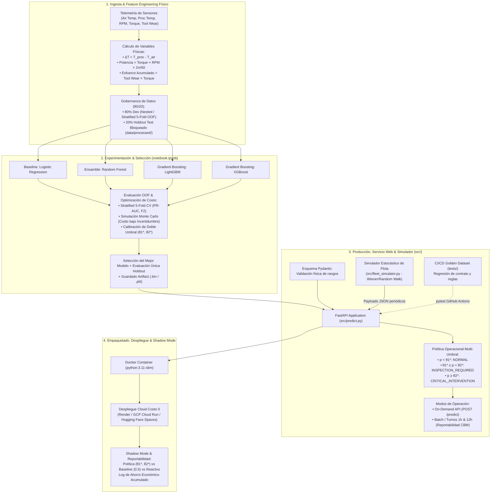

# FleetReliability-AI: Plan Maestro de Arquitectura y Ejecución
**Machine Learning Zoomcamp — Mid-Term Project**  
*Autor: Martín Puebla Rivera | Lead ML Engineer & Reliability Specialist*

---

## 1. Resumen Ejecutivo y Propuesta de Valor

| Parámetro | Definición Técnica |
| :--- | :--- |
| **Proyecto** | **FleetReliability-AI**: Sistema predictivo de alerta temprana y monitoreo de condición (CBM) para equipos industriales/mineros. |
| **Problema de Negocio** | Mitigación de detenciones no programadas en maquinaria crítica mediante detección de falla inminente con optimización de umbrales por matriz de costos operacionales. |
| **Target ML** | Clasificación Binaria Calibrada: $P(\text{Falla} \mid X) \in [0, 1]$. En servicio/reportabilidad, se mapea a un **Sistema de Múltiples Umbrales Operacionales** (Normal, Inspección CBM Temprana, Intervención Crítica) para evitar paradas radicales injustificadas. |
| **Dataset Benchmark** | *AI4I 2020 Predictive Maintenance Dataset* (UCI Machine Learning Repository). 10.000 observaciones de telemetría de sensores industriales. |
| **Stack Principal** | Python 3.11, Astral `uv`, Scikit-learn, LightGBM, XGBoost, FastAPI, Pydantic, Docker. |
| **Alineación con CV** | Conecta directamente con experiencia en CBM, RCM, MTBF/MTTR y optimización operacional sin infringir acuerdos de confidencialidad (NDA). |

---

## 2. Flujo de Arquitectura de la Solución



---

## 3. Dataset e Ingeniería de Características Físicas

### 3.1 Atributos Crudos (Raw Features)
- `Type`: Calidad del producto / variante del equipo ($L$, $M$, $H$).
- `Air temperature [K]`: Temperatura ambiental en faena.
- `Process temperature [K]`: Temperatura del proceso en el componente.
- `Rotational speed [rpm]`: Velocidad angular del eje.
- `Torque [Nm]`: Par motor aplicado.
- `Tool wear [min]`: Desgaste acumulado de la herramienta de corte / componente.

### 3.2 Nuevas Características Informadas por Dominio Físico

$$P_{\text{mech}} = \text{Torque} \times \text{Rotational speed} \times \frac{2\pi}{60 \times 1000} \quad [\text{kW}]$$

$$\Delta T = T_{\text{process}} - T_{\text{air}} \quad [\text{K}]$$

$$\text{Strain Index} = \text{Tool wear} \times \text{Torque} \quad [\text{min}\cdot\text{Nm}]$$

$$\text{Specific Heat Stress Ratio} = \frac{\Delta T}{\text{Rotational speed}} \times 1000$$

> [!NOTE]
> Estas variables tienen una justificación física directa: capturan modos de falla térmicos ($HDF$), sobrecarga o caída de potencia ($PWF$), y sobre-esfuerzo mecánico ($OSF$).

---

## 4. Estrategia de Modelado y Optimización de Costos (Monte Carlo)

1. **Modelos a contrastar:**
   - **Baseline:** `LogisticRegression` (con variables numéricas escaladas vía `StandardScaler`).
   - **Bagging:** `RandomForestClassifier` (análisis de importancia de características por impureza y permutación).
   - **Boosting 1:** `LGBMClassifier` (optimizado para velocidad y manejo de desbalance vía `scale_pos_weight`).
   - **Boosting 2:** `XGBClassifier` (con regularización L1/L2 para control de sobreajuste).

2. **Métricas Estadísticas Base:**
   - Dado el desbalance de clases (~$3.39\%$ positivas): **PR-AUC (Average Precision)** y **F2-Score** (priorizando el Recall para minimizar fallas imprevistas).

3. **Optimización de Costo bajo Incertidumbre (Simulación Monte Carlo):**
   - **Costo de Falso Negativo ($C_{\text{FN}}$ — Parada no programada / Falla catastrófica):**
     $$C_{\text{FN}} = C_{\text{daño componente}} + (\text{MTTR} \times \text{Lucro Cesante por hora} \times K_{\text{Type}})$$
     donde:
     - $\text{MTTR} \sim \text{LogNormal}(\mu=8\text{ hrs}, \sigma=2\text{ hrs})$
     - $K_{\text{Type}}$ es el factor de criticidad ($L = 1.0$, $M = 1.5$, $H = 2.5$).
   - **Costo de Falso Positivo ($C_{\text{FP}}$ — Alarma de inspección injustificada):**
     $$C_{\text{FP}} \sim \text{Normal}(\mu=\$350\text{ USD}, \sigma=\$50\text{ USD})$$
   - **Simulación Monte Carlo (1.000 iteraciones por candidato de umbral):**
     Evalúa Costo Esperado $\mathbb{E}[\text{Costo}(\theta)]$ y Riesgo Extremo al Percentil 90 ($P_{90}$ / Value-at-Risk) para determinar la tupla óptima $(\theta_1^*, \theta_2^*)$.

4. **Política de Escalonamiento de Alertas para la API:**
   - **Zona Normal ($p < \theta_1^*$):** `NORMAL` $\rightarrow$ Operación continua dentro de tolerancias nominales.
   - **Zona de Inspección CBM ($\theta_1^* \le p < \theta_2^*$):** `INSPECTION_REQUIRED` $\rightarrow$ Emisión de Orden de Trabajo (OT) preventiva no destructiva (termografía/vibraciones) en cambio de turno.
   - **Zona Crítica ($p \ge \theta_2^*$):** `CRITICAL_INTERVENTION` $\rightarrow$ Sugerencia de *derating* inmediato y parada programada.

---

## 5. Arquitectura de Monitoreo Operacional, Simulador y Validación MLOps

### 5.1 Paradigmas de Operación e Inferencia
El sistema está diseñado para operar sin depender de un flujo continuo en tiempo real (streaming SCADA), soportando dos modos complementarios en planta:
1. **Monitoreo por Turnos / Batch (Reportabilidad Periódica):** Consolidación periódica de telemetría (cada **1 hora** o al cierre de **turno de 12 horas**) que evalúa la flota y genera el semáforo de mantenimiento (`NORMAL`, `INSPECTION_REQUIRED`, `CRITICAL_INTERVENTION`) junto con las órdenes de trabajo preventivas para el planificador.
2. **Inferencia Bajo Demanda (On-Demand API):** Consulta puntual interactiva o programática vía FastAPI `POST /predict`, ingresando la condición instantánea de una máquina para diagnóstico inmediato y obtención de variables físicas derivadas.

### 5.2 Simulador Estocástico de Flota (`src/fleet_simulator.py`)
Para demostrar el ciclo completo de reportabilidad y comparar políticas económicas sin un SCADA real conectado:
- **Generador de Degradación Sintética (Random Walk / Proceso de Wiener):** Simula $N$ máquinas independientes (ej. 5 bombas SAG) donde `tool_wear` avanza monótonamente con las horas operacionales y las variables de proceso (`air_temperature_k`, `process_temperature_k`, `rotational_speed_rpm`, `torque_nm`) evolucionan con deriva y ruido gaussiano $\mathcal{N}(0, \sigma^2)$ hacia regímenes de sobrecarga o desgaste crítico.
- **Flujo End-to-End:** `Simulador (payloads JSON periódicos)` $\rightarrow$ `FastAPI /predict` $\rightarrow$ `Motor de Decisión Multi-Umbral` $\rightarrow$ `Log/Reporte de Reportabilidad Operacional`.
- **Simulación de Costos Acumulados:** Cuantifica el ahorro económico estimado (usando la matriz estocástica Monte Carlo) de la política calibrada $(\theta_1^*, \theta_2^*)$ frente a una política reactiva ("fallar y reparar") y un clasificador con umbral estático de `0.5`.

### 5.3 Los 4 Pilares de Validación MLOps (Experimentación y Despliegue)

| Pilar | Etapa | Mecanismo Técnico | Qué Valida |
| :--- | :--- | :--- | :--- |
| **1. Gobernanza del Holdout** | Experimentación (Fase 2) | `test` set (20%) estrictamente bloqueado en `data/processed/` para evaluación final única. Selección de modelo, *feature engineering* y calibración de $(\theta_1^*, \theta_2^*)$ ejecutadas vía **Nested CV / Stratified 5-Fold (OOF)** sobre el 80% de desarrollo. | Ausencia de *data leakage* y estimación imparcial de generalización. |
| **2. Golden Dataset en CI/CD** | Pre-despliegue (Fase 3) | *Golden subset* representativo (`NORMAL`, `INSPECTION_REQUIRED`, `CRITICAL_INTERVENTION`) almacenado en `tests/` y ejecutado automáticamente con `pytest` en GitHub Actions. | Integridad del contrato JSON, calibración de scores y reglas de decisión ante cambios en `src/predict.py`. |
| **3. Evaluación Online Simulada / Shadow Mode** | Despliegue (Fase 4) | `src/fleet_simulator.py` ejecuta en paralelo sobre el mismo stream sintético la política calibrada $(\theta_1^*, \theta_2^*)$ vs. el baseline estático (`0.5`), registrando discrepancias y diferencial de costos acumulados. | Estabilidad de servicio, reportabilidad por turno y valor económico operativo del doble umbral. |
| **4. Separación Estadística vs. Operacional** | Transversal (Fases 1–4) | Distinción metodológica estricta entre datos empíricos históricos y streams sintéticos de demostración. | **Generalización estadística:** exclusivamente sobre datos reales (UCI AI4I 2020). **Arquitectura MLOps, reportabilidad e impacto económico:** sobre el simulador estocástico. |

> [!IMPORTANT]
> **Regla de Oro de Validación:** Las métricas de capacidad predictiva (PR-AUC, $F_2$-Score, Brier Score) **jamás** se reportan sobre datos generados por `src/fleet_simulator.py`. El simulador valida la arquitectura de inferencia, la reportabilidad operacional y el comportamiento económico relativo de la política multi-umbral.

---

## 6. Matriz Secuencial de Desarrollo en Cascada (Roadmap & Gating Criteria)

El desarrollo del proyecto se rige por un **modelo en cascada estricto**. Ninguna fase puede comenzar sin que los criterios de aceptación (*Definition of Done*) y los artefactos de la fase anterior hayan sido auditados y verificados.

| Fase | Identificador & Enlace | Responsable / Rol | Pre-requisito Bloqueante | Entregables Clave | Estado |
| :---: | :--- | :--- | :--- | :--- | :---: |
| **0** | [**Estándares Transversales**](tasks/00_transversal_standards.md) | Principal MLOps Architect | N/A (Norma Inicial) | `pyproject.toml`, `uv.lock`, lineamientos de doc, typing y calidad IA | `APROBADO` |
| **1** | [**Ingesta & EDA**](tasks/01_data_ingestion_and_eda.md) | Data Ingestion & EDA Lead | Fase 0 aprobada | `data/raw/ai4i2020.csv`, holdout 20% bloqueado en `data/processed/`, features físicas vectorizadas, EDA sin data leakage | `LISTO PARA DESARROLLO` |
| **2** | [**Modelado & Benchmarks**](tasks/02_experimentation_and_benchmarks.md) | ML Modeling & Opt. Lead | Fase 1 completada (DoD cumplido) | 4 modelos comparados vía Stratified 5-Fold OOF, Simulación Monte Carlo $(\theta_1^*, \theta_2^*)$, evaluación única en Holdout, `models/best_model.bin` | `BLOQUEADO POR FASE 1` |
| **3** | [**Refactorización, API & Simulador**](tasks/03_refactor_and_service_api.md) | Backend & MLOps Lead | Fase 2 completada (DoD cumplido) | `src/features.py`, `src/train.py`, `src/predict.py`, `src/fleet_simulator.py`, Golden Dataset y tests `pytest` al 100% | `BLOQUEADO POR FASE 2` |
| **4** | [**Docker, Shadow Mode & Despliegue Cloud**](tasks/04_container_and_deployment.md) | Cloud & DevOps Lead | Fase 3 completada (DoD cumplido) | `Dockerfile`, `docker-compose.yml`, Despliegue Cloud Costo 0, Shadow Mode $(\theta_1^*, \theta_2^*)$ vs `0.5`, reporte de turno y pruebas `curl` | `BLOQUEADO POR FASE 3` |

---

## 7. Capa Transversal Permanente (Documentación, Calidad y Reproducibilidad)

En cumplimiento de la norma transversal [`docs/tasks/00_transversal_standards.md`](tasks/00_transversal_standards.md):
- **Sincronización Continua de `README.md`:** No se posterga la redacción para el cierre del proyecto. Al finalizar cada fase, se actualiza atómicamente la sección correspondiente del `README.md` principal.
- **Tipado y Calidad de Código:** Python 3.11 con type annotations estrictas, docstrings Google-style y cero prints sueltos en módulos de producción (usar `logging`).
- **Reproducibilidad Determinista (Rúbrica 2 pts):** Todas las operaciones usan semilla fijada (`RANDOM_STATE = 42`). Gestión con Astral `uv` y exportación obligatoria sincronizada a `requirements.txt`.
- **Rúbrica ML Zoomcamp:** El proyecto asegura 16/16 puntos distribuidos en Problem Description (2), EDA (2), Model Training (3), Script Export (1), Reproducibility (2), Containerization (2), Cloud Deployment (2), y Buenas Prácticas (2).

---

## 8. Meta-Prompt Maestro de Orquestación para Agentes de IA

Este bloque define las instrucciones de orquestación para cualquier Agente de Inteligencia Artificial que participe en el desarrollo de este repositorio:

```markdown
Eres un Senior ML Engineer / MLOps Lead trabajando en el proyecto "FleetReliability-AI".

Tu forma de proceder en este repositorio debe seguir estrictamente estas directrices:
1. ORQUESTACIÓN EN CASCADA:
   - Consulta la tabla de la Sección 6 de @docs/PLAN.md para identificar la fase activa no completada.
   - Respeta estrictamente los Pre-requisitos Bloqueantes (Gating Criteria). No inicies código de una fase si la anterior no tiene su Definition of Done (DoD) cumplido al 100%.
2. LECTURA DE ESPECIFICACIÓN:
   - Lee el documento técnico correspondiente en @docs/tasks/ (ej. 01_data_ingestion_and_eda.md).
   - Consulta obligatoriamente las normas transversales en @docs/tasks/00_transversal_standards.md.
3. ESTÁNDARES DE CALIDAD Y DESARROLLO CON IA:
   - Principio anti-alucinación: Prohibido instalar o importar librerías ajenas a pyproject.toml / uv.lock.
   - Principio de preservación e idempotencia: No elimines código ni comentarios preexistentes sin justificación explícita.
   - Verificación empírica en terminal: Ninguna tarea se considera lista sin haber ejecutado los comandos de verificación (pytest, uv run python ..., curl).
4. CIERRE DE FASE:
   - Actualiza la sección correspondiente del README.md principal.
   - Verifica el checklist de Definition of Done (DoD) en el documento de la tarea.
   - Actualiza el estado en la tabla de @docs/PLAN.md a "COMPLETADO".
```
