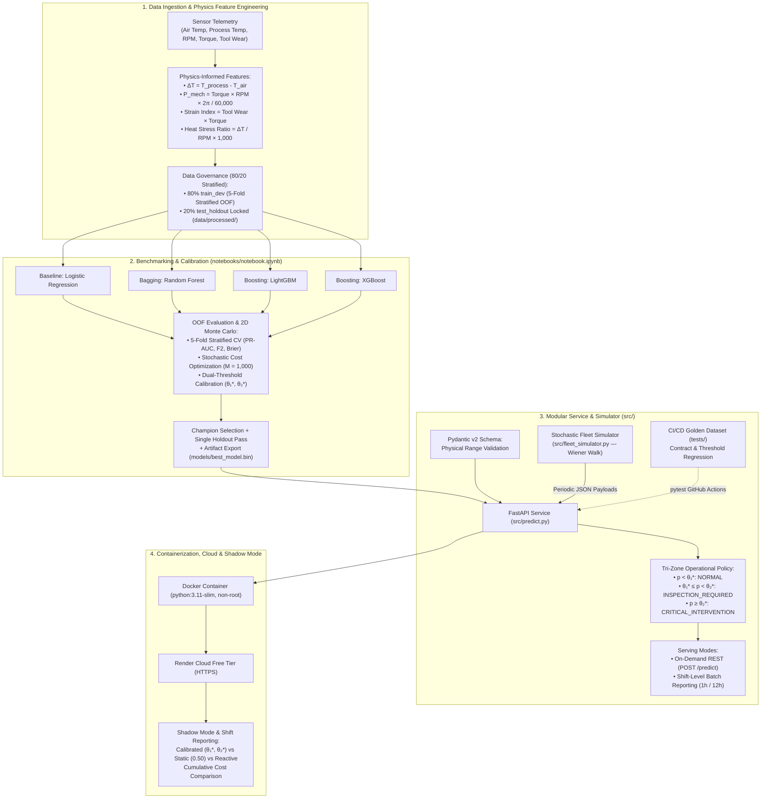

# FleetReliability-AI: Architecture & Technical Reference

**Machine Learning Zoomcamp — Mid-Term Project**  
*Author: Martín Puebla Rivera*

---

## 1. Executive Summary & Technical Scope

| Parameter | Technical Specification |
| :--- | :--- |
| **Project** | **FleetReliability-AI**: Predictive failure-risk and Condition-Based Monitoring (CBM) system for heavy industrial/mining machinery. |
| **Business Problem** | Mitigate unplanned equipment downtime through early failure detection and stochastic cost-calibrated decision thresholds. |
| **ML Formulation** | Calibrated binary probability `P(Failure | X) ∈ [0, 1]`, mapped to a **Tri-Zone Operational Action Policy** (`NORMAL`, `INSPECTION_REQUIRED`, `CRITICAL_INTERVENTION`) to avoid unnecessary full shutdowns. |
| **Benchmark Dataset** | *AI4I 2020 Predictive Maintenance Dataset* (UCI Machine Learning Repository), 10,000 industrial sensor telemetry records. |
| **Core Stack** | Python 3.11, Astral `uv`, Scikit-learn, LightGBM, XGBoost, FastAPI, Pydantic v2, Docker, Render. |

---

## 2. End-to-End Solution Architecture

---

## 3. Dataset & Physics-Informed Feature Engineering

### 3.1 Raw Telemetry Attributes
- `machine_type` (`Type`): Asset quality / criticality tier (`L`, `M`, `H`).
- `air_temperature_k`: Ambient operating temperature `[K]`.
- `process_temperature_k`: Component process temperature `[K]`.
- `rotational_speed_rpm`: Shaft angular velocity `[rpm]`.
- `torque_nm`: Applied mechanical torque `[Nm]`.
- `tool_wear_min`: Cumulative tool / component wear `[min]`.

### 3.2 Domain-Derived Physical Features

$$P_{\text{mech}} = \text{Torque} \times \text{Rotational speed} \times \frac{2\pi}{60\,000} \quad [\text{kW}]$$

$$\Delta T = T_{\text{process}} - T_{\text{air}} \quad [\text{K}]$$

$$\text{Strain Index} = \text{Tool wear} \times \text{Torque} \quad [\text{min}\cdot\text{Nm}]$$

$$\text{Heat Stress Ratio} = \frac{\Delta T}{\max(\text{Rotational speed}, \epsilon)} \times 1\,000$$

> [!NOTE]
> These engineered features map directly to the physical failure modes in AI4I 2020: Heat Dissipation Failure (`HDF`), Power Failure (`PWF`), and Overstrain Failure (`OSF`).

---

## 4. Modeling & 2D Monte Carlo Cost Optimization

1. **Candidate Model Families:**
   - **Baseline:** `LogisticRegression` (with `StandardScaler` + `OneHotEncoder(drop="first")`).
   - **Bagging:** `RandomForestClassifier` (with MDI and Out-of-Fold Permutation Feature Importance).
   - **Gradient Boosting:** `LGBMClassifier` and `XGBClassifier`.
2. **Primary Statistical Metrics:**
   - Under `3.39%` positive class prevalence: **PR-AUC (Average Precision)**, **F2-Score**, **ROC-AUC**, and **Brier Score** (isotonic vs. sigmoid calibration).
3. **Stochastic Cost Model (`M = 1,000` Monte Carlo realizations):**
   - **False Negative Cost (`C_FN` — unplanned catastrophic failure):**
     - `C_FN = C_damage + (MTTR × Downtime_Rate × K_Type)`
     - `MTTR ~ LogNormal(μ = 8 h, σ = 2 h)`, `C_damage ~ Normal(USD 5,000, USD 1,000)`, `Downtime_Rate = USD 1,500/hr`, criticality `K_Type ∈ {1.0 (L), 1.5 (M), 2.5 (H)}`.
   - **False Positive Cost (`C_FP` — preventive CBM inspection):**
     - `C_FP ~ Normal(USD 350, USD 50)`.
   - **True Positive Intervention Cost (`C_TP` — planned shutdown & repair):**
     - `C_TP ~ Normal(USD 1,200, USD 200)`.
   - **Risk-Averse 2D Objective (`λ_risk = 0.15`):**

$$J(\theta_1, \theta_2) = \mathbb{E}[\text{Cost}(\theta_1, \theta_2)] + 0.15 \cdot \text{VaR}_{90}(\theta_1, \theta_2), \quad \theta_1 < \theta_2$$

4. **API Tri-Zone Escalation Policy (`θ₁* = 0.01`, `θ₂* = 0.76`):**
   - `NORMAL` (`p < θ₁*`): Continue nominal operation.
   - `INSPECTION_REQUIRED` (`θ₁* ≤ p < θ₂*`): Issue a preventive non-destructive CBM work order (thermography / vibration analysis) for the next shift handover.
   - `CRITICAL_INTERVENTION` (`p ≥ θ₂*`): Recommend immediate load derating and planned shutdown.

---

## 5. Operational Monitoring, Simulator & MLOps Validation Pillars

### 5.1 Serving Modes
1. **On-Demand API Inference:** Real-time `POST /predict` queries returning calibrated risk score, operational tier, CBM recommendation, and derived physics telemetry.
2. **Shift-Level Batch Reporting:** Periodic fleet consolidation (every 1h across 12h shifts) via `src/fleet_simulator.py` to generate work-order summaries and policy cost comparisons.

### 5.2 MLOps Validation Pillars

| Pillar | Stage | Mechanism | What It Validates |
| :--- | :--- | :--- | :--- |
| **1. Holdout Governance** | Phase 2 | Locked 20% `test_holdout.csv` evaluated once; model tuning, calibration, and `(θ₁*, θ₂*)` optimization run strictly on 5-Fold Stratified OOF (`train_dev.csv`). | Zero data leakage and unbiased generalization estimates. |
| **2. CI/CD Golden Dataset** | Phase 3 | Anchor payloads (`NORMAL`, `INSPECTION_REQUIRED`, `CRITICAL_INTERVENTION`) in `tests/golden_dataset.json` verified on every push via `pytest`. | JSON schema contract, physical guardrails, and threshold stability. |
| **3. Cloud Shadow Mode** | Phase 4 | `src/fleet_simulator.py` executes parallel policy evaluation (`(θ₁*, θ₂*)` vs. `0.50` vs. Reactive) against the live Render HTTPS service. | End-to-end availability, shift reporting, and economic policy behavior. |
| **4. Statistical vs. Operational Separation** | All Phases | Empirical metrics (`PR-AUC`, `F2`, `Brier`) are reported solely on UCI AI4I 2020; simulated streams validate serving and operational reporting only. | Honest, non-inflated model evaluation. |

---

## 6. Project Milestones

| Phase | Scope | Key Deliverables | Status |
| :---: | :--- | :--- | :---: |
| **Phase 1** | Data Ingestion, Physics Features & EDA | `src/data_loader.py`, `src/features.py`, leakage-free 80/20 splits, EDA figures, `LogisticRegression` CV baseline | `COMPLETED` |
| **Phase 2** | Multi-Model Benchmarking & 2D Monte Carlo | `src/montecarlo.py`, 4-family 5-Fold CV benchmarks, isotonic calibration, `(θ₁*, θ₂*)` optimization, `models/best_model.bin` | `COMPLETED` |
| **Phase 3** | Production Modularization, API & Simulator | `src/train.py`, `src/predict.py` (FastAPI), `src/fleet_simulator.py`, Golden Dataset, `91` passing `pytest` tests | `COMPLETED` |
| **Phase 4** | Containerization, Cloud Deploy & Shadow Mode | Hardened `Dockerfile`, `docker-compose.yml`, CI `docker-build` gate, `scripts/test_e2e_cloud.sh`, live Render HTTPS service, `reports/cloud_shadow_report.json` | `COMPLETED` |
