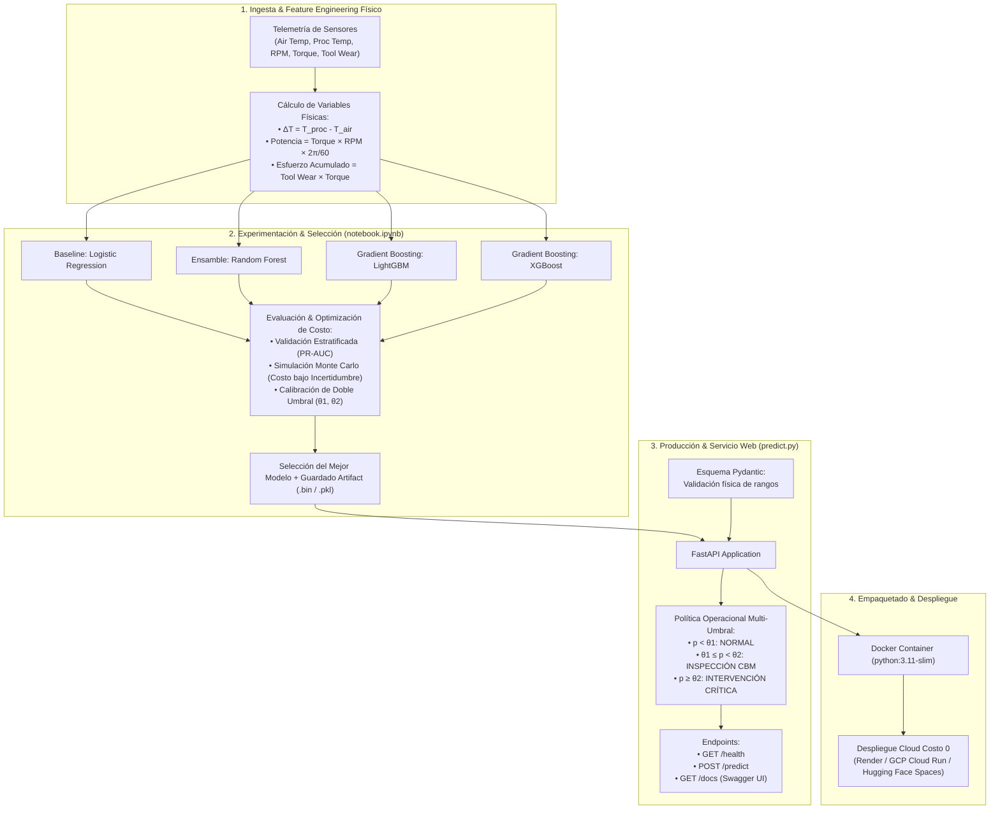

# FleetReliability-AI: Plan Maestro de Arquitectura y Ejecución
**Machine Learning Zoomcamp — Mid-Term Project**
*Autor: Martín Puebla Rivera | Mentoría Técnica de Carrera*

---

## 1. Resumen Ejecutivo y Propuesta de Valor

| Parámetro | Definición Técnica |
| :--- | :--- |
| **Proyecto** | **FleetReliability-AI**: Sistema predictivo de alerta temprana y monitoreo de condición (CBM) para equipos industriales/mineros. |
| **Problema de Negocio** | Mitigación de detenciones no programadas en maquinaria crítica mediante detección de falla inminente con optimización de umbrales por matriz de costos operacionales. |
| **Target ML** | Clasificación Binaria Calibrada: $P(\text{Falla} \mid X) \in [0, 1]$. En servicio/reportabilidad, se mapea a un **Sistema de Múltiples Umbrales Operacionales** (Normal, Inspección CBM Temprana, Intervención Crítica) para evitar paradas radicales injustificadas. |
| **Dataset Benchmark** | *AI4I 2020 Predictive Maintenance Dataset* (UCI Machine Learning Repository). 10.000 observaciones de telemetría de sensores industriales. |
| **Stack Principal** | Python 3.11, Astral `uv`, Scikit-learn, LightGBM, XGBoost, FastAPI, Pydantic, Docker. |
| **Alineación con CV** | Conecta directamente con experiencia en CBM, RCM, MTBF/MTTR y optimización operacional sin infringir acuerdos de confidencialidad (NDA). |

---

## 2. Flujo de Arquitectura de la Solución



---

## 3. Dataset e Ingeniería de Características Físicas

### 3.1 Atributos Crudos (Raw Features)
- `Type`: Calidad del producto / variante del equipo ($L$, $M$, $H$).
- `Air temperature [K]`: Temperatura ambiental en faena.
- `Process temperature [K]`: Temperatura del proceso en el componente.
- `Rotational speed [rpm]`: Velocidad angular del eje.
- `Torque [Nm]`: Par motor aplicado.
- `Tool wear [min]`: Desgaste acumulado de la herramienta de corte / componente.

### 3.2 Nuevas Características Informadas por Dominio Físico

$$P_{\text{mech}} = \text{Torque} \times \text{Rotational speed} \times \frac{2\pi}{60 \times 1000} \quad [\text{kW}]$$

$$\Delta T = T_{\text{process}} - T_{\text{air}} \quad [\text{K}]$$

$$\text{Strain Index} = \text{Tool wear} \times \text{Torque} \quad [\text{min}\cdot\text{Nm}]$$

$$\text{Specific Heat Stress Ratio} = \frac{\Delta T}{\text{Rotational speed}} \times 1000$$

> [!NOTE]
> Estas variables tienen una justificación física directa: capturan modos de falla térmicos ($HDF$), sobrecarga o caída de potencia ($PWF$), y sobre-esfuerzo mecánico ($OSF$).

---

## 4. Estrategia de Modelado y Evaluación

Para asegurar los **3 puntos de Model Training** de la rúbrica oficial de Alexey Grigorev:

1. **Modelos a contrastar:**
   - **Baseline:** `LogisticRegression` (con variables numéricas escaladas vía `StandardScaler`).
   - **Bagging:** `RandomForestClassifier` (análisis de importancia de características por impureza y permutación).
   - **Boosting 1:** `LGBMClassifier` (optimizado para velocidad y manejo de desbalance vía `scale_pos_weight`).
   - **Boosting 2:** `XGBClassifier` (con regularización L1/L2 para control de sobreajuste).

2. **Métricas Estadísticas Base:**
   - Dado el desbalance de clases (~$3.39\%$ positivas): **PR-AUC (Average Precision)** y **F2-Score** (priorizando el Recall para minimizar fallas imprevistas).

3. **Optimización de Costo bajo Incertidumbre (Simulación Monte Carlo):**
   En lugar de asumir costos deterministas, modelamos las pérdidas operacionales como variables estocásticas con distribuciones realistas de faena:
   - **Costo de Falso Negativo ($C_{\text{FN}}$ — Parada no programada / Falla catastrófica):**
     $$C_{\text{FN}} = C_{\text{daño componente}} + (\text{MTTR} \times \text{Lucro Cesante por hora} \times K_{\text{Type}})$$
     donde:
     - $\text{MTTR} \sim \text{LogNormal}(\mu=8\text{ hrs}, \sigma=2\text{ hrs})$ (tiempo de reparación variable según disponibilidad de repuestos en bodega y cuadrilla).
     - $K_{\text{Type}}$ es el factor de criticidad del equipo ($L = 1.0$, $M = 1.5$, $H = 2.5$ para equipos en la línea crítica del proceso).
   - **Costo de Falso Positivo ($C_{\text{FP}}$ — Alarma de inspección injustificada):**
     $$C_{\text{FP}} \sim \text{Normal}(\mu=\$350\text{ USD}, \sigma=\$50\text{ USD})$$
     (costo menor por hh de técnico CBM realizando inspección no destructiva de termografía/vibración).
   - **Simulación Monte Carlo (1.000 iteraciones por candidato de umbral):**
     Para un mallado de umbrales candidatos $(\theta_1, \theta_2)$, evaluamos:
     - Costo Esperado: $\mathbb{E}[\text{Costo}(\theta)]$
     - Riesgo Extremo: Percentil 90 ($P_{90}$ / Value-at-Risk)
     - Se selecciona $(\theta_1^*, \theta_2^*)$ que minimiza el costo esperado acotando el riesgo en cola.

4. **Política de Escalonamiento de Alertas para la API:**
   - **Zona Normal ($p < \theta_1^*$):** `NORMAL` $\rightarrow$ Continuidad de turno estándar.
   - **Zona de Inspección CBM ($\theta_1^* \le p < \theta_2^*$):** `WARNING` $\rightarrow$ Orden de trabajo (OT) para inspección no destructiva en el próximo cambio de turno.
   - **Zona Crítica ($p \ge \theta_2^*$):** `CRITICAL` $\rightarrow$ Sugerencia de *derating* inmediato (bajar carga operativa) y coordinación de detención programada.

---

## 5. Diseño del Servicio de Inferencia (FastAPI)

### 5.1 Esquema de Entrada (Pydantic)
```python
from pydantic import BaseModel, Field
from typing import Literal

class TelemetryPayload(BaseModel):
    machine_id: str = Field(..., example="PUMP-SAG-04")
    machine_type: Literal["L", "M", "H"] = Field(..., description="L=Low, M=Medium, H=High criticality")
    air_temperature_k: float = Field(..., ge=250.0, le=350.0, example=298.2)
    process_temperature_k: float = Field(..., ge=250.0, le=380.0, example=308.7)
    rotational_speed_rpm: float = Field(..., ge=500.0, le=3500.0, example=1500.0)
    torque_nm: float = Field(..., ge=0.0, le=200.0, example=42.8)
    tool_wear_min: float = Field(..., ge=0.0, le=400.0, example=120.0)
```

### 5.2 Esquema de Salida
```python
class PredictionResponse(BaseModel):
    machine_id: str
    failure_risk_score: float = Field(..., description="Probabilidad calibrada [0.0 - 1.0]")
    operational_status: Literal["NORMAL", "INSPECTION_REQUIRED", "CRITICAL_INTERVENTION"]
    recommended_cbm_action: str
    criticality_level: str
    derived_physics: dict
```

---

## 6. Estructura de Directorios del Repositorio

Para garantizar la máxima puntuación en **Reproducibilidad (2 pts)** y **Documentación (2 pts)**:

```text
fleetreliability-ai/
├── .github/
│   └── workflows/
│       └── ci.yml               # Linting (flake8/black) y tests automáticos
├── data/
│   ├── raw/
│   │   └── ai4i2020.csv         # Dataset original o script para descargarlo
│   └── processed/
├── notebooks/
│   └── notebook.ipynb           # EDA completo, Feature Importance, Model Tuning
├── src/
│   ├── __init__.py
│   ├── features.py              # Funciones de cálculo físico reproducibles
│   ├── train.py                 # Script de entrenamiento y serialización del modelo
│   └── predict.py               # Servicio web con FastAPI
├── tests/
│   ├── test_features.py         # Tests unitarios del pipeline físico
│   └── test_api.py              # Tests del endpoint /predict con TestClient
├── Dockerfile                   # Imagen ligera python:3.11-slim
├── docker-compose.yml           # Para levantar API con un solo comando
├── pyproject.toml               # Dependencias declaradas (PEP 621 / PEP 735)
├── uv.lock                      # Lockfile determinista generado por Astral uv
├── requirements.txt             # Exportado desde uv para facilitar revisión a pares
└── README.md                    # Descripción de negocio, arquitectura, API y cómo correr
```

> [!TIP]
> **Pro-Tip para Revisores Pares:** Aunque `uv` es el orquestador principal, incluir un archivo `requirements.txt` generado automáticamente (`uv export --no-hashes --no-dev -o requirements.txt`) evita que un revisor par novato en `uv` penalice la reproducibilidad.

---

## 7. Cronograma de Ejecución Estimado (15-20 Horas)

| Bloque | Tareas Principales | Dedicación |
| :--- | :--- | :---: |
| **Fase 1: EDA & Baseline** | Descarga de datos, análisis univariado/bivariado, correlaciones, implementación de variables físicas y modelo baseline de regresión logística. | 4-5 hrs |
| **Fase 2: Modelado & Tuning** | Entrenamiento de Random Forest, LightGBM y XGBoost. Búsqueda de hiperparámetros, curvas PR-AUC, Simulación Monte Carlo de costo bajo incertidumbre y selección de doble umbral operacional (θ1*, θ2*). | 5-6 hrs |
| **Fase 3: Refactorización** | Exportación de `notebook.ipynb` a scripts modulares (`features.py`, `train.py`, `predict.py`). Pruebas locales con Pytest. | 3 hrs |
| **Fase 4: Docker & Cloud Costo 0** | Creación del `Dockerfile`, verificación local de build/run, despliegue en plataforma Cloud gratuita (Render / Cloud Run) y pruebas curl. | 3-4 hrs |
| **Fase 5: Documentación README** | Redacción contextual del README, diagrama de arquitectura, ejemplos de payloads JSON, capturas de pantalla de la API en la nube. | 2 hrs |
