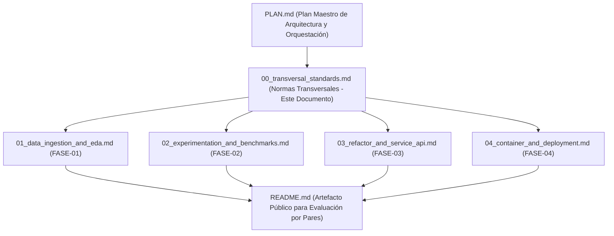
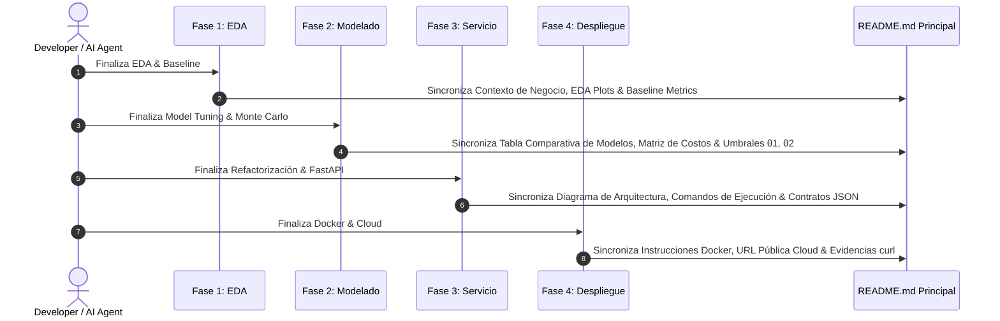
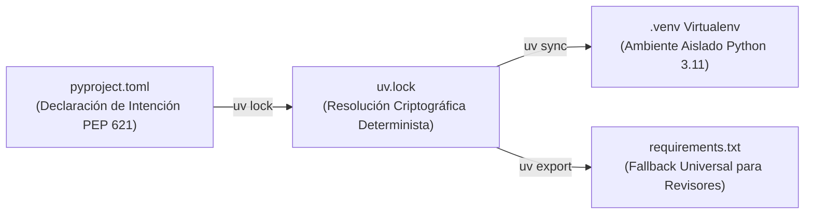

# STD-TRV-00: Estándares Transversales de Ingeniería y Aseguramiento de Calidad

> **Documento de Especificación Técnica de Desarrollo**  
> **Proyecto:** FleetReliability-AI — Sistema Predictivo CBM para Equipos Industriales y Mineros  
> **Programa:** Machine Learning Zoomcamp (Mid-Term Project)  
> **Referencias:** [PLAN.md](../PLAN.md)

---

## 1. Metadatos y Control de Fase

### 1.1 Ficha de Control

| Atributo | Especificación Técnica |
| :--- | :--- |
| **Identificador** | `STD-TRV-00` |
| **Título** | Estándares Transversales de Ingeniería, Documentación, Reproducibilidad y Calidad IA |
| **Responsable / Rol** | Principal MLOps Architect & Quality Assurance Lead |
| **Versión y Estado** | `1.0.0` — `APROBADO / OBLIGATORIO` |
| **Pre-requisitos Bloqueantes** | N/A (Constitución técnica inicial del repositorio) |
| **Entregables Clave** | `pyproject.toml`, `uv.lock`, `requirements.txt`, convenciones de tipado/logging, flujo Git y protocolo Docs-as-Code |
| **Entorno y Stack** | Python 3.11 (`>=3.11,<3.13`), Astral `uv`, Pydantic v2, Black, isort, Pytest |
| **Impacto en Rúbrica Zoomcamp** | Problem Description (2 pts), Reproducibility (2 pts), Dependency Management (2 pts), Code Quality & Testing (Transversal 16/16 pts) |

### 1.2 Objetivo Técnico y Alcance
El presente documento define la gobernanza técnica, los estándares de arquitectura de software, los protocolos de reproducibilidad determinista y los criterios de aseguramiento de la calidad (QA/MLOps) que rigen el ciclo de vida completo del proyecto **FleetReliability-AI**.

Este estándar es de cumplimiento estricto y obligatorio para todas las fases de ejecución del proyecto:
- **Fase 1 (`FASE-01`):** Ingesta Idempotente, Features Termodinámicas & EDA Libre de Leakage.
- **Fase 2 (`FASE-02`):** Entrenamiento Comparativo (OOF), Simulación Monte Carlo & Calibración de Umbrales Operacionales.
- **Fase 3 (`FASE-03`):** Modularización Productiva (`src/features.py`, `src/train.py`, `src/predict.py`, `src/fleet_simulator.py`) & Testing (`pytest` + Golden Dataset).
- **Fase 4 (`FASE-04`):** Contenedorización (`Dockerfile`, `docker-compose.yml`), Despliegue Cloud Costo Cero, Shadow Mode & Reportabilidad.

### 1.3 Rol en la Arquitectura de Documentación
Dentro del repositorio, la jerarquía de especificaciones se organiza de forma piramidal:



`STD-TRV-00` actúa como la constitución técnica del proyecto. Ningún cambio de código, notebook o configuración puede ser fusionado o considerado concluido si viola las directrices aquí contenidas.

### 1.4 Alineación con la Rúbrica de Evaluación de ML Zoomcamp (16/16 Puntos)
El objetivo primordial de este estándar es garantizar la máxima puntuación auditable en la rúbrica oficial de revisión por pares (*Peer Reviewing Rubric*):

| Dimensión de la Rúbrica | Puntuación Máxima | Mecanismo de Garantía en este Estándar |
| :--- | :---: | :--- |
| **Problem Description** | 2 pts | Contexto industrial minero detallado, análisis de criticidad y formulación formal del problema de negocio en `README.md`. |
| **EDA & Feature Engineering** | 2 pts | Análisis univariado, bivariado, matriz de correlación, desglose de desbalance y derivación de 4 leyes físicas ($\Delta T$, $P_{\text{mech}}$, Strain, Heat Stress). |
| **Model Training & Tuning** | 3 pts | Comparación estricta de 4 familias de modelos (Linear, Bagging, Boosting x2), búsqueda de hiperparámetros y optimización de umbral mediante Simulación Monte Carlo. |
| **Export Notebook to Script** | 1 pt | Extracción limpia de la lógica de entrenamiento en `src/train.py` y cálculo de variables en `src/features.py`. |
| **Reproducibilidad** | 2 pts | Script determinista de descarga de datos, semillas estocásticas globales (`RANDOM_STATE = 42`) y gestión dual `uv.lock` + `requirements.txt`. |
| **Model Deployment** | 1 pt | Microservicio web RESTful implementado en FastAPI (`src/predict.py`) con endpoints `/health` y `/predict`. |
| **Dependency Management** | 2 pts | Archivo `pyproject.toml` estándar (PEP 621), `uv.lock` determinista y `requirements.txt` sincronizado para evaluadores sin `uv`. |
| **Containerization** | 2 pts | `Dockerfile` multi-stage optimizado sobre `python:3.11-slim`, `docker-compose.yml`, usuario no-root y healthcheck integrado. |
| **Cloud Deployment** | 2 pts | Despliegue en plataforma Cloud gratuita con URL pública activa o evidencia en video/captura de llamadas `curl` exitosas. |
| **Puntaje Total Objetivo** | **16/16 pts** | **Excelencia técnica integral verificada contra checklist auditable.** |

---

## 2. Protocolo de Documentación Continua (README.md & Repositorio)

### 2.1 Filosofía "Docs-as-Code" e Incrementos Vivos
La documentación no es una tarea post-mortem reservada para el cierre del proyecto. El archivo principal `README.md` debe evolucionar de forma atómica y sincronizada con cada fase terminada. 

Queda estrictamente prohibido entregar código o modelos sin su correspondiente reflejo en la documentación pública.

### 2.2 Ciclo de Actualización Incremental por Fase



#### Reglas de Sincronización Obligatoria por Fase:
1. **Tras Concluir la Fase 1:**
   - Detallar el problema de negocio: Paradas no programadas en equipos mineros (molinos SAG, bombas centrífugas, camiones de extracción), costo de inactividad por hora ($> \$10,000\text{ USD/hr}$) y la necesidad de mantenimiento basado en condición (CBM).
   - Documentar el dataset: Origen UCI AI4I 2020, 10,000 registros, 14 atributos, tasa de desbalance de fallas ($\approx 3.39\%$).
   - Presentar el catálogo de ecuaciones físicas implementadas ($\Delta T$, $P_{\text{mech}}$, etc.) con justificación termodinámica.
   - Insertar tabla de métricas iniciales del modelo baseline (Logistic Regression) evaluado con estratificación.

2. **Tras Concluir la Fase 2:**
   - Publicar la tabla comparativa consolidada de modelos evaluados en validación cruzada estratificada (5-Fold Stratified CV):
     - `LogisticRegression`
     - `RandomForestClassifier`
     - `LGBMClassifier`
     - `XGBClassifier`
   - Métricas obligatorias en la tabla: ROC-AUC, PR-AUC (Average Precision), F1-Score y F2-Score (Recall weighting).
   - Detallar la formulación de la **Simulación Monte Carlo de Costos**:
     - Función de distribución de reparación: $\text{MTTR} \sim \text{LogNormal}(\mu=8\,\text{h}, \sigma=2\,\text{h})$.
     - Factores de criticidad de activos: $K_{\text{Type}} \in \{L: 1.0, M: 1.5, H: 2.5\}$.
     - Costo de inspección preventiva no destructiva: $C_{\text{FP}} \sim \mathcal{N}(350, 50)$.
   - Publicar los umbrales operativos óptimos calibrados: $(\theta_1^*, \theta_2^*)$, justificando la política multi-umbral de 3 niveles (`NORMAL`, `INSPECTION_REQUIRED`, `CRITICAL_INTERVENTION`).

3. **Tras Concluir la Fase 3:**
   - Incorporar diagrama Mermaid de la arquitectura de inferencia desacoplada.
   - Especificar instrucciones exactas para ejecutar el pipeline de entrenamiento:
     ```bash
     uv run python -m src.train
     ```
   - Especificar instrucciones para ejecutar el servicio web local:
     ```bash
     uv run uvicorn src.predict:app --host 0.0.0.0 --port 9696 --reload
     ```
   - Publicar la especificación formal de los contratos JSON de API (Request y Response) junto con comandos `curl` funcionales listos para copiar y pegar por los evaluadores.
   - Documentar la suite de tests unitarios y cómo ejecutarla (`uv run pytest tests/ -v`).

4. **Tras Concluir la Fase 4:**
   - Detallar los comandos de construcción y ejecución del contenedor Docker:
     ```bash
     docker build -t fleetreliability-ai .
     docker run -it --rm -p 9696:9696 fleetreliability-ai
     ```
   - Detallar la orquestación con Docker Compose (`docker compose up --build`).
   - Enlace visible a la URL pública del servicio en la nube (Render / Hugging Face Spaces / GCP Cloud Run).
   - Evidencia visual auditable: Captura de pantalla de la interfaz interactiva Swagger UI (`/docs`) y salida de consola de llamada `curl` al servicio desplegado en producción remota.

### 2.3 Estándar de Estilo en Markdown
- **GitHub Flavored Markdown (GFM):** Utilizar tablas con alineación semántica (`:---` para texto, `:---:` para estados/códigos, `---:` para cifras numéricas).
- **Rigor Matemático con KaTeX:**
  - Ecuaciones matemáticas en línea utilizando sintaxis KaTeX delimitada por `$...$`: e.g., $P(\text{Falla} \mid X)$.
  - Fórmulas complejas o de múltiples términos en bloques dedicados delimitados por `$$...$$`.
  - **Escape de Símbolos Monetarios:** Cuando se escriba sobre costos o divisas en prosa en dólares, se DEBE escapar el carácter dólar como `\$` (e.g., `\$350 USD`) para evitar colisiones con el intérprete KaTeX. En bloques de código se escribe bare (`$`).
- **Alertas Estilizadas de GitHub:**
  - `> [!NOTE]`: Para contexto operativo, notas de diseño o clarificaciones teóricas.
  - `> [!TIP]`: Para recomendaciones de alto rendimiento, shortcuts de `uv` o consejos para revisores.
  - `> [!IMPORTANT]`: Para requisitos críticos de instalación o dependencias mandatorias.
  - `> [!WARNING]`: Para precauciones sobre incompatibilidades de versiones o desbalances severos de datos.
  - `> [!CAUTION]`: Para acciones que puedan causar pérdida de reproducibilidad o sobreescritura destructiva de artefactos.
- **Diagramas Mermaid:** Obligatorios para arquitecturas y flujos. Los nodos con caracteres especiales, paréntesis o saltos de línea deben usar etiquetas entrecomilladas (`node["Texto (Detalle)"]`).

---

## 3. Estándares de Código y Tipado Estático

### 3.1 Entorno de Ejecución (Python Runtime)
- **Versión de Referencia:** `Python 3.11.x` (estrictamente restringido a `>=3.11, <3.13` según especificación en `pyproject.toml`).
- Se seleccionó Python 3.11 por su estabilidad probada con los binarios precompilados de LightGBM, XGBoost y Scikit-learn en arquitecturas Linux x86_64 y ARM64.

### 3.2 Tipado Estático Estricto (Type Annotations)
Todo el código contenido en `src/` y `tests/` debe contener anotaciones de tipo exhaustivas en las firmas de funciones, métodos y atributos de clase:

1. **Uso de Tipos Modernos y `typing`:**
   - Tipos primitivos: `int`, `float`, `str`, `bool`.
   - Contenedores estándar tipados: `list[str]`, `dict[str, float]`, `tuple[int, ...]`.
   - Constructores avanzados desde el módulo `typing`:
     - `Optional[T]` (o `T | None`) para valores anulables.
     - `Literal[...]` para enumeraciones cerradas (e.g., tipos de máquina: `Literal["L", "M", "H"]`).
     - `Union[T1, T2]` (o `T1 | T2`) cuando una función acepta múltiples tipos fundamentados.
     - `Any` queda restringido exclusivamente a interfaces de serialización agnósticas (e.g., carga de artefactos serializados con joblib) y debe justificarse con un comentario.

2. **Validación en Tiempo de Ejecución con Pydantic v2:**
   - Todas las estructuras de datos de entrada/salida de la API REST deben heredar de `pydantic.BaseModel`.
   - Se debe utilizar `Field` con restricciones físicas de dominio (e.g., temperaturas absolutas mayores a 0 K, velocidades mayores a 0 rpm) y ejemplos contextuales (`json_schema_extra`).

### 3.3 Formato de Docstrings (Estilo Google)
Cada módulo, clase y función pública debe contar con un docstring redactado en Estilo Google estructurado con las siguientes secciones:

```python
def compute_physical_features(df: pd.DataFrame) -> pd.DataFrame:
    """Calculates domain-informed mechanical and thermal features from sensor telemetry.

    Computes mechanical power (P_mech), process temperature gradient (delta_T),
    cumulative mechanical strain, and specific heat stress ratio to represent
    known physical failure modes (HDF, PWF, OSF).

    Args:
        df: Input pandas DataFrame containing normalized raw sensor columns:
            'air_temperature_k', 'process_temperature_k',
            'rotational_speed_rpm', 'torque_nm', 'tool_wear_min'.

    Returns:
        pd.DataFrame: A copy of the input DataFrame enriched with derived physical
            feature columns ('mechanical_power_kw', 'temperature_difference_k',
            'strain_index_min_nm', 'heat_stress_ratio').

    Raises:
        KeyError: If one or more required raw telemetry columns are missing in `df`.
        ValueError: If input telemetry contains physically invalid values (e.g., negative torque).

    Example:
        >>> import pandas as pd
        >>> raw_data = pd.DataFrame({
        ...     'air_temperature_k': [298.1],
        ...     'process_temperature_k': [308.6],
        ...     'rotational_speed_rpm': [1500.0],
        ...     'torque_nm': [40.0],
        ...     'tool_wear_min': [120.0]
        ... })
        >>> enriched = compute_physical_features(raw_data)
        >>> 'mechanical_power_kw' in enriched.columns
        True
    """
```

### 3.4 Manejo de Excepciones Explícito y Logging Estructurado
- **Prohibición de `print()` en Producción:** Queda terminantemente prohibido el uso de la función nativa `print()` dentro del paquete `src/`. Todo mensaje diagnóstico, traza de auditoría o registro de eventos debe emitirse mediante el módulo estándar `logging`.
- **Configuración de Logging Estructurado:**
  El formateador de logs debe incluir timestamp en formato ISO 8601, nivel de severidad, módulo emisor, línea y mensaje:
  ```python
  import logging

  logging.basicConfig(
      level=logging.INFO,
      format="%(asctime)s | %(levelname)-8s | %(name)s:%(funcName)s:%(lineno)d - %(message)s",
      datefmt="%Y-%m-%dT%H:%M:%S",
  )
  logger = logging.getLogger("fleetreliability")
  ```
- **Jerarquía de Excepciones de Dominio:**
  Se deben definir excepciones personalizadas que permitan a los llamadores capturar fallos semánticos:
  - `FleetReliabilityException`: Excepción base del proyecto.
  - `DataValidationError`: Fallos en validación de esquema o rangos físicos.
  - `ModelNotFoundError`: Falla al cargar el artefacto del modelo serializado (`models/best_model.bin`).
  - `ModelInferenceError`: Fallos al deserializar o ejecutar inferencia sobre el artefacto del modelo.
  - `ThresholdCalibrationError`: Fallos en la optimización numérica o simulación Monte Carlo.
- **Tratamiento Granular de Excepciones:**
  Evitar bloques `except Exception:` genéricos que enmascaren bugs críticos de Python (`KeyboardInterrupt`, `MemoryError`). Siempre capturar excepciones específicas:
  ```python
  import joblib

  try:
      artifact = joblib.load(model_path)
  except FileNotFoundError as err:
      logger.error("Artifact file was not found at path: %s", model_path)
      raise ModelNotFoundError(f"Model artifact missing: {model_path}") from err
  except (OSError, EOFError, ValueError, KeyError) as err:
      logger.critical("Model artifact at %s is corrupted or invalid.", model_path)
      raise ModelInferenceError("Corrupted or invalid model artifact binary.") from err
  ```

---

## 4. Gestión Determinista del Entorno (Reproducibilidad — Rúbrica 2 Pts)

### 4.1 Principio de Determinismo Criptográfico
Un proyecto de Machine Learning es reproducible si y solo si cualquier ingeniero o revisor por pares en cualquier sistema operativo compatible puede clonar el repositorio, ejecutar un único comando de sincronización y obtener un entorno con exactamente las mismas versiones a nivel de byte de todas las bibliotecas dependientes.

### 4.2 Flujo de Trabajo Principal: Astral `uv`
El gestor oficial y primario del proyecto es **Astral `uv`** (implementado en Rust), que provee resolución determinista de dependencias hasta 100x más rápida que `pip` y `pip-tools`.



#### Comandos Oficiales de Ciclo de Vida:
1. **Creación del Entorno Virtual Aislado:**
   ```bash
   uv venv --python 3.11
   ```
2. **Sincronización Determinista de Dependencias (Incluyendo Dev Tools):**
   ```bash
   uv sync --all-groups
   ```
3. **Instalación de Nuevas Dependencias (Ejemplo):**
   ```bash
   uv add "scipy>=1.14.0"
   ```
4. **Ejecución en Contexto Aislado (Sin requerir `source .venv/bin/activate`):**
   ```bash
   uv run python -m src.train
   uv run pytest tests/
   ```

### 4.3 Mecanismo de Salvaguarda: Exportación a `requirements.txt`
> [!IMPORTANT]
> **Riesgo Identificado en Rúbrica:** Algunos evaluadores por pares en ML Zoomcamp pueden no tener instalado `uv` en sus estaciones locales y podrían intentar evaluar el proyecto usando `pip` tradicional. Si no encuentran un archivo de dependencias estándar legible por pip, la rúbrica penaliza con 0 o 1 punto en "Dependency Management".

Para blindar la evaluación con los **2 puntos completos**:
- Se debe mantener en la raíz del repositorio un archivo `requirements.txt` generado automáticamente desde el lockfile de `uv`.
- **Regla de Sincronización:** Cada vez que se agregue o modifique una dependencia en `pyproject.toml`, es mandatorio ejecutar:
  ```bash
  uv export --no-hashes --no-dev -o requirements.txt
  ```
- Ambos archivos (`uv.lock` y `requirements.txt`) deben estar comiteados y versionados en Git.

### 4.4 Fijación Universal de Semillas Aleatorias (Seed Control)
Todas las rutinas de partición de datos, inicialización de pesos y simulaciones estocásticas deben utilizar una constante centralizada:

```python
# src/constants.py or src/config.py
RANDOM_STATE: int = 42
```

Debe inyectarse de forma consistente en:
- `train_test_split(..., random_state=RANDOM_STATE)`
- `StratifiedKFold(n_splits=5, shuffle=True, random_state=RANDOM_STATE)`
- `RandomForestClassifier(random_state=RANDOM_STATE)`
- `LGBMClassifier(random_state=RANDOM_STATE)`
- `XGBClassifier(random_state=RANDOM_STATE)`
- `numpy.random.default_rng(RANDOM_STATE)` en simulaciones de Monte Carlo.

---

## 5. Convenciones de Control de Versiones (Git)

### 5.1 Especificación Conventional Commits 1.0.0
Todos los mensajes de confirmación (commits) deben adherirse estrictamente al estándar formal de **Conventional Commits**:

$$\text{Formato:} \quad \langle\text{tipo}\rangle(\langle\text{alcance opcional}\rangle)\text{:\ } \langle\text{descripción en presente imperativo}\rangle$$

#### Tipos Permitidos:
- **`feat`**: Incorporación de nueva funcionalidad observable por el usuario o pipeline (e.g., `feat(features): implement thermal and mechanical physics equations`).
- **`fix`**: Corrección de un defecto o error de ejecución (e.g., `fix(api): handle missing torque parameter with 422 Unprocessable Entity`).
- **`docs`**: Modificaciones exclusivas en documentación (e.g., `docs(readme): add cost-matrix comparison table and curl examples`).
- **`test`**: Incorporación o corrección de pruebas unitarias/integración (e.g., `test(features): add unit tests for power calculation edge cases`).
- **`refactor`**: Reestructuración de código productivo sin alterar su comportamiento funcional observable (e.g., `refactor(train): extract hyperparameter dictionary into dedicated config`).
- **`chore`**: Actualización de tareas de compilación, herramientas de linter, `.gitignore` o gestión de dependencias (e.g., `chore(deps): regenerate requirements.txt from uv.lock`).
- **`perf`**: Optimización de rendimiento de ejecución o consumo de memoria (e.g., `perf(inference): vectorize telemetry preprocessing using numpy arrays`).

#### Ejemplos de Evaluación de Commits:
| Mensaje de Commit | Veredicto | Justificación |
| :--- | :---: | :--- |
| `feat(features): calculate delta_temp and mechanical power` | ✅ Válido | Tipo estándar, alcance definido, verbo en imperativo minúscula. |
| `docs(readme): update Phase 2 benchmark results table` | ✅ Válido | Alcance claro, acción directa sobre la documentación. |
| `fix: bug in prediction` | ❌ Inválido | Demasiado vago, sin alcance ni detalle del error corregido. |
| `Subiendo cambios finales para entrega` | ❌ Inválido | Idioma informal, no respeta la sintaxis de Conventional Commits. |
| `feat: added XGBoost model` | ❌ Inválido | Uso de pasado ("added") en lugar de presente imperativo ("add"). |

### 5.2 Estrategia de Ramas y Commits Atómicos
1. **Rama Troncal:** `main` (código probado, validado y siempre desplegable).
2. **Ramas de Trabajo por Fase:**
   - `feat/phase-1-eda-baseline`
   - `feat/phase-2-modeling-montecarlo`
   - `feat/phase-3-modularization-service`
   - `feat/phase-4-docker-cloud-deploy`
3. **Principio de Atomicidad:**
   Cada commit debe representar una unidad de trabajo lógica mínima indivisible. Queda prohibido acumular días de trabajo o mezclar refactorizaciones de código con cambios en documentación en un commit monolítico masivo ("mega-commit").

---

## 6. Marco de Calidad para Desarrollo Asistido por IA

### 6.1 Principio Anti-Alucinación de Dependencias
> [!CAUTION]
> Los modelos de lenguaje pueden generar código que importe librerías externas inexistentes, submódulos obsoletos o APIs deprecadas.

- **Regla Estricta:** Ningún agente de IA ni desarrollador humano puede escribir código que invoque dependencias que no estén formalmente declaradas en `pyproject.toml` y resueltas en `uv.lock`.
- Si se requiere una nueva biblioteca (e.g., `scipy` para distribuciones estadísticas continuas en Monte Carlo), el primer paso debe ser incorporarla formalmente mediante `uv add <paquete>`, verificar la compatibilidad de versiones y regenerar `requirements.txt`.
- No se deben inventar argumentos en firmas de Scikit-learn o LightGBM sin consultar la documentación de las versiones fijadas en el entorno (`scikit-learn 1.9.1`, `lightgbm 4.7.0`, `xgboost 3.2.0`, `pandas 3.1.1`, `numpy 2.4.6`, `pyarrow 26.0.1` — incluido en `pyproject.toml` para soportar `.parquet` si se requiere junto a `.csv`).

### 6.2 Principio de Preservación de Código e Idempotencia
- **Prohibición de Sobreescritura Destructiva:** Al modificar un archivo existente (`README.md`, `src/features.py`, `pyproject.toml`), el agente no debe eliminar bloques de código, docstrings o comentarios arquitectónicos previos a menos que la tarea lo solicite explícitamente y con una justificación técnica justificada.
- **Idempotencia:** Toda función o script debe ser diseñado de modo que múltiples ejecuciones sucesivas produzcan idéntico resultado sin corromper el estado del repositorio ni duplicar registros.

### 6.3 Principio de Verificación Empírica Obligatoria (Console Ground-Truth)
> [!IMPORTANT]
> **Ninguna tarea se considera finalizada sobre la base de una deducción teórica.**
> Todo código, script o contenedor desarrollado DEBE someterse a una validación empírica en tiempo de ejecución ejecutando los comandos correspondientes en la terminal del sistema.

#### Protocolo de Validación Empírica Pre-Cierre:
1. **Validación de Estilo y Formato:**
   ```bash
   uv run black --check src tests
   uv run isort --check-only src tests
   ```
   *Criterio de Aprobación:* Código de salida `0` (sin advertencias ni reformateos pendientes).

2. **Validación de Pruebas Unitarias e Integración:**
   ```bash
   uv run pytest tests/ -v
   ```
   *Criterio de Aprobación:* `100% passed`, tiempo de ejecución razonable, sin excepciones no capturadas.

3. **Validación de Script de Entrenamiento End-to-End:**
   ```bash
   uv run python -m src.train
   ```
   *Criterio de Aprobación:* Creación física del archivo binario serializado del modelo en la ruta de artefactos especificada (`models/best_model.bin`, serializado con `joblib.dump(..., compress=3)`), con métricas impresas en logs estructurados.

4. **Validación de Servicio Web en Local:**
   ```bash
   # In terminal or background:
   uv run uvicorn src.predict:app --host 0.0.0.0 --port 9696 &
   # Check health endpoint:
   curl -s -f http://localhost:9696/health | grep -E '"status"\s*:\s*"HEALTHY"'
   ```
   *Criterio de Aprobación:* Código HTTP `200 OK` con respuesta JSON válida.

Si cualquiera de estas validaciones arroja un código de salida distinto de `0` ($exit \ne 0$), la tarea permanece en estado `IN_PROGRESS` y debe remediarse de inmediato.

---

## 7. Definition of Done (DoD) Auditable para la Capa Transversal

Para que cualquier incremento o entrega de fase sea catalogada formalmente como `DONE` y admitida en la rama `main`, debe satisfacer íntegramente el siguiente checklist auditable:

### 7.1 Checklist de Configuración y Reproducibilidad
- [ ] Entorno gestionado exclusivamente con Python 3.11 (`.python-version` fijado en `3.11`).
- [ ] Archivo `pyproject.toml` actualizado con todas las dependencias directas y de desarrollo bajo estándares PEP 621 / PEP 735.
- [ ] Archivo `uv.lock` sincronizado y verificado criptográficamente.
- [ ] Archivo `requirements.txt` actualizado y sincronizado con `uv.lock` (`uv export --no-hashes --no-dev -o requirements.txt`).
- [ ] Semilla estocástica `RANDOM_STATE = 42` aplicada de manera ubicua en particiones de datos, modelos y simulaciones.

### 7.2 Checklist de Calidad de Código y Tipado
- [ ] 100% de las funciones y métodos en `src/` cuentan con anotaciones de tipo estáticas (`typing`, `Pydantic`).
- [ ] 100% de las funciones y clases públicas cuentan con docstrings exhaustivos en Estilo Google (`Args`, `Returns`, `Raises`, `Example`).
- [ ] Cero llamadas a `print()` en módulos de producción (`src/`), reemplazadas por `logging` estructurado con timestamps ISO 8601.
- [ ] Excepciones customizadas de dominio implementadas para capturar fallos semánticos (`DataValidationError`, etc.).
- [ ] El código pasa `black --check` y `isort --check-only` sin discrepancias de estilo.

### 7.3 Checklist de Documentación Continua (README.md)
- [ ] El `README.md` refleja el estado real del proyecto correspondiente a la última fase concluida.
- [ ] Las métricas de modelos presentadas corresponden a ejecuciones empíricas registradas (no aproximaciones ni datos inventados).
- [ ] Todas las fórmulas matemáticas emplean sintaxis KaTeX (`$...$` y `$$...$$`) con caracteres de moneda correctamente escapados (`\$`).
- [ ] Los ejemplos de invocación vía `curl` y llamadas HTTP contienen payloads JSON sintácticamente válidos y campos validados por los esquemas Pydantic.
- [ ] Diagramas Mermaid integrados sin errores de renderizado.

### 7.4 Checklist de Pruebas y Verificación en Ejecución
- [ ] Suite de pruebas en `tests/` ejecutada exitosamente con `pytest -v` (código de salida 0).
- [ ] Cobertura de tests unitarios para funciones de física (`src/features.py`) con casos borde (e.g., valores extremos de temperatura o RPM).
- [ ] Cobertura de tests de integración para la API (`src/predict.py`) utilizando `TestClient` de FastAPI/Starlette comprobando respuestas `200 OK` y `422 Unprocessable Entity`.
- [ ] Pipeline de CI en GitHub Actions (`.github/workflows/ci.yml`) ejecutándose en verde sobre cada push o pull request.

---

## 8. Desbloqueo y Siguiente Fase

Al cumplirse la configuración base del entorno bajo `STD-TRV-00`, el proyecto queda habilitado para iniciar la **[FASE-01: Ingesta de Datos, Features Físicas y EDA](./01_data_ingestion_and_eda.md)** y debe ser auditado transversalmente en cada cambio según [PLAN.md](../PLAN.md).
