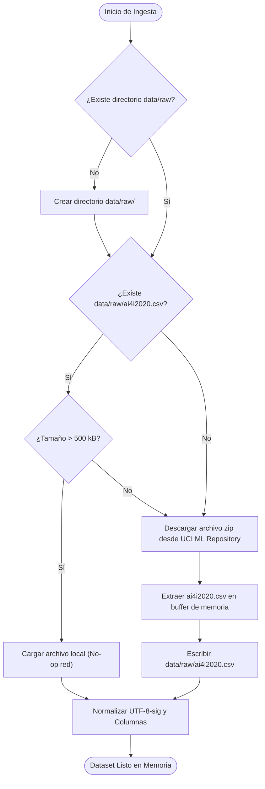
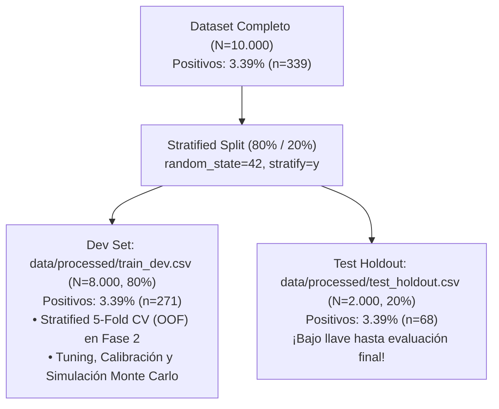

# FASE-01: Ingesta de Datos, Ingeniería de Características Físicas y Análisis Exploratorio de Datos (EDA)

> **Documento de Especificación Técnica de Desarrollo**  
> **Proyecto:** FleetReliability-AI — Sistema Predictivo CBM para Equipos Industriales y Mineros  
> **Programa:** Machine Learning Zoomcamp (Mid-Term Project)  
> **Referencias:** [PLAN.md](../PLAN.md) | [00_transversal_standards.md](./00_transversal_standards.md)

---

## 1. Metadatos y Control de Fase

### 1.1 Ficha de Control

| Atributo | Especificación Técnica |
| :--- | :--- |
| **Identificador** | `FASE-01` |
| **Título** | Ingesta Idempotente, Features Termodinámicas y EDA Libre de Leakage |
| **Responsable / Rol** | Staff Data Scientist & Senior Reliability Engineer |
| **Versión y Estado** | `1.0.0` — `LISTO PARA DESARROLLO` |
| **Pre-requisitos Bloqueantes** | Fase 0 ([00_transversal_standards.md](./00_transversal_standards.md)) aprobada: Python 3.11 (`>=3.11,<3.13`) con `uv sync --all-groups` activo y herramientas `black`, `isort`, `pytest` operativas. |
| **Entregables Clave** | 1. `src/data_loader.py` (descarga idempotente desde UCI ML Repository).<br/>2. `data/raw/ai4i2020.csv` (10.000 registros, 14 columnas base) y splits en `data/processed/`.<br/>3. `src/features.py` (implementación 100% vectorizada de features físicas).<br/>4. `notebooks/notebook.ipynb` (sección EDA y validación de características).<br/>5. `tests/test_features.py` pasando al 100%. |
| **Entorno y Stack** | Python 3.11 (`>=3.11,<3.13`), Astral `uv`, Pandas, NumPy, SciPy, Scikit-learn, Matplotlib, Seaborn, Pytest |
| **Impacto en Rúbrica Zoomcamp** | Problem Description (2/2 pts), EDA (2/2 pts), Reproducibility (2/2 pts) |

### 1.2 Objetivo Técnico y Alcance
El objetivo principal de la **Fase 1** es establecer una ingesta determinista e idempotente del dataset *AI4I 2020 Predictive Maintenance*, construir el núcleo de ingeniería de características informadas por física termodinámica y mecánica sin bucles lentos ni fuga de datos (*data leakage*), y ejecutar un Análisis Exploratorio de Datos (EDA) riguroso que fundamente las decisiones de modelado y métricas de la Fase 2.

### 1.3 Pre-requisitos del Sistema y Entregables Verificables
1. **Entorno Base (`uv`):** Sincronizar el entorno virtual ejecutando `uv sync --all-groups` antes de correr cualquier script o notebook.
2. **Artefactos Esperados al Cierre:**
   - **Módulo de Ingesta:** `src/data_loader.py` con descarga automatizada e idempotente desde el repositorio UCI ML.
   - **Dataset Crudo y Procesado:** `data/raw/ai4i2020.csv` con integridad verificada y particiones estratificadas en `data/processed/`.
   - **Módulo de Transformación Físico:** `src/features.py` con implementación 100% vectorizada de variables termodinámicas y cinemáticas.
   - **Notebook de Investigación:** `notebooks/notebook.ipynb` completamente ejecutado (de celda 1 a fin), documentando hipótesis de confiabilidad, análisis univariado/bivariado, correlaciones y conclusiones operacionales.
   - **Batería de Pruebas Unitarias:** `tests/test_features.py` pasando al 100% (`uv run pytest tests/test_features.py`).
   - **Documentación Actualizada:** `README.md` sincronizado con la sección de análisis del dataset y hallazgos preliminares.

---

## 2. Especificación Técnica de Ingesta de Datos

### 2.1 Origen, Benchmark y Licencia
El proyecto utiliza el **AI4I 2020 Predictive Maintenance Dataset**, publicado por Stephan Matzka (HTW Berlin) en el repositorio de Machine Learning de la Universidad de California en Irvine (UCI ML Repository, ID 601).
- **Licencia:** Creative Commons Attribution 4.0 International (CC BY 4.0).
- **URL Directa Oficial:** `https://archive.ics.uci.edu/static/public/601/ai4i+2020+predictive+maintenance+dataset.zip`
- **Volumen:** 10.000 observaciones de telemetría de fresadoras/centros de mecanizado CNC simulados a partir de parámetros de operación reales en manufactura pesada.

### 2.2 Catálogo Detallado de Variables Crudas

| Variable Cruda | Tipo Pandas | Unidad Física | Rango Teórico / Esperado | Descripción de Dominio y Rol Operacional |
| :--- | :--- | :---: | :---: | :--- |
| `UDI` | `int64` | Adimensional | $[1, 10000]$ | Identificador secuencial de registro. **Debe excluirse de $X$** para evitar fuga de orden cronológico. |
| `Product ID` | `object` / `string` | Adimensional | `L[0-9]+`, `M[0-9]+`, `H[0-9]+` | Código de activo compuesto por variante y correlativo de lote. **Debe excluirse de $X$**. |
| `Type` | `category` / `object` | Categórico | `L` (50%), `M` (30%), `H` (20%) | Nivel de calidad/criticidad del equipo: *Low* (50% desgaste rápido), *Medium* (30%), *High* (20% servicio severo/alta precisión). |
| `Air temperature [K]` | `float64` | Kelvin [$K$] | $[295.0, 305.0]$ | Temperatura ambiente en nave industrial, modelada mediante paseo aleatorio. Base para gradiente de enfriamiento. |
| `Process temperature [K]` | `float64` | Kelvin [$K$] | $[305.0, 315.0]$ | Temperatura en el punto de contacto herramienta-pieza. Típicamente $\approx T_{\text{air}} + 10\text{ K}$. |
| `Rotational speed [rpm]` | `int64` / `float64` | RPM [$\text{min}^{-1}$] | $[1100, 2900]$ | Velocidad de rotación del husillo principal, gobernada por una potencia constante de $\approx 2860\text{ W}$ con ruido gaussiano. |
| `Torque [Nm]` | `float64` | Newton-metro [$\text{Nm}$] | $[3.5, 80.0]$ | Par torsional resistivo en el husillo. Distribución normal con $\mu \approx 40\text{ Nm}, \sigma \approx 10\text{ Nm}$. |
| `Tool wear [min]` | `int64` / `float64` | Minutos [$\text{min}$] | $[0, 260]$ | Tiempo acumulado de uso de la herramienta. Aumenta en 2, 3 o 5 min por ciclo según variante ($H, M, L$). Reemplazo entre 200-240 min. |
| `Machine failure` | `int64` | Booleano | $0$ (96.61%), $1$ (3.39%) | **Target Principal de Clasificación.** Indicador global de interrupción operacional no programada (339 positivos). |
| `TWF` | `int64` | Booleano | $0, 1$ (46 casos) | *Tool Wear Failure:* Falla por desgaste excesivo de filo entre 200 y 240 minutos de operación. |
| `HDF` | `int64` | Booleano | $0, 1$ (115 casos) | *Heat Dissipation Failure:* Falla térmica por insuficiente disipación ($\Delta T < 8.6\text{ K}$ y velocidad $< 1380\text{ rpm}$). |
| `PWF` | `int64` | Booleano | $0, 1$ (95 casos) | *Power Failure:* Falla por potencia mecánica fuera de rango admisible ($< 3500\text{ W}$ o $> 9000\text{ W}$). |
| `OSF` | `int64` | Booleano | $0, 1$ (98 casos) | *Overstrain Failure:* Falla por sobreesfuerzo combinado ($\text{Tool wear} \times \text{Torque} > \text{límite por variante}$). |
| `RNF` | `int64` | Booleano | $0, 1$ (19 casos) | *Random Failure:* Falla aleatoria no correlacionada con los sensores (probabilidad base del 0.1%). |

> [!CAUTION]
> **Aislamiento Mandatorio de Columnas Diagnósticas:** Las variables `TWF`, `HDF`, `PWF`, `OSF` y `RNF` corresponden a diagnósticos post-mortem (causa raíz de la falla). **Bajo ninguna circunstancia deben incluirse en la matriz de features $X$** durante el entrenamiento. Incluirlas constituye un *target leakage* catastrófico que invalidará completamente el proyecto.

### 2.3 Tratamiento Especial del Byte Order Mark (BOM UTF-8)
El archivo `ai4i2020.csv` provisto por el repositorio UCI contiene un marcador de orden de bytes UTF-8 (`\ufeff`) al inicio de la primera línea.
- Si se utiliza `pd.read_csv('ai4i2020.csv')` sin especificar encoding, la primera columna queda nombrada como `'\ufeffUDI'`.
- **Regla Estricta de Carga:** Se debe usar `encoding="utf-8-sig"` al leer el CSV con Pandas, o bien aplicar una normalización de nombres de columnas que elimine caracteres no imprimibles:
  ```python
  df = pd.read_csv(filepath, encoding="utf-8-sig")
  ```

### 2.4 Arquitectura del Módulo de Ingesta Idempotente
El script de ingesta debe garantizar **idempotencia total**: si el archivo ya reside en `data/raw/ai4i2020.csv` con el tamaño esperado (~522 kB), no debe realizar peticiones de red redundantes.



### 2.5 Interfaz de Código del Módulo de Ingesta (`src/data_loader.py`)
```python
"""Idempotent Data Ingestion Module for AI4I 2020 Telemetry.

FleetReliability-AI — CBM Predictive Maintenance.
"""

from io import BytesIO
import logging
from pathlib import Path
import urllib.request
import zipfile

import pandas as pd

logger = logging.getLogger(__name__)

DATA_URL: str = (
    "https://archive.ics.uci.edu/static/public/601/"
    "ai4i+2020+predictive+maintenance+dataset.zip"
)
RAW_DATA_PATH: Path = Path("data/raw/ai4i2020.csv")
MIN_EXPECTED_BYTES: int = 500_000


def download_ai4i_dataset(
    url: str = DATA_URL,
    dest_path: Path = RAW_DATA_PATH,
    force_download: bool = False,
) -> Path:
    """Downloads and extracts the AI4I 2020 dataset idempotently.

    Args:
        url: Official UCI ML Repository ZIP download URL.
        dest_path: Destination CSV file path on local disk.
        force_download: If True, re-downloads even when a valid file exists.

    Returns:
        Path: Local path to the verified raw CSV file.

    Raises:
        FileNotFoundError: If the expected CSV file is missing inside the ZIP archive.
    """
    dest_path.parent.mkdir(parents=True, exist_ok=True)

    if not force_download and dest_path.exists():
        file_size = dest_path.stat().st_size
        if file_size >= MIN_EXPECTED_BYTES:
            logger.info(
                "Dataset already exists at %s (%d bytes). Skipping download.",
                dest_path,
                file_size,
            )
            return dest_path
        logger.warning(
            "Existing dataset file at %s appears incomplete (%d bytes). Retrying download.",
            dest_path,
            file_size,
        )

    logger.info("Downloading industrial telemetry dataset from %s", url)
    req = urllib.request.Request(url, headers={"User-Agent": "FleetReliability-AI/1.0"})
    with urllib.request.urlopen(req) as response:
        archive_bytes = response.read()

    with zipfile.ZipFile(BytesIO(archive_bytes)) as archive:
        target_filename = "ai4i2020.csv"
        if target_filename not in archive.namelist():
            raise FileNotFoundError(
                f"Expected file '{target_filename}' was not found inside the downloaded ZIP archive."
            )
        with archive.open(target_filename) as source, open(dest_path, "wb") as target:
            target.write(source.read())

    logger.info("Dataset verified and saved successfully to %s", dest_path)
    return dest_path


def load_raw_data(data_path: Path = RAW_DATA_PATH) -> pd.DataFrame:
    """Loads the raw AI4I 2020 CSV dataset with UTF-8 BOM handling.

    Args:
        data_path: Local path to the raw CSV file.

    Returns:
        pd.DataFrame: Raw telemetry DataFrame with 10,000 rows and 14 base columns.
    """
    if not data_path.exists():
        download_ai4i_dataset(dest_path=data_path)

    df = pd.read_csv(data_path, encoding="utf-8-sig")
    return df
```

---

## 3. Especificación Matemática y Física de Features Derivadas

En Condition-Based Maintenance (CBM), los modelos estadísticos 'caja negra' que ignoran los primeros principios de la termodinámica y la cinemática sufren de pobre generalización ante cambios operacionales. El diseño de variables en **FleetReliability-AI** se fundamenta en las leyes de conservación de energía y mecánica de falla de componentes rotatorios.

### 3.1 Potencia Mecánica Efectiva del Husillo ($P_{\text{mech}}$)
- **Fundamento Físico:** La potencia disipada en el punto de corte resulta del producto escalar entre el torque aplicado ($\tau$) y la velocidad angular del eje ($\omega$). Un husillo que consume potencia fuera de la envolvente admisible de diseño ($[3500\text{ W}, 9000\text{ W}]$) experimenta deslizamiento de correas, sobrecalentamiento de devanados del motor eléctrico o atascamiento del herramental (*Power Failure - PWF*).
- **Deducción Matemática:**
  $$\omega = \text{Rotational speed [rpm]} \times \frac{2\pi\text{ rad}}{1\text{ rev}} \times \frac{1\text{ min}}{60\text{ s}} = \frac{2\pi}{60} \times \text{Speed} \quad [\text{rad/s}]$$

  $$P_{\text{mech}} = \tau \times \omega = \text{Torque [Nm]} \times \left( \text{Speed [rpm]} \times \frac{2\pi}{60} \right) \quad [\text{W}]$$

  Para estandarizar en kilovatios (kW):
  $$P_{\text{mech}} [\text{kW}] = \frac{2\pi}{60 \times 1000} \times \text{Torque [Nm]} \times \text{Speed [rpm]} \approx 1.047198 \times 10^{-4} \times (\tau \cdot \omega_{\text{rpm}})$$

### 3.2 Salto Térmico del Proceso ($\Delta T$)
- **Fundamento Físico:** De acuerdo con la Ley de Enfriamiento de Newton y la transferencia de calor por convección forzada en el fluido de corte, el gradiente térmico entre la zona de corte ($T_{\text{process}}$) y la temperatura ambiente del taller ($T_{\text{air}}$) cuantifica la eficiencia de disipación térmica. Si $\Delta T$ desciende por debajo de un umbral crítico ($< 8.6\text{ K}$) en condiciones de bajo flujo de refrigerante o baja convección cinemática ($\omega < 1380\text{ rpm}$), se induce una falla por disipación térmica (*Heat Dissipation Failure - HDF*).
- **Formulación Matemática:**
  $$\Delta T = T_{\text{process}} - T_{\text{air}} \quad [\text{K}]$$

### 3.3 Índice de Esfuerzo Acumulado de Herramienta ($\text{Strain Index}$)
- **Fundamento Físico:** La fatiga y desgaste abrasivo del filo de corte siguen el principio de acumulación de tensiones mecánicas. A medida que aumenta el tiempo acumulado de corte (`Tool wear`), el área de contacto y fricción se incrementa exponencialmente, demandando un mayor torque ($\tau$). El producto de ambas variables define la energía torsional acumulada. En el diseño industrial del dataset, la falla por sobreesfuerzo (*Overstrain Failure - OSF*) ocurre cuando esta métrica supera los límites de resistencia del material:
  - Variante $L$: $\text{Strain Index} > 11.000\text{ min}\cdot\text{Nm}$
  - Variante $M$: $\text{Strain Index} > 12.000\text{ min}\cdot\text{Nm}$
  - Variante $H$: $\text{Strain Index} > 13.000\text{ min}\cdot\text{Nm}$
- **Formulación Matemática:**
  $$\text{Strain Index} = \text{Tool wear [min]} \times \text{Torque [Nm]} \quad [\text{min}\cdot\text{Nm}]$$

### 3.4 Ratio de Estrés Térmico Específico ($\text{Heat Stress Ratio}$)
- **Fundamento Físico:** Cuantifica la densidad de acumulación de calor por ciclo de rotación mecánica del husillo. A menores velocidades angulares, el coeficiente de transferencia convectiva superficial disminuye drásticamente, concentrando el salto térmico en el cabezal.
- **Formulación Matemática:**
  $$\text{Heat Stress Ratio} = \frac{\Delta T}{\text{Rotational speed [rpm]}} \times 1000 \quad \left[\frac{\text{K}\cdot\text{min}}{\text{rot}} \times 10^3\right]$$

### 3.5 Matriz Resumen de Características Físicas

A partir de las columnas crudas normalizadas a `snake_case` (`machine_type`, `air_temperature_k`, `process_temperature_k`, `rotational_speed_rpm`, `torque_nm`, `tool_wear_min`), se generan exactamente las 4 características físicas derivadas:

| Nombre de Feature | Expresión Vectorizada NumPy/Pandas | Unidad | Relevancia en Modos de Falla |
| :--- | :--- | :---: | :--- |
| `mechanical_power_kw` | `df["torque_nm"] * df["rotational_speed_rpm"] * ((2.0 * np.pi) / 60_000.0)` | $\text{kW}$ | Detección directa de sobrecarga/subcarga de motor ($PWF$). |
| `temperature_difference_k` | `df["process_temperature_k"] - df["air_temperature_k"]` | $\text{K}$ | Monitoreo de disipación térmica y falla de refrigeración ($HDF$). |
| `strain_index_min_nm` | `df["tool_wear_min"] * df["torque_nm"]` | $\text{min}\cdot\text{Nm}$ | Tensión torsional acumulada por desgaste de herramienta ($OSF$). |
| `heat_stress_ratio` | `(df["temperature_difference_k"] / np.maximum(df["rotational_speed_rpm"], 1e-6)) * 1000.0` | $\text{K}\cdot\text{min/rev} \times 10^3$ | Densidad térmica por revolución cinemática. |

> [!IMPORTANT]
> **Prohibición de Iteración Escalar:** Queda estrictamente prohibido el uso de constructos iterativos lentos (`df.iterrows()`, `df.itertuples()`, bucles `for` nativos de Python). Todas las columnas deben ser computadas utilizando las implementaciones vectorizadas de NumPy y Pandas para garantizar eficiencia $O(N)$ y tiempos de ejecución menores a 5 milisegundos para 10.000 registros.

---

## 4. Protocolo de Partición Estratificada y Prevención de Data Leakage

### 4.1 Estrategia de Partición (80% Dev / 20% Test Holdout)
La tasa base de eventos positivos en el dataset es de solo **3.39%** (339 máquinas en estado de falla de 10.000 observaciones).
- Una partición aleatoria ingenua no estratificada corre el riesgo de introducir sesgos severos de distribución del target entre conjuntos.
- **Protocolo de División Única (80/20):**
  - **Desarrollo (`train_dev`):** 80% del dataset ($N = 8.000$, 271 fallas), utilizado exclusivamente en la Fase 2 para validación cruzada estratificada (`StratifiedKFold(n_splits=5)`), búsqueda de hiperparámetros, calibración y optimización Monte Carlo.
  - **Prueba Final (`test_holdout`):** 20% del dataset ($N = 2.000$, 68 fallas), congelado bajo llave para una evaluación única final al cierre del modelado.
- **Estratificación Mandatoria y Persistencia:** La división se realiza mediante `train_test_split` de Scikit-Learn fijando `test_size=0.2`, `stratify=y` y semilla pseudoaleatoria fija (`random_state=42`). Los splits resultantes se persisten en formato CSV primario en:
  - `data/processed/train_dev.csv`
  - `data/processed/test_holdout.csv`



### 4.2 La Regla de Oro contra Data Leakage
1. **Aislamiento Estadístico:** Ningún estadístico poblacional (media, desviación estándar, medianas para imputación, codificaciones de target, cuantiles) puede ser computado sobre el conjunto completo. Todo objeto transformador (`StandardScaler`, `OneHotEncoder`, `OrdinalEncoder`) debe ser ajustado (`.fit()`) **exclusivamente** sobre los pliegues de entrenamiento de `train_dev` dentro de un `Pipeline` de Scikit-Learn, y luego aplicado (`.transform()`) sobre los pliegues de validación y `x_test`.
2. **Features Físicas Deterministas:** Las variables derivadas definidas en la Sección 3 ($P_{\text{mech}}, \Delta T, \text{Strain Index}, \text{Heat Stress Ratio}$) dependen únicamente de las mediciones de la fila en curso (transformaciones puntuales sin dependencia inter-muestra). Por lo tanto, pueden ser generadas dentro de `PhysicalFeatureTransformer` en el pipeline sin riesgo de fuga estadística entre filas.
3. **Exclusión Rigurosa de Identificadores y Columnas Causal-Leakage:**
   - **`UDI`:** Identificador correlativo del experimento; correlaciona espuriamente con el desgaste acumulativo continuo del generador del dataset. Debe eliminarse.
   - **`Product ID`:** Identificador alfanumérico que duplica la variable `Type` agregando un índice correlativo. Debe eliminarse.
   - **`TWF`, `HDF`, `PWF`, `OSF`, `RNF`:** Indicadores deterministas de causa raíz. Si un modelo tiene acceso a estas columnas, la tarea de predicción se degrada a una tautología trivial ($R^2 = 1.0$), destruyendo el valor predictivo de la alerta temprana.

---

## 5. Protocolo de Análisis Exploratorio de Datos (EDA)

El notebook `notebooks/notebook.ipynb` debe estructurarse rigurosamente en las siguientes fases analíticas, combinando rigor estadístico con visualizaciones técnicas listas para auditoría:

### 5.1 Fase A: Integridad Estructural y Calidad de Datos
- Comprobación de dimensiones exactas (`df.shape == (10000, 14)`).
- Detección de valores nulos o faltantes por columna (`df.isna().sum()`).
- Detección de duplicados en clave primaria (`df['UDI'].nunique() == 10000`).
- Validación de rangos físicos de sensores frente a límites de seguridad industrial:
  - $T_{\text{air}} \in [295, 305]\text{ K}$
  - $T_{\text{process}} \in [305, 315]\text{ K}$
  - $\text{Speed} \in [1100, 2900]\text{ rpm}$
  - $\text{Torque} \in [3.5, 80]\text{ Nm}$
  - $\text{Tool wear} \in [0, 260]\text{ min}$

> [!NOTE]
> **Compatibilidad con `pandas 3.1.1` (`StringDtype`):** A partir de Pandas 3.x, las columnas de texto utilizan `str` (`StringDtype`) por defecto en lugar de `object`. Al seleccionar columnas categóricas o de texto durante el EDA, se debe usar `df.select_dtypes(include=["object", "string", "str"])` o `df.select_dtypes(exclude="number")`.

### 5.2 Fase B: Análisis Univariado y Distribuciones
- **Variable Objetivo (`Machine failure`):**
  - Conteo absoluto y porcentual de clases.
  - Cálculo del factor de desbalance: $\text{Imbalance Ratio} = \frac{N_{\text{neg}}}{N_{\text{pos}}} \approx \frac{9661}{339} \approx 28.5 : 1$.
  - Gráfico de barras con anotación exacta de porcentajes.
- **Variables Continuas de Telemetría:**
  - Generación de histogramas con estimación de densidad por kernel (KDE).
  - Cálculo de estadísticos de forma: Sesgo (*Skewness*) y Curtosis (*Kurtosis*).
  - Diagramas de caja (*Boxplots*) agrupados por estado de falla para identificar anomalías y valores atípicos.

### 5.3 Fase C: Análisis Bivariado, Multivariado y Correlaciones
- **Matriz de Correlación Lineal (Pearson):**
  - Evaluación de la fuerte multicolinealidad inversa entre `Rotational speed` y `Torque` (consecuencia de la relación hiperbólica $P \approx \text{constante}$).
  - Correlación positiva esperada entre `Air temperature` y `Process temperature` ($r > 0.85$).
- **Matriz de Correlación Monótona (Spearman):**
  - Captura de relaciones no lineales entre variables de desgaste, esfuerzo torsional y la probabilidad de falla.
- **Puntuación de Información Mutua (Mutual Information):**
  - Computar `mutual_info_classif(X_num, y)` para cuantificar la dependencia no lineal de cada sensor respecto al target binario.

### 5.4 Fase D: Análisis Causal de Modos de Falla y Validación de Nuevas Features
- **Validación Experimental de la Potencia Mecánica ($P_{\text{mech}}$):**
  - Contrastar la distribución de $P_{\text{mech}}$ en registros con etiqueta `PWF == 1` vs `PWF == 0`.
  - Demostrar que los casos de falla de potencia caen fuera del intervalo seguro $[3500\text{ W}, 9000\text{ W}]$ ($[3.5\text{ kW}, 9.0\text{ kW}]$).
- **Validación del Salto Térmico ($\Delta T$):**
  - Visualizar el espacio bidimensional $(\text{Rotational speed}, \Delta T)$ mediante diagrama de dispersión (*scatter plot*), resaltando las observaciones con `HDF == 1`.
  - Confirmar el cuadrante de falla térmica ($\Delta T < 8.6\text{ K} \land \omega < 1380\text{ rpm}$).
- **Validación del Índice de Esfuerzo ($\text{Strain Index}$):**
  - Visualizar el plano $(\text{Tool wear}, \text{Torque})$ estratificado por variante de producto ($L, M, H$).
  - Trazar las asíntotas hiperbólicas de los límites de rotura ($11.000$, $12.000$ y $13.000\text{ min}\cdot\text{Nm}$).

### 5.5 Fase E: Análisis de Activo por Variante (`Type`)
- Frecuencia de falla condicional por tipo de máquina:
  $$P(\text{Falla} \mid \text{Type} = L) \quad \text{vs} \quad P(\text{Falla} \mid \text{Type} = M) \quad \text{vs} \quad P(\text{Falla} \mid \text{Type} = H)$$
- Justificación de negocio: Las máquinas tipo $L$ exhiben mayor tasa de falla debido a herramientas de menor calidad o mayor régimen de desgaste por minuto de operación, lo cual impactará en la matriz de costos de mantenimiento.

---

## 6. Módulo Inicial de Features (`src/features.py`)

A continuación se define el contrato unificado de producción para `src/features.py`, reutilizado sin cambios incompatibles en las fases de entrenamiento y servicio (Fases 2 y 3):

```python
"""Domain-Informed Physical Feature Engineering Module for FleetReliability-AI.

Provides column normalization, pure vectorized physics functions, a scikit-learn
compatible transformer, and a leakage-free stratified split helper.
"""

from typing import Union

import numpy as np
import pandas as pd
from sklearn.base import BaseEstimator, TransformerMixin
from sklearn.model_selection import train_test_split

# Physical constants
POWER_CONVERSION_FACTOR: float = (2.0 * np.pi) / (60.0 * 1000.0)
EPSILON: float = 1e-6

# Canonical raw column mapping from UCI AI4I 2020 headers to snake_case
RAW_COLUMN_MAPPING: dict[str, str] = {
    "Type": "machine_type",
    "Air temperature [K]": "air_temperature_k",
    "Process temperature [K]": "process_temperature_k",
    "Rotational speed [rpm]": "rotational_speed_rpm",
    "Torque [Nm]": "torque_nm",
    "Tool wear [min]": "tool_wear_min",
    "Machine failure": "machine_failure",
}

RAW_FEATURE_COLUMNS: list[str] = [
    "machine_type",
    "air_temperature_k",
    "process_temperature_k",
    "rotational_speed_rpm",
    "torque_nm",
    "tool_wear_min",
]

PHYSICAL_FEATURE_COLUMNS: list[str] = [
    "mechanical_power_kw",
    "temperature_difference_k",
    "strain_index_min_nm",
    "heat_stress_ratio",
]

TARGET_COLUMN: str = "machine_failure"

FAILURE_MODES: list[str] = ["TWF", "HDF", "PWF", "OSF", "RNF"]

EXCLUDE_COLUMNS: list[str] = ["UDI", "Product ID"] + FAILURE_MODES


def normalize_raw_dataframe(df: pd.DataFrame) -> pd.DataFrame:
    """Normalizes raw UCI AI4I 2020 column headers to canonical snake_case names.

    Args:
        df: Raw or partially normalized telemetry DataFrame.

    Returns:
        pd.DataFrame: Copy of `df` with standardized column names.
    """
    df_norm = df.copy()
    df_norm.columns = [col.strip().lstrip("\ufeff") for col in df_norm.columns]
    return df_norm.rename(columns=RAW_COLUMN_MAPPING)


def compute_mechanical_power(
    torque_nm: Union[float, np.ndarray, pd.Series],
    rotational_speed_rpm: Union[float, np.ndarray, pd.Series],
) -> Union[float, np.ndarray, pd.Series]:
    """Computes mechanical shaft power in kilowatts (kW).

    Formula: P_mech = Torque [Nm] * Speed [rpm] * (2 * pi / 60000)

    Args:
        torque_nm: Applied shaft torque in Newton-meters.
        rotational_speed_rpm: Rotational speed in revolutions per minute.

    Returns:
        Mechanical power in kilowatts (kW).
    """
    return torque_nm * rotational_speed_rpm * POWER_CONVERSION_FACTOR


def compute_temperature_difference(
    process_temperature_k: Union[float, np.ndarray, pd.Series],
    air_temperature_k: Union[float, np.ndarray, pd.Series],
) -> Union[float, np.ndarray, pd.Series]:
    """Computes thermal gradient between process and ambient air in Kelvin (K).

    Formula: Delta_T = Process_Temperature - Air_Temperature

    Args:
        process_temperature_k: Process temperature in Kelvin.
        air_temperature_k: Ambient air temperature in Kelvin.

    Returns:
        Temperature difference in Kelvin (K).
    """
    return process_temperature_k - air_temperature_k


def compute_strain_index(
    tool_wear_min: Union[float, np.ndarray, pd.Series],
    torque_nm: Union[float, np.ndarray, pd.Series],
) -> Union[float, np.ndarray, pd.Series]:
    """Computes cumulative mechanical strain index in min*Nm.

    Formula: Strain_Index = Tool_Wear * Torque

    Args:
        tool_wear_min: Cumulative tool wear in minutes.
        torque_nm: Applied shaft torque in Newton-meters.

    Returns:
        Cumulative strain index in min*Nm.
    """
    return tool_wear_min * torque_nm


def compute_heat_stress_ratio(
    temperature_difference_k: Union[float, np.ndarray, pd.Series],
    rotational_speed_rpm: Union[float, np.ndarray, pd.Series],
) -> Union[float, np.ndarray, pd.Series]:
    """Computes specific heat stress ratio normalized by rotational speed.

    Formula: Heat_Stress_Ratio = (Delta_T / max(Rotational_Speed, EPSILON)) * 1000

    Args:
        temperature_difference_k: Thermal gradient in Kelvin.
        rotational_speed_rpm: Rotational speed in RPM.

    Returns:
        Scaled heat stress ratio.
    """
    if isinstance(rotational_speed_rpm, (float, int)):
        denom = max(float(rotational_speed_rpm), EPSILON)
    elif isinstance(rotational_speed_rpm, pd.Series):
        denom = rotational_speed_rpm.clip(lower=EPSILON)
    else:
        denom = np.clip(rotational_speed_rpm, a_min=EPSILON, a_max=None)

    return (temperature_difference_k / denom) * 1000.0


class PhysicalFeatureTransformer(BaseEstimator, TransformerMixin):
    """Scikit-learn compatible transformer that injects derived physical features.

    Expects normalized snake_case raw telemetry columns and appends the four
    derived thermodynamic and mechanical features without data leakage.
    """

    def __init__(self) -> None:
        """Initializes the physical feature transformer."""
        self.feature_names_: list[str] = []

    def fit(self, X: pd.DataFrame, y: None = None) -> "PhysicalFeatureTransformer":
        """Validates presence of required snake_case raw telemetry columns.

        Args:
            X: Input DataFrame with normalized raw telemetry columns.
            y: Unused target placeholder (scikit-learn estimator API compliance).

        Returns:
            Fitted transformer instance.

        Raises:
            ValueError: If any required raw telemetry column is missing.
        """
        required_cols = {
            "air_temperature_k",
            "process_temperature_k",
            "rotational_speed_rpm",
            "torque_nm",
            "tool_wear_min",
        }
        if isinstance(X, pd.DataFrame):
            missing = required_cols - set(X.columns)
            if missing:
                raise ValueError(f"Missing required telemetry columns for physics features: {missing}")
        return self

    def transform(self, X: pd.DataFrame) -> pd.DataFrame:
        """Computes and appends the four derived physical features.

        Args:
            X: Input DataFrame containing normalized raw telemetry columns.

        Returns:
            pd.DataFrame: Copy of `X` enriched with derived physical features.
        """
        X_out = X.copy()
        X_out["mechanical_power_kw"] = compute_mechanical_power(
            X_out["torque_nm"], X_out["rotational_speed_rpm"]
        )
        X_out["temperature_difference_k"] = compute_temperature_difference(
            X_out["process_temperature_k"], X_out["air_temperature_k"]
        )
        X_out["strain_index_min_nm"] = compute_strain_index(
            X_out["tool_wear_min"], X_out["torque_nm"]
        )
        X_out["heat_stress_ratio"] = compute_heat_stress_ratio(
            X_out["temperature_difference_k"], X_out["rotational_speed_rpm"]
        )
        self.feature_names_ = list(X_out.columns)
        return X_out

    def get_feature_names_out(self, input_features: list[str] | None = None) -> list[str]:
        """Returns the list of output feature column names."""
        return self.feature_names_


def prepare_training_matrices(
    df: pd.DataFrame,
    test_size: float = 0.2,
    random_state: int = 42,
) -> tuple[pd.DataFrame, pd.DataFrame, pd.Series, pd.Series]:
    """Normalizes columns, computes physical features, and performs an 80/20 stratified split.

    Drops identifier and post-mortem diagnostic columns (`UDI`, `Product ID`,
    `TWF`, `HDF`, `PWF`, `OSF`, `RNF`) to prevent target leakage, and returns
    a single 80% Dev / 20% Test Holdout split.

    Args:
        df: Raw or normalized AI4I 2020 DataFrame.
        test_size: Fraction reserved for the locked test holdout set.
        random_state: Deterministic random seed for stratification.

    Returns:
        Tuple `(x_train_dev, x_test, y_train_dev, y_test)`.

    Raises:
        ValueError: If `machine_failure` target column is missing.
    """
    df_norm = normalize_raw_dataframe(df)
    if TARGET_COLUMN not in df_norm.columns:
        raise ValueError(f"Target column '{TARGET_COLUMN}' not found in DataFrame.")

    transformer = PhysicalFeatureTransformer()
    df_enriched = transformer.fit_transform(df_norm)

    y = df_enriched[TARGET_COLUMN].copy()
    cols_to_drop = [
        col for col in EXCLUDE_COLUMNS + [TARGET_COLUMN] if col in df_enriched.columns
    ]
    x = df_enriched.drop(columns=cols_to_drop)

    x_train_dev, x_test, y_train_dev, y_test = train_test_split(
        x,
        y,
        test_size=test_size,
        random_state=random_state,
        stratify=y,
    )
    return x_train_dev, x_test, y_train_dev, y_test
```

Los splits resultantes (`x_train_dev` + `y_train_dev` y `x_test` + `y_test`) deben persistirse en formato CSV en `data/processed/train_dev.csv` y `data/processed/test_holdout.csv` para su consumo directo en la Fase 2.

---

## 7. Especificación de Pruebas Unitarias (`tests/test_features.py`)

Para garantizar la estabilidad y reproducibilidad del pipeline numérico, se especifican pruebas unitarias automatizadas con `pytest`.

### 7.1 Casos de Prueba Sintéticos de Control Analítico
Se crean casos de prueba donde los valores resultantes se conocen a priori por cálculo manual:
- **Caso Nominal:**
  - $T_{\text{air}} = 300.0\text{ K}$, $T_{\text{process}} = 310.0\text{ K} \implies \Delta T = 10.0\text{ K}$.
  - $\text{Speed} = 1500.0\text{ rpm}$, $\text{Torque} = 40.0\text{ Nm}$:
    $$\omega = 1500 \times \frac{2\pi}{60} = 50\pi \approx 157.07963\text{ rad/s}$$
    $$P_{\text{mech}} = 40.0 \times 157.07963 = 6283.1853\text{ W} = 6.2831853\text{ kW}$$
  - $\text{Tool wear} = 100.0\text{ min}$, $\text{Torque} = 40.0\text{ Nm} \implies \text{Strain Index} = 4000.0\text{ min}\cdot\text{Nm}$.
  - $\text{Heat Stress Ratio} = \frac{10.0}{1500.0} \times 1000 = 6.66667\text{ K}\cdot\text{min/rev} \times 10^3$.

### 7.2 Casos Límite y Robustez
- Verificación de no alteración de índices de Pandas tras vectorización.
- Comprobación de que no se generen valores infinitos ni `NaN` ante entradas numéricas estándar.
- Inmutabilidad del DataFrame de entrada (garantía de pureza de funciones funcionales).

### 7.3 Código de Prueba Unitario (`tests/test_features.py`)
```python
"""Unit tests for the Physical Feature Engineering module.

FleetReliability-AI.
"""

import numpy as np
import pandas as pd
import pytest

from src.features import (
    PHYSICAL_FEATURE_COLUMNS,
    RAW_FEATURE_COLUMNS,
    PhysicalFeatureTransformer,
    compute_heat_stress_ratio,
    compute_mechanical_power,
    compute_strain_index,
    compute_temperature_difference,
    normalize_raw_dataframe,
    prepare_training_matrices,
)


@pytest.fixture
def synthetic_sample_df() -> pd.DataFrame:
    """Provides a synthetic raw AI4I 2020 DataFrame with analytically known outputs."""
    return pd.DataFrame(
        {
            "UDI": [1, 2],
            "Product ID": ["L47181", "M14860"],
            "Type": ["L", "M"],
            "Air temperature [K]": [300.0, 298.0],
            "Process temperature [K]": [310.0, 308.5],
            "Rotational speed [rpm]": [1500.0, 1200.0],
            "Torque [Nm]": [40.0, 50.0],
            "Tool wear [min]": [100.0, 200.0],
            "Machine failure": [0, 1],
            "TWF": [0, 0],
            "HDF": [0, 1],
            "PWF": [0, 0],
            "OSF": [0, 0],
            "RNF": [0, 0],
        }
    )


def test_normalize_raw_dataframe_maps_columns(synthetic_sample_df: pd.DataFrame) -> None:
    """Verifies that raw AI4I headers are normalized to canonical snake_case."""
    normalized = normalize_raw_dataframe(synthetic_sample_df)
    for col in RAW_FEATURE_COLUMNS + ["machine_failure"]:
        assert col in normalized.columns


def test_pure_physics_functions_nominal_values() -> None:
    """Verifies that vectorized physics functions match analytical hand calculations."""
    # 1. Delta T: 310.0 - 300.0 = 10.0 K
    assert np.isclose(compute_temperature_difference(310.0, 300.0), 10.0, atol=1e-5)

    # 2. Mechanical Power kW: 40.0 * 1500 * (2*pi/60) / 1000 = 2*pi kW
    expected_power = (40.0 * 1500.0 * 2.0 * np.pi / 60.0) / 1000.0
    assert np.isclose(compute_mechanical_power(40.0, 1500.0), expected_power, atol=1e-5)

    # 3. Strain index: 100 * 40.0 = 4000.0 min*Nm
    assert np.isclose(compute_strain_index(100.0, 40.0), 4000.0, atol=1e-5)

    # 4. Heat stress ratio: (10.0 / 1500.0) * 1000.0 = 6.66667
    expected_ratio = (10.0 / 1500.0) * 1000.0
    assert np.isclose(compute_heat_stress_ratio(10.0, 1500.0), expected_ratio, atol=1e-5)


def test_compute_heat_stress_ratio_zero_rpm_edge_case() -> None:
    """Verifies that RPM=0 does not raise ZeroDivisionError thanks to EPSILON."""
    actual = compute_heat_stress_ratio(10.0, 0.0)
    assert not np.isnan(actual)
    assert not np.isinf(actual)
    assert actual > 0.0


def test_physical_feature_transformer_columns_and_shape(
    synthetic_sample_df: pd.DataFrame,
) -> None:
    """Verifies PhysicalFeatureTransformer outputs all derived features without NaNs."""
    df_norm = normalize_raw_dataframe(synthetic_sample_df)
    transformer = PhysicalFeatureTransformer()
    res = transformer.fit_transform(df_norm)

    assert len(res) == len(synthetic_sample_df)
    for col in PHYSICAL_FEATURE_COLUMNS:
        assert col in res.columns
        assert not res[col].isna().any()


def test_prepare_training_matrices_leakage_isolation(
    synthetic_sample_df: pd.DataFrame,
) -> None:
    """Verifies forbidden columns are excluded and 80/20 split contract holds."""
    # Replicate rows to allow minimum stratified 80/20 split in test
    df_extended = pd.concat([synthetic_sample_df] * 10, ignore_index=True)
    x_train_dev, x_test, y_train_dev, y_test = prepare_training_matrices(
        df_extended, test_size=0.2, random_state=42
    )

    forbidden_cols = [
        "UDI",
        "Product ID",
        "Machine failure",
        "machine_failure",
        "TWF",
        "HDF",
        "PWF",
        "OSF",
        "RNF",
    ]
    for col in forbidden_cols:
        assert col not in x_train_dev.columns
        assert col not in x_test.columns

    # Verify presence of raw and derived physics features in X
    for col in RAW_FEATURE_COLUMNS + PHYSICAL_FEATURE_COLUMNS:
        assert col in x_train_dev.columns
        assert col in x_test.columns

    # Verify split proportions (80% Dev / 20% Test Holdout) and alignment
    assert len(x_train_dev) == 16
    assert len(x_test) == 4
    assert len(x_train_dev) == len(y_train_dev)
    assert len(x_test) == len(y_test)
```

---

## 8. Requerimientos Transversales y Sincronización del Repositorio

### 8.1 Actualización del `README.md` Principal
Al finalizar la ejecución de las tareas de esta fase, se debe actualizar la sección correspondiente del `README.md` del repositorio con:
1. Resumen de hallazgos del EDA (tasa base del 3.39%, desglose por modo de falla más incidente: HDF 1.15%, OSF 0.98%, PWF 0.95%, TWF 0.46%, RNF 0.19%).
2. Tabla de las 4 características físicas introducidas y su correlación con la variable `Machine failure`.
3. Instrucciones paso a paso de reproducibilidad con comandos `uv run`.

### 8.2 Exportación de Tablas y Gráficos Clave
El notebook de EDA debe guardar automáticamente las visualizaciones principales en el directorio `reports/figures/`:
- `reports/figures/01_target_imbalance.png`: Distribución porcentual y conteo de fallas.
- `reports/figures/02_correlation_matrix.png`: Matriz de calor de correlaciones Pearson/Spearman.
- `reports/figures/03_failure_modes_distribution.png`: Gráfico de barras de modos de falla específicos.
- `reports/figures/04_physics_features_separation.png`: Distribuciones de $P_{\text{mech}}$, $\Delta T$ y $\text{Strain Index}$ condicionadas por falla.

---

## 9. Definition of Done (DoD) Auditable para Fase 1

Para dar por concluida la **FASE-01** y autorizar el inicio de la **FASE-02 (Modelado, Benchmarking y Optimización Monte Carlo)**, deben satisfacerse los siguientes criterios técnicos y de rúbrica:

### 9.1 Ingesta y Calidad de Datos
- [ ] El script `src/data_loader.py` descarga de forma idempotente y reproducible el archivo `data/raw/ai4i2020.csv` desde la URL oficial de UCI ML Repository.
- [ ] La carga del dataset resuelve de forma transparente el problema del BOM UTF-8 (`encoding="utf-8-sig"`), sin generar caracteres espurios en columnas.
- [ ] El dataset en disco contiene exactamente 10.000 filas y 14 columnas base sin registros truncados.

### 9.2 Transformaciones Físicas y Prevención de Data Leakage
- [ ] El módulo `src/features.py` implementa `normalize_raw_dataframe`, las 4 funciones vectorizadas (`compute_mechanical_power`, `compute_temperature_difference`, `compute_strain_index`, `compute_heat_stress_ratio`) y `PhysicalFeatureTransformer` (sin bucles `for`, `iterrows` ni `itertuples`).
- [ ] El módulo implementa `prepare_training_matrices(df, test_size=0.2, random_state=42)` excluyendo `UDI`, `Product ID` y los 5 diagnósticos post-mortem (`TWF`, `HDF`, `PWF`, `OSF`, `RNF`) de las matrices $X$.
- [ ] La partición estratificada 80% Dev / 20% Test Holdout se persiste en `data/processed/train_dev.csv` y `data/processed/test_holdout.csv` preservando la proporción del target `machine_failure` con `random_state=42` y dejando bloqueado el conjunto `test_holdout` para evaluación final.

### 9.3 Análisis Exploratorio de Datos (EDA)
- [ ] El notebook `notebooks/notebook.ipynb` corre de principio a fin sin errores en el entorno `uv run jupyter notebook`.
- [ ] El notebook contiene análisis univariado, bivariado, análisis de interacción de modos de falla y evaluación de importancia de características mediante Information Gain / Mutual Information.
- [ ] Se documentan conclusiones explícitas de negocio sobre por qué la métrica de evaluación no puede ser Accuracy y se proponen PR-AUC y F2-Score.

### 9.4 Pruebas Unitarias y Calidad de Código
- [ ] La suite de tests en `tests/test_features.py` pasa exitosamente con código de salida 0:
  ```bash
  uv run pytest tests/test_features.py -v
  ```
- [ ] El código cumple con las directrices de formateo y estilo:
  ```bash
  uv run black --check src/ tests/
  uv run isort --check src/ tests/
  ```

### 9.5 Documentación y Versionado
- [ ] El `README.md` principal incluye la descripción del dataset y un resumen técnico del EDA.
- [ ] Todos los archivos creados o modificados cuentan con commits descriptivos en Git (`feat(eda): ...`, `test(features): ...`).

---

## 10. Desbloqueo y Siguiente Fase

Al completarse al 100% los criterios del presente documento, el proyecto queda habilitado para iniciar la **[FASE-02: Experimentación, Benchmarking de Modelos y Optimización Monte Carlo](./02_experimentation_and_benchmarks.md)** y debe actualizarse su estado en [PLAN.md](../PLAN.md).
