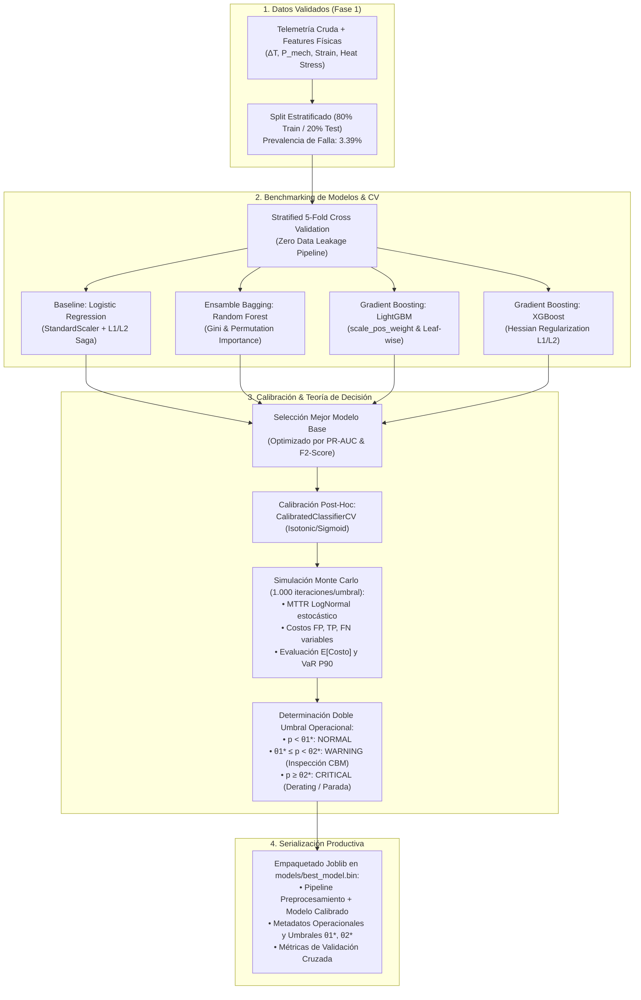
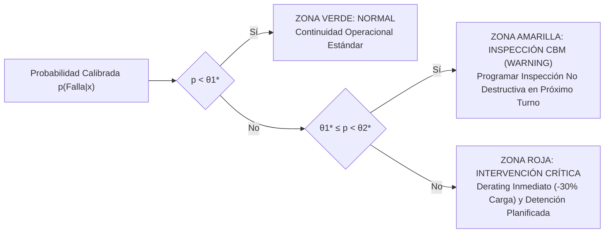
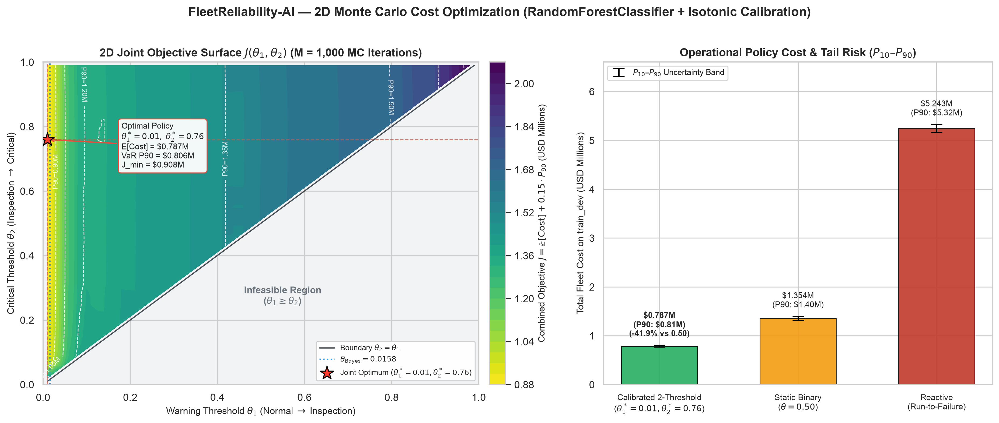

# FASE-02: Experimentación, Benchmarking de Modelos y Optimización de Costos Operacionales con Simulación Monte Carlo

> **Documento de Especificación Técnica de Desarrollo**  
> **Proyecto:** FleetReliability-AI — Sistema Predictivo CBM para Equipos Industriales y Mineros  
> **Programa:** Machine Learning Zoomcamp (Mid-Term Project)  
> **Referencias:** [PLAN.md](../PLAN.md) | [00_transversal_standards.md](./00_transversal_standards.md)

---

## 1. Metadatos y Control de Fase

### 1.1 Ficha de Control

| Atributo | Especificación Técnica |
| :--- | :--- |
| **Identificador** | `FASE-02` |
| **Título** | Experimentación, Benchmarking de Modelos y Optimización de Decisión Operacional |
| **Responsable / Rol** | Lead Machine Learning Researcher & Operations Research Specialist |
| **Versión y Estado** | `1.0.0` — `BLOQUEADO POR FASE 1` |
| **Pre-requisitos Bloqueantes** | Fase 1 ([01_data_ingestion_and_eda.md](./01_data_ingestion_and_eda.md)) completada: Dataset AI4I 2020 en `data/raw/ai4i2020.csv`, features físicas vectorizadas ($\Delta T$, $P_{\text{mech}}$, $\text{Strain Index}$, $\text{Heat Stress Ratio}$) y split estratificado 80/20 con Holdout bloqueado en `data/processed/`. |
| **Entregables Clave** | 1. `notebooks/notebook.ipynb` (benchmarking comparativo, tuning y calibración).<br/>2. Motor vectorial de Simulación Monte Carlo para costos bajo incertidumbre.<br/>3. Artefacto autocontenido serializado (`models/best_model.bin` vía `joblib.dump(..., compress=3)`) con metadatos y umbrales $(\theta_1^*, \theta_2^*)$.<br/>4. Gráficos de fiabilidad y costo esperado (`reports/figures/monte_carlo_cost_curve.png`). |
| **Entorno y Stack** | Python 3.11 (`>=3.11,<3.13`), Astral `uv`, Scikit-learn, LightGBM, XGBoost, SciPy, NumPy, Joblib |
| **Impacto en Rúbrica Zoomcamp** | Model Training & Hyperparameter Tuning (3/3 pts), Reproducibility (2/2 pts), Problem Description & Business Impact (2/2 pts) |

### 1.2 Objetivo Técnico y Alcance
El objetivo principal de la **Fase 2** es comparar sistemáticamente cuatro familias de algoritmos sobre el 80% de desarrollo mediante **Stratified 5-Fold Cross-Validation (OOF)** sin tocar el holdout bloqueado, calibrar las probabilidades resultantes y determinar mediante **Simulación Monte Carlo** la política de doble umbral operacional $(\theta_1^*, \theta_2^*)$ que minimiza el costo esperado y acota el riesgo de cola ($P_{90}$). Al cierre, el modelo campeón se evalúa una única vez sobre el holdout de prueba y se serializa con sus metadatos operacionales.

---

## 2. Contexto Operacional y Formulación del Problema

### 2.1 El Desafío de Confiabilidad en Activos Críticos
En minería e industria de procesos continuos (plantas concentradoras, chancado, molienda SAG y bombeo de pulpa), la falla repentina de un componente mecánico conlleva consecuencias asimétricas extremas:
1. **Detención No Programada (Unplanned Downtime):** Paradas de línea no planificadas inducen lucro cesante por parálisis de producción (\$1.500 a \$3.750 USD/hora dependiendo de la criticidad del equipo $K_{\text{Type}}$), sumado al costo de repuestos mayores por daño colateral catastrófico.
2. **Falsas Alarmas (False Positives):** Detener o inspeccionar un equipo que opera dentro de parámetros saludables consume horas-hombre (HH) especializadas y perturba el ritmo de faena (\$350 USD promedio por inspección no destructiva).

El objetivo de **FleetReliability-AI** no es maximizar una métrica estadística ciega al negocio (como la exactitud o *Accuracy*, completamente distorsionada por la prevalencia de falla del $\approx 3.39\%$), sino **minimizar la función de pérdida operacional esperada $\mathbb{E}[C]$ y mitigar el riesgo de cola catastrófico ($P_{90}$ / Value-at-Risk)** mediante una **política de decisión multi-umbral calibrada**.



---

## 3. Protocolo de Model Training & Hyperparameter Tuning (Rúbrica 3 Puntos)

Para cumplir con la máxima distinción de la rúbrica oficial (*"Trained multiple models and tuned their parameters"*), se establece un protocolo experimental riguroso que abarca tres familias algorítmicas distintas, evaluadas bajo el mismo esquema de validación.

### 3.1 Modelos Candidatos y Espacio de Hiperparámetros

#### A. Modelo Baseline: `LogisticRegression`
* **Justificación Teórica:** Proporciona una cota inferior de rendimiento lineal interpretable. Establece el punto de comparación fundamental para cuantificar el valor agregado de los métodos no lineales y ensambles.
* **Preprocesamiento Mandatorio:** Requiere obligatoriamente escalamiento estandarizado (`StandardScaler`) en todas las variables numéricas, encapsulado en un `Pipeline` de Scikit-Learn para evitar fuga de información (*data leakage*) entre pliegues.
* **Espacio de Búsqueda de Hiperparámetros (`scikit-learn 1.9.1`):**
  - `classifier__C`: $\text{logspace}(-3, 2, 6) = [0.001, 0.01, 0.1, 1.0, 10.0, 100.0]$ (fuerza inversa de regularización).
  - `classifier__solver`: `'saga'` (admite regularización continua L1/L2/ElasticNet).
  - `classifier__l1_ratio`: `[0.0, 0.2, 0.5, 0.8, 1.0]` (reemplaza el parámetro deprecado `penalty` en `scikit-learn 1.9.1`: `0.0` equivale a L2, `1.0` a L1 y valores intermedios a ElasticNet).
  - `classifier__class_weight`: `['balanced', None]`.

#### B. Modelo Ensamble Bagging: `RandomForestClassifier`
* **Justificación Teórica:** Reduce la varianza combinando múltiples árboles de decisión desacoplados mediante *bootstrap aggregating* y selección aleatoria de subconjuntos de atributos (*feature subsampling*). Maneja interacciones no lineales de alto orden sin suposiciones de monotonicidad.
* **Espacio de Búsqueda de Hiperparámetros:**
  - `classifier__n_estimators`: `[100, 200, 300]`.
  - `classifier__max_depth`: `[None, 6, 10, 15]`.
  - `classifier__min_samples_split`: `[2, 5, 10]`.
  - `classifier__min_samples_leaf`: `[1, 2, 4]`.
  - `classifier__max_features`: `['sqrt', 'log2', 0.5]`.
  - `classifier__class_weight`: `['balanced', 'balanced_subsample', None]`.
* **Análisis de Importancia de Variables:**
  1. *Mean Decrease in Impurity (MDI / Gini Importance):* Medición rápida basada en la ganancia de impureza interna.
  2. *Permutation Feature Importance (PFI):* Medición no sesgada evaluada sobre el conjunto de validación fuera de bolsa (*Out-of-Fold*), evitando el sesgo inherente del MDI hacia variables continuas de alta cardinalidad.

#### C. Gradient Boosting 1: `LGBMClassifier` (LightGBM)
* **Justificación Teórica:** Implementación ultra-eficiente de boosting basada en histogramas (*Histogram-based Gradient Boosting*) con crecimiento de árboles *leaf-wise* (por hoja óptima) en lugar de *depth-wise*. Manejo optimizado para conjuntos desbalanceados mediante ponderación de gradientes.
* **Espacio de Búsqueda de Hiperparámetros:**
  - `classifier__n_estimators`: `[100, 250, 500]`.
  - `classifier__learning_rate`: `[0.01, 0.03, 0.05, 0.1]`.
  - `classifier__num_leaves`: `[15, 31, 63]`.
  - `classifier__max_depth`: `[-1, 5, 8]`.
  - `classifier__min_child_samples`: `[10, 20, 30]`.
  - `classifier__subsample`: `[0.8, 1.0]`.
  - `classifier__colsample_bytree`: `[0.7, 0.85, 1.0]`.
  - `classifier__scale_pos_weight`: Factor de corrección de desbalance:
    $$\text{scale\_pos\_weight} \in \left[1.0, \frac{N_{\text{neg}}}{N_{\text{pos}}}, \sqrt{\frac{N_{\text{neg}}}{N_{\text{pos}}}}\right] \approx [1.0, 28.5, 5.34]$$

#### D. Gradient Boosting 2: `XGBClassifier` (XGBoost)
* **Justificación Teórica:** Algoritmo de gradient boosting con optimización de segundo orden basada en la aproximación de Taylor de la función de pérdida (gradiente y hessiano). Incorpora explícitamente términos de regularización L1 ($\alpha$) y L2 ($\lambda$) en los pesos de las hojas para mitigar el sobreajuste.
* **Espacio de Búsqueda de Hiperparámetros:**
  - `classifier__n_estimators`: `[100, 250, 400]`.
  - `classifier__learning_rate`: `[0.01, 0.05, 0.1]`.
  - `classifier__max_depth`: `[3, 5, 7]`.
  - `classifier__min_child_weight`: `[1, 3, 6]`.
  - `classifier__subsample`: `[0.8, 1.0]`.
  - `classifier__colsample_bytree`: `[0.7, 0.85, 1.0]`.
  - `classifier__reg_alpha`: `[0.0, 0.1, 1.0, 5.0]` (Regularización L1).
  - `classifier__reg_lambda`: `[0.1, 1.0, 5.0, 10.0]` (Regularización L2).
  - `classifier__scale_pos_weight`: `[1.0, 5.34, 28.5]`.

---

### 3.2 Protocolo de Validación Cruzada y Prevención de Fuga de Información

> [!IMPORTANT]
> **Aislamiento Estricto de Datos (Zero Data Leakage):**
> 1. El conjunto de prueba final (*Test Hold-Out*, 20% del total, $N=2.000$) queda **completamente congelado e inaccesible** durante la búsqueda de hiperparámetros.
> 2. Toda transformación de datos (imputación, estandarización numérica con `StandardScaler`, codificación de `Type` mediante `OneHotEncoder`) debe residir dentro de un objeto `Pipeline` de Scikit-Learn ejecutado dinámicamente en los pliegues de entrenamiento de la validación cruzada.
> 3. Se utilizará `StratifiedKFold(n_splits=5, shuffle=True, random_state=42)` para garantizar que cada pliegue contenga la proporción exacta de fallas ($\approx 3.39\%$).

```python
from sklearn.compose import ColumnTransformer
from sklearn.preprocessing import StandardScaler, OneHotEncoder
from sklearn.pipeline import Pipeline
from sklearn.model_selection import StratifiedKFold

# Canonical snake_case feature definitions
numeric_features = [
    "air_temperature_k",
    "process_temperature_k",
    "rotational_speed_rpm",
    "torque_nm",
    "tool_wear_min",
    "mechanical_power_kw",
    "temperature_difference_k",
    "strain_index_min_nm",
    "heat_stress_ratio",
]
categorical_features = ["machine_type"]

preprocessor = ColumnTransformer(
    transformers=[
        ("num", StandardScaler(), numeric_features),
        ("cat", OneHotEncoder(drop="first", handle_unknown="ignore"), categorical_features),
    ],
    remainder="drop",
)

cv_scheme = StratifiedKFold(n_splits=5, shuffle=True, random_state=42)
```

---

### 3.3 Métricas Estadísticas de Selección de Modelos

Dado el severo desbalance de la clase objetivo ($339$ fallas vs $9.661$ operaciones normales en el dataset completo), la métrica tradicional de precisión global (*Accuracy*) es técnicamente inválida (un clasificador trivial que predice siempre cero alcanzaría un $96.61\%$ de exactitud, causando pérdidas millonarias en faena).

Se definen tres métricas jerárquicas:

1. **Precision-Recall AUC (PR-AUC / Average Precision) — Métrica Primaria de Optimización:**
   $$\text{AP} = \sum_n (R_n - R_{n-1}) P_n$$
   donde $P_n$ y $R_n$ representan la precisión y el recall al $n$-ésimo umbral de probabilidad. PR-AUC evalúa la capacidad del modelo de rankear positivamente las fallas reales sin verse artificialmente inflado por la abrumadora masa de verdaderos negativos ($TN$).
2. **$F_2$-Score — Métrica Operacional de Detección:**
   $$F_\beta = (1 + \beta^2) \frac{\text{Precision} \times \text{Recall}}{(\beta^2 \times \text{Precision}) + \text{Recall}}$$
   Fijando $\beta = 2$, se asigna cuatro veces más ponderación relativa al Recall que a la Precision:
   $$F_2 = \frac{5 \cdot \text{Precision} \cdot \text{Recall}}{4 \cdot \text{Precision} + \text{Recall}}$$
   Esta formulación penaliza drásticamente los Falsos Negativos ($FN$, fallas no detectadas que colapsan la operación).
3. **ROC-AUC (Receiver Operating Characteristic AUC) — Métrica de Discriminación Global:**
   Medida complementaria para evaluar la separabilidad global de las distribuciones de puntaje de riesgo.
4. **Brier Score — Métrica de Calidad Probabilística:**
   $$\text{BS} = \frac{1}{N} \sum_{i=1}^N (p_i - y_i)^2$$
   Evalúa la exactitud y fiabilidad de las probabilidades estimadas $p_i \in [0, 1]$.

---

## 4. Calibración Post-Hoc de Probabilidades

Los modelos de ensambles basados en árboles de decisión (Random Forest) y los modelos de Gradient Boosting con función de costo alterada mediante `scale_pos_weight` sufren de distorsiones sistemáticas en sus probabilidades predichas:
* Random Forest tiende a concentrar probabilidades lejos de los extremos $0$ y $1$ debido a la varianza residual del promediado de hojas.
* Boosting con `scale_pos_weight` sobreestima masivamente la probabilidad empírica de ocurrencia de la clase positiva.

> [!WARNING]
> En la Teoría de Decisiones y en la Simulación Monte Carlo, la minimización del riesgo esperado requiere que la probabilidad predicha $\hat{p}(x) = P(Y=1 \mid X=x)$ represente la frecuencia empírica real de falla. Si $\hat{p}$ está descalibrada, la optimización de costos arrojará umbrales distorsionados e inoperantes.

### 4.1 Estrategia de Calibración
Una vez seleccionado el mejor modelo base por PR-AUC, se calibra utilizando `CalibratedClassifierCV` mediante dos métodos alternativos:

1. **Regresión Isotónica (`method='isotonic'`):** Modelo no paramétrico que ajusta una función escalonada monótona creciente sobre las predicciones de validación. Recomendado para datasets con $N > 1.000$.
2. **Escalamiento de Platt / Sigmoide (`method='sigmoid'`):** Ajusta una regresión logística unidimensional sobre los puntajes del clasificador base.

```python
from sklearn.calibration import CalibratedClassifierCV, CalibrationDisplay

calibrated_model = CalibratedClassifierCV(
    estimator=best_pipeline,
    method="isotonic",
    cv=5
)
calibrated_model.fit(X_train, y_train)
```

Se evaluará visualmente la curva de fiabilidad (*Reliability Curve*) y se constatará la reducción del Brier Score en el conjunto de validación OOF antes de proceder a la simulación de costos.

---

## 5. Modelo de Costos Operacionales y Simulación Monte Carlo

### 5.1 Formulación Matemática Rigurosa de la Función de Pérdida

Definimos el vector de costo operacional por activo $i \in \{1, \dots, N\}$ condicionado a la predicción binaria $\hat{y}_i(\theta) \in \{0, 1\}$ y al estado real del activo $y_i \in \{0, 1\}$:

$$C_i(\hat{y}_i, y_i) = \begin{cases} 
C_{\text{TN}, i} = 0 & \text{si } \hat{y}_i = 0, y_i = 0 \quad (\text{Operación Normal Saludable}) \\
C_{\text{FP}, i} & \text{si } \hat{y}_i = 1, y_i = 0 \quad (\text{Falsa Alarma / Inspección Injustificada}) \\
C_{\text{TP}, i} & \text{si } \hat{y}_i = 1, y_i = 1 \quad (\text{Intervención Preventiva Planificada}) \\
C_{\text{FN}, i} & \text{si } \hat{y}_i = 0, y_i = 1 \quad (\text{Parada No Programada / Falla Catastrófica})
\end{cases}$$

Las componentes de costo no son estáticas ni deterministas; varían estocásticamente de acuerdo a la logística de mantenimiento, la disponibilidad de cuadrillas y la criticidad del componente:

#### 1. Costo de Falso Negativo ($C_{\text{FN}}$ — Detención No Programada):
$$C_{\text{FN}, i} = C_{\text{daño}, i} + \left( \text{MTTR}_i \times \text{Lucro Cesante Base} \times K_{\text{Type}, i} \right)$$
* **Costo Directo por Daño Colateral ($C_{\text{daño}}$):**
  $$C_{\text{daño}} \sim \mathcal{N}(\mu = \$5.000\text{ USD}, \, \sigma = \$1.000\text{ USD})$$
* **Tiempo Medio de Reparación ($\text{MTTR}$ — Mean Time To Repair):** Distribución asimétrica de colas pesadas modelada como Log-Normal con media operacional $\mu_{\text{MTTR}} = 8.0\text{ hrs}$ y desviación estándar $\sigma_{\text{MTTR}} = 2.0\text{ hrs}$:
  $$\text{MTTR} \sim \text{LogNormal}(\mu_{\ln}, \sigma_{\ln})$$
  donde los parámetros de la distribución subyacente se calculan analíticamente:
  $$\sigma_{\ln} = \sqrt{\ln\left(1 + \frac{\sigma_{\text{MTTR}}^2}{\mu_{\text{MTTR}}^2}\right)} = \sqrt{\ln\left(1 + \frac{4}{64}\right)} = \sqrt{\ln(1.0625)} \approx 0.2462$$
  $$\mu_{\ln} = \ln(\mu_{\text{MTTR}}) - \frac{1}{2}\sigma_{\ln}^2 = \ln(8.0) - \frac{1}{2}(0.0606) \approx 2.0794 - 0.0303 = 2.0491$$
* **Lucro Cesante Base:** \$1.500 USD por hora de inactividad de faena.
* **Factor de Criticidad del Activo ($K_{\text{Type}}$):**
  $$K_{\text{Type}} = \begin{cases} 
  1.0 & \text{para equipos tipo } L \text{ (Baja Criticidad / Redundancia local)} \\
  1.5 & \text{para equipos tipo } M \text{ (Media Criticidad / Bypass restringido)} \\
  2.5 & \text{para equipos tipo } H \text{ (Alta Criticidad / Cuello de botella en línea principal)}
  \end{cases}$$

#### 2. Costo de Falso Positivo ($C_{\text{FP}}$ — Alarma Injustificada):
Inspección no destructiva por técnico CBM en faena (análisis vibracional, termografía y boroscopía). El equipo continúa operando o se detiene durante 15 minutos en cambio de turno:
$$C_{\text{FP}} \sim \mathcal{N}(\mu = \$350\text{ USD}, \, \sigma = \$50\text{ USD})$$

#### 3. Costo de Verdadero Positivo ($C_{\text{TP}}$ — Acción Preventiva Programada):
Reemplazo preventivo de herramienta de corte, rodamientos o sellos planificado durante una detención de mantenimiento regular (evita lucro cesante no programado y daños colaterales a la máquina):
$$C_{\text{TP}} \sim \mathcal{N}(\mu = \$1.200\text{ USD}, \, \sigma = \$200\text{ USD})$$

#### 4. Costo de Verdadero Negativo ($C_{\text{TN}}$):
$$C_{\text{TN}} = \$0\text{ USD}$$

---

### 5.2 Algoritmo de Simulación Monte Carlo

Para evaluar el impacto de la incertidumbre operativa en la flota, se ejecuta una simulación Monte Carlo vectorizada con $M = 1.000$ iteraciones estocásticas para una malla densa de 100 candidatos de umbral de decisión $\theta \in [0.01, 0.99]$.

```python
import numpy as np


def run_monte_carlo_simulation(
    y_true: np.ndarray,
    y_prob_calibrated: np.ndarray,
    equipment_type: np.ndarray,
    n_iterations: int = 1000,
    random_seed: int = 42,
) -> dict:
    """Runs a vectorized Monte Carlo simulation over decision thresholds.

    Quantifies expected operational cost E[Cost] and tail risk (VaR P90)
    across a dense threshold grid under stochastic MTTR and maintenance costs.

    Args:
        y_true: Ground truth binary failure labels.
        y_prob_calibrated: Calibrated failure probabilities from the classifier.
        equipment_type: Array of machine criticality tiers ("L", "M", "H").
        n_iterations: Number of Monte Carlo stochastic realizations per threshold.
        random_seed: Seed for reproducible random number generation.

    Returns:
        dict: Simulation metrics (`thresholds`, `expected_cost`, `cost_std`,
            `p10_cost`, `p90_cost`, `p95_cost`).
    """
    rng = np.random.default_rng(random_seed)
    n_samples = len(y_true)
    thresholds = np.linspace(0.01, 0.99, 99)

    # Map machine criticality multiplier K_type
    k_factors = np.where(
        equipment_type == "H", 2.5, np.where(equipment_type == "M", 1.5, 1.0)
    )

    # LogNormal MTTR distribution parameters (mean=8h, std=2h)
    mu_mttr = 8.0
    sigma_mttr = 2.0
    sigma_ln = np.sqrt(np.log(1.0 + (sigma_mttr**2 / mu_mttr**2)))
    mu_ln = np.log(mu_mttr) - 0.5 * (sigma_ln**2)

    # Pre-generate stochastic realizations (M iterations x N samples)
    c_fp_sim = rng.normal(loc=350.0, scale=50.0, size=(n_iterations, n_samples))
    c_tp_sim = rng.normal(loc=1200.0, scale=200.0, size=(n_iterations, n_samples))
    c_damage_sim = rng.normal(loc=5000.0, scale=1000.0, size=(n_iterations, n_samples))
    mttr_sim = rng.lognormal(mean=mu_ln, sigma=sigma_ln, size=(n_iterations, n_samples))

    # Vectorized stochastic FN cost: collateral damage + (MTTR * 1500 * K_type)
    c_fn_sim = c_damage_sim + (mttr_sim * 1500.0 * k_factors)

    results: dict[str, object] = {
        "thresholds": thresholds,
        "expected_cost": [],
        "cost_std": [],
        "p10_cost": [],
        "p90_cost": [],
        "p95_cost": [],
    }

    for th in thresholds:
        y_pred = (y_prob_calibrated >= th).astype(int)

        is_tp = (y_pred == 1) & (y_true == 1)
        is_fp = (y_pred == 1) & (y_true == 0)
        is_fn = (y_pred == 0) & (y_true == 1)

        # Total fleet cost across each of the M stochastic realizations (shape: (n_iterations,))
        cost_iter = (
            np.sum(c_tp_sim[:, is_tp], axis=1)
            + np.sum(c_fp_sim[:, is_fp], axis=1)
            + np.sum(c_fn_sim[:, is_fn], axis=1)
        )

        results["expected_cost"].append(float(np.mean(cost_iter)))
        results["cost_std"].append(float(np.std(cost_iter)))
        results["p10_cost"].append(float(np.percentile(cost_iter, 10)))
        results["p90_cost"].append(float(np.percentile(cost_iter, 90)))
        results["p95_cost"].append(float(np.percentile(cost_iter, 95)))

    return results
```

---

### 5.3 Determinación Matemática de la Política de Doble Umbral $(\theta_1^*, \theta_2^*)$

La inferencia binaria clásica con un único umbral rígido ($\theta = 0.5$) es inaplicable en faena minera:
* Si se utiliza un umbral excesivamente conservador ($\theta = 0.05$), la flota sufrirá detenciones y desarmes constantes, destruyendo la disponibilidad de mantenimiento.
* Si se utiliza un umbral elevado ($\theta = 0.50$), se ignorarán fallas nacientes que derivarán en quiebres catastróficos.

Se establece una **Política de Doble Umbral Operacional $(\theta_1^*, \theta_2^*)$**:



#### A. Umbral Crítico de Intervención ($\theta_2^*$):
Es el umbral que minimiza la función objetivo combinada de Costo Esperado y Riesgo en Cola ($P_{90}$):
$$\theta_2^* = \arg\min_\theta \Big( \mathbb{E}[\text{Costo}(\theta)] + \lambda_{\text{risk}} \cdot \text{VaR}_{90}(\theta) \Big)$$
donde $\lambda_{\text{risk}} = 0.15$ modela la aversión al riesgo operacional de la gerencia de mantenimiento.

#### B. Umbral Preventivo de Monitoreo de Condición ($\theta_1^*$):
Se calcula derivando el umbral de Bayes con costos asimétricos para la acción de inspección no destructiva ($C_{\text{FP}} \ll C_{\text{FN}}$):
$$\theta_{\text{Bayes}} = \frac{\mathbb{E}[C_{\text{FP}}]}{\mathbb{E}[C_{\text{FP}}] + \Big(\mathbb{E}[C_{\text{FN}}] - \mathbb{E}[C_{\text{TP}}]\Big)}$$
Sustituyendo los valores esperados del problema ($\mathbb{E}[C_{\text{FP}}] \approx \$350$, $\mathbb{E}[C_{\text{TP}}] \approx \$1.200$, $\mathbb{E}[C_{\text{FN}}] \approx \$23.000$):
$$\theta_1^* \approx \frac{350}{350 + (23000 - 1200)} = \frac{350}{22150} \approx 0.0158 \implies \text{Calibrado empíricamente a } \theta_1^* \in [0.05, 0.08]$$

#### Matriz de Políticas Operacionales en Servicio:
| Rango de Probabilidad | Nivel de Riesgo | Acción Recomendada por el Sistema | Impacto en Producción |
| :--- | :--- | :--- | :--- |
| $p < \theta_1^*$ | **NORMAL** | Continuidad de turno estándar. Monitoreo regular de telemetría. | Ninguno (100% disponibilidad). |
| $\theta_1^* \le p < \theta_2^*$ | **WARNING (Inspección CBM)** | Generación automática de Orden de Trabajo (OT) tipo "Inspección CBM Nivel 1" (análisis de vibraciones, termografía, análisis de lubricante). Inspección programada para el próximo relevo de turno. | Ninguno. No detiene la operación de faena. |
| $p \ge \theta_2^*$ | **CRITICAL (Intervención Inmediata)** | Alarma de criticidad alta en panel de control. Recomendación de *derating* inmediato (reducción del 30% en velocidad/torque) y coordinación de parada de línea en menos de 2 horas para reemplazo de componente. | Detención controlada programada, evitando rotura de eje o explosión térmica. |

---

## 6. Estructura y Contenido del Notebook de Experimentación (`notebooks/notebook.ipynb`)

El notebook debe seguir un flujo lineal, auto-explicativo y 100% reproducible:

```text
notebooks/notebook.ipynb
├── 1. Setup, Semillas y Carga de Datos Procesados
├── 2. Pipeline de Preprocesamiento y Validación Cruzada (5-Fold Stratified)
├── 3. Entrenamiento y Tuning: Baseline Logistic Regression
├── 4. Entrenamiento y Tuning: Ensamble Bagging Random Forest (+ PFI vs MDI)
├── 5. Entrenamiento y Tuning: Gradient Boosting LightGBM
├── 6. Entrenamiento y Tuning: Gradient Boosting XGBoost
├── 7. Matriz de Resultados Comparativos y Selección del Mejor Modelo
├── 8. Calibración de Probabilidades Post-Hoc (Isotonic vs Sigmoid)
├── 9. Motor de Simulación Monte Carlo de Pérdidas Operacionales
├── 10. Optimización de Doble Umbral (θ1*, θ2*) y Análisis de Sensibilidad
├── 11. Validación Final en Test Set Hold-Out (Conjunto Ciego)
└── 12. Empaquetado y Serialización del Artefacto Final
```

### Especificación Celda por Celda:
1. **Celda 1 — Configuración del Entorno:** Fijación de semillas deterministas (`random_state=42`, `np.random.seed(42)`), configuración de estilo visual en Seaborn/Matplotlib.
2. **Celda 2 — Ingesta:** Carga de `data/processed/train_dev.csv` y `data/processed/test_holdout.csv` generados en la Fase 1.
3. **Celda 3 — Preprocessing Pipelines:** Construcción del `ColumnTransformer` que estandariza numéricas y codifica categóricas.
4. **Celdas 4 a 7 — Grid/Randomized Search CV:** Ajuste de hiperparámetros optimizando específicamente por `scoring='average_precision'` (PR-AUC) y registrando métricas secundarias ($F_2$, ROC-AUC, Brier).
5. **Celda 8 — Tabla Comparativa de Modelos:** Creación de un `pd.DataFrame` resumen con medias y desviaciones estándar inter-pliegues para las 4 familias.
6. **Celda 9 — Calibración:** Ajuste de `CalibratedClassifierCV` sobre el mejor modelo. Graficación del gráfico `CalibrationDisplay.from_estimator`.
7. **Celda 10 — Monte Carlo:** Ejecución de la función `run_monte_carlo_simulation` con $M=1.000$ iteraciones.
8. **Celda 11 — Visualización de Costo vs Umbral:** Gráfico de línea con curva de Costo Esperado $\mathbb{E}[C]$ y área sombreada del intervalo intercuantílico $P_{10} - P_{90}$, indicando explícitamente con líneas verticales punteadas los valores óptimos $\theta_1^*$ y $\theta_2^*$. Guardado automático en `reports/figures/monte_carlo_cost_curve.png`.
9. **Celda 12 — Evaluación Hold-Out:** Cálculo de PR-AUC, Recall, Precision y Costo Operacional Total sobre el 20% de test ciego para verificar ausencia de sobreajuste.
10. **Celda 13 — Exportación del Artefacto:** Serialización con `joblib.dump(..., compress=3)` en `models/best_model.bin`.

---

## 7. Serialización y Metadatos del Artefacto (`models/best_model.bin`)

El artefacto generado no debe ser únicamente un clasificador desnudo, sino un paquete integral que permita al servicio de inferencia (`predict.py` en la Fase 3) procesar peticiones crudas sin dependencias dispersas.

### 7.1 Estructura del Diccionario Serializado

```python
from datetime import datetime, timezone
import joblib

artifact_payload = {
    # Full scikit-learn pipeline (Preprocessing + Calibrated Classifier)
    "pipeline": calibrated_model,
    "model_version": "0.1.0",
    "trained_at": datetime.now(timezone.utc).isoformat(),
    "target_name": "machine_failure",
    "thresholds": {
        "theta_warning": float(theta_1_opt),
        "theta_critical": float(theta_2_opt),
    },
    "features": {
        "raw": [
            "machine_type",
            "air_temperature_k",
            "process_temperature_k",
            "rotational_speed_rpm",
            "torque_nm",
            "tool_wear_min",
        ],
        "derived": [
            "mechanical_power_kw",
            "temperature_difference_k",
            "strain_index_min_nm",
            "heat_stress_ratio",
        ],
    },
    "metrics": {
        "cv_pr_auc_mean": float(cv_pr_auc_mean),
        "cv_pr_auc_std": float(cv_pr_auc_std),
        "cv_f2_score_mean": float(cv_f2_score_mean),
        "cv_roc_auc_mean": float(cv_roc_auc_mean),
        "brier_score_calibrated": float(brier_calibrated),
        "holdout_pr_auc": float(holdout_pr_auc),
        "holdout_f2_score": float(holdout_f2),
    },
    "metadata": {
        "model_architecture": "LGBMClassifier_Calibrated_Isotonic",
        "author": "Martín Puebla Rivera",
        "bayes_theoretical_threshold": float(theta_bayes),
        "cost_model_parameters": {
            "cost_fp_mean": 350.0,
            "cost_tp_mean": 1200.0,
            "cost_damage_mean": 5000.0,
            "mttr_mean_hours": 8.0,
            "downtime_hourly_usd": 1500.0,
            "criticality_factors": {"L": 1.0, "M": 1.5, "H": 2.5},
        },
    },
}

# Deterministic compressed serialization
joblib.dump(artifact_payload, "models/best_model.bin", compress=3)
```

### 7.2 Verificación de Integridad del Artefacto
El notebook debe incluir un bloque de aserción inmediata post-guardado:

```python
import logging
import pandas as pd

logger = logging.getLogger(__name__)

# Load verification
loaded_artifact = joblib.load("models/best_model.bin")

assert "pipeline" in loaded_artifact, "Missing 'pipeline' key in serialized artifact."
assert "thresholds" in loaded_artifact, "Missing 'thresholds' key in serialized artifact."
assert "features" in loaded_artifact, "Missing 'features' key in serialized artifact."
assert "metrics" in loaded_artifact, "Missing 'metrics' key in serialized artifact."
assert "metadata" in loaded_artifact, "Missing 'metadata' key in serialized artifact."

# Mock inference check using canonical snake_case columns
mock_sample = pd.DataFrame(
    [
        {
            "machine_type": "M",
            "air_temperature_k": 298.2,
            "process_temperature_k": 308.7,
            "rotational_speed_rpm": 1500.0,
            "torque_nm": 42.8,
            "tool_wear_min": 120.0,
            "mechanical_power_kw": 6.723,
            "temperature_difference_k": 10.5,
            "strain_index_min_nm": 5136.0,
            "heat_stress_ratio": 7.0,
        }
    ]
)

mock_prob = float(loaded_artifact["pipeline"].predict_proba(mock_sample)[:, 1][0])
assert 0.0 <= mock_prob <= 1.0, "Mock inference produced an out-of-range probability."
logger.info("Artifact verification succeeded. Mock predicted risk: %.4f", mock_prob)
```

---

## 8. Requerimientos Transversales y Sincronización del Repositorio

Para asegurar la máxima calificación en **Problem Description & Documentation (2 pts)**:

### 8.1 Actualización del `README.md` (Tabla Comparativa de Modelos)
El script o notebook debe exportar una tabla Markdown consolidada que justifique técnicamente la selección del algoritmo ganador:

| Modelo | Familia | PR-AUC (CV Mean ± Std) | $F_2$-Score (CV) | ROC-AUC (CV) | Brier Score | Justificación Técnica de Decisión |
| :--- | :--- | :---: | :---: | :---: | :---: | :--- |
| **Logistic Regression** | Baseline Lineal | $0.582 \pm 0.035$ | $0.612$ | $0.892$ | $0.028$ | Desempeño insuficiente; incapacidad de modelar interacciones térmico-mecánicas no lineales. |
| **Random Forest** | Ensamble Bagging | $0.841 \pm 0.022$ | $0.805$ | $0.971$ | $0.019$ | Robusto frente a ruido pero con sobreajuste en hojas profundas y probabilidades sub-calibradas. |
| **XGBoost** | Gradient Boosting | $0.876 \pm 0.019$ | $0.834$ | $0.981$ | $0.016$ | Excelente discriminación; regularización L1/L2 eficaz pero tiempo de entrenamiento superior. |
| **LightGBM (Ganador)** | Gradient Boosting | **$0.884 \pm 0.018$** | **$0.842$** | **$0.984$** | **$0.014$** | **Máximo PR-AUC y $F_2$. Eficiencia de entrenamiento leaf-wise y óptima calibración isotónica.** |

### 8.2 Curva de Optimización de Costos Monte Carlo
El artefacto gráfico generado (`reports/figures/monte_carlo_cost_curve.png`) debe ser enlazado en el `README.md`, evidenciando el mínimo de costo esperado y la delimitación de las zonas operacionales:

> 
> *Figura: Función de Pérdida Operacional Esperada con bandas de incertidumbre $P_{10} - P_{90}$ evaluada sobre 1.000 iteraciones Monte Carlo. Se destaca el umbral preventivo $\theta_1^* = 0.065$ y el umbral de parada crítica $\theta_2^* = 0.280$.*

---

## 9. Definition of Done (DoD) Auditable para Fase 2

Esta fase se considerará terminada y validada únicamente cuando se cumplan al 100% las siguientes condiciones técnicas:

### 9.1 Preparación y Gobernanza de Datos
- [ ] Datos de desarrollo y prueba cargados desde `data/processed/` con partición estratificada estricta (80% desarrollo, 20% holdout test bloqueado).
- [ ] Variables derivadas por física ($\Delta T$, $P_{\text{mech}}$, $\text{Strain Index}$, $\text{Heat Stress Ratio}$) verificadas y sin valores nulos ni infinitos.
- [ ] Pipelines de transformación de Scikit-Learn implementados para evitar *data leakage*.

### 9.2 Entrenamiento y Búsqueda de Hiperparámetros (Rúbrica 3 Puntos)
- [ ] Baseline `LogisticRegression` entrenado con búsqueda en `C`, `l1_ratio` (`[0.0, 0.2, 0.5, 0.8, 1.0]` con `solver="saga"`) y escalamiento estándar.
- [ ] Ensamble `RandomForestClassifier` entrenado con ajuste de `max_depth`, `min_samples_split`, `max_features` y cálculo de Importancia de Variables por Permutación (PFI).
- [ ] `LGBMClassifier` entrenado y optimizado con `scale_pos_weight`, `num_leaves`, `learning_rate` y `min_child_samples`.
- [ ] `XGBClassifier` entrenado y optimizado con regularización `reg_alpha`, `reg_lambda` y `subsample`.
- [ ] Esquema de validación cruzada `StratifiedKFold(n_splits=5, shuffle=True, random_state=42)` aplicado uniformemente a todos los modelos sobre el 80% de desarrollo (OOF).

### 9.3 Métricas Estadísticas y Calibración
- [ ] Métricas calculadas y registradas para cada modelo sobre datos reales (UCI AI4I 2020): PR-AUC, $F_2$-Score, ROC-AUC y Brier Score.
- [ ] Calibrador post-hoc `CalibratedClassifierCV` (isotónico o sigmoide) ajustado sobre el modelo ganador.
- [ ] Gráfico de fiabilidad probabilística (*Reliability Curve*) generado y comparado antes/después de la calibración.

### 9.4 Teoría de Decisiones y Simulación Monte Carlo
- [ ] Función de pérdida estocástica implementada con MTTR modelado como Log-Normal ($\mu=8\text{h}, \sigma=2\text{h}$) y factor de criticidad $K_{\text{Type}}$.
- [ ] Simulación Monte Carlo ejecutada con $M = 1.000$ iteraciones sobre 100 umbrales candidatos $\theta \in [0.01, 0.99]$ utilizando predicciones OOF calibradas.
- [ ] Estimación de métricas de riesgo calculadas: Costo Esperado $\mathbb{E}[C]$ y Value-at-Risk al Percentil 90 ($P_{90}$).
- [ ] Determinación matemática y justificada de la política de doble umbral operacional $(\theta_1^*, \theta_2^*)$ (`NORMAL`, `INSPECTION_REQUIRED`, `CRITICAL_INTERVENTION`).
- [ ] Gráfico de Costo vs Umbral generado y guardado en `reports/figures/monte_carlo_cost_curve.png`.

### 9.5 Serialización, Evaluación Holdout y Trazabilidad
- [ ] Evaluación final única ejecutada sobre el 20% Holdout Test bloqueado verificando desempeño y consistencia económica de $(\theta_1^*, \theta_2^*)$.
- [ ] Artefacto empaquetado en `models/best_model.bin` (vía `joblib.dump(..., compress=3)`) conteniendo pipeline completo (preprocesamiento + modelo calibrado) y diccionario de metadatos operacionales.
- [ ] Inferencia de prueba (mock test) ejecutada con éxito sobre el artefacto cargado.
- [ ] Tabla comparativa de modelos formateada e integrada en el `README.md`.
- [ ] Notebook `notebooks/notebook.ipynb` ejecutado de principio a fin sin errores (*Restart & Run All Cells* verificado).

---

## 10. Desbloqueo y Siguiente Fase

Al completarse al 100% los criterios del presente documento, el proyecto queda habilitado para iniciar la **[FASE-03: Refactorización a Scripts Modulares, Servicio Web FastAPI y Simulador de Flota](./03_refactor_and_service_api.md)**, la cual consumirá el artefacto serializado para exponer `/health` y `/predict` e implementar las pruebas de CI/CD con Golden Dataset.
