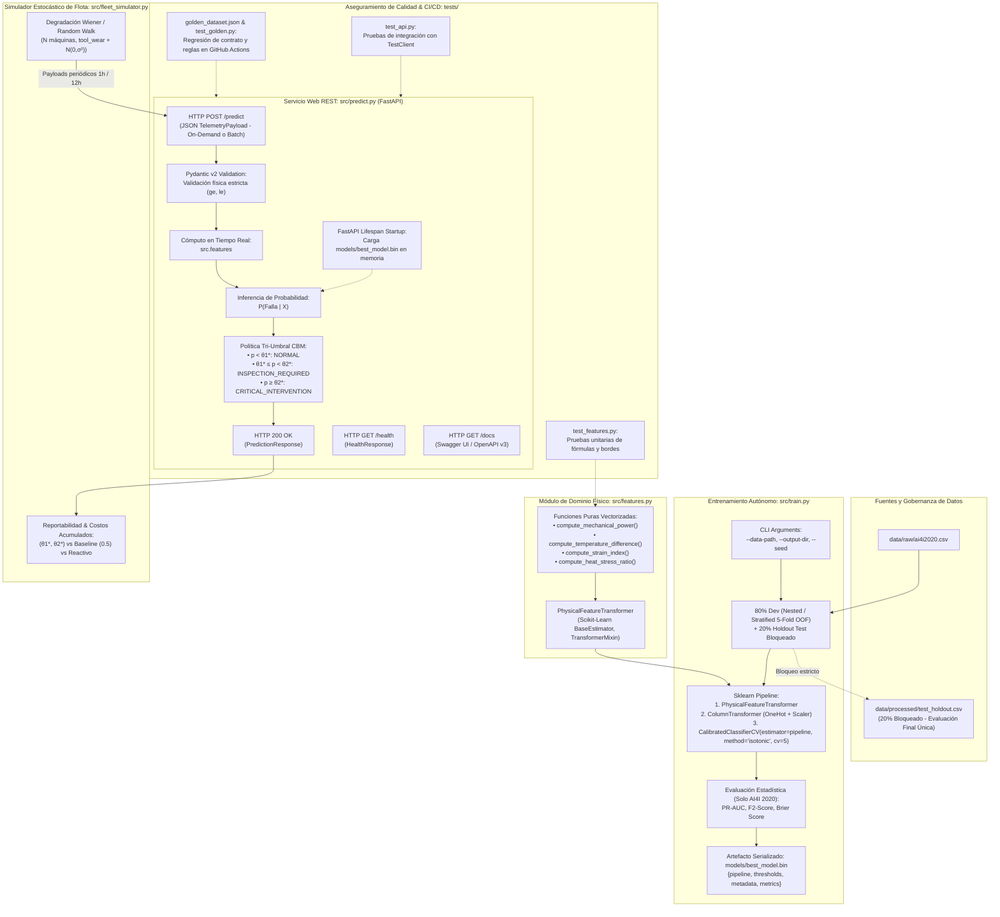

# FASE-03: Refactorización Modular, Entrenamiento Autónomo, API REST (FastAPI) y Simulador de Flota

> **Documento de Especificación Técnica de Desarrollo**  
> **Proyecto:** FleetReliability-AI — Sistema Predictivo CBM para Equipos Industriales y Mineros  
> **Programa:** Machine Learning Zoomcamp (Mid-Term Project)  
> **Referencias:** [PLAN.md](../PLAN.md) | [00_transversal_standards.md](./00_transversal_standards.md)

---

## 1. Metadatos y Control de Fase

### 1.1 Ficha de Control

| Atributo | Especificación Técnica |
| :--- | :--- |
| **Identificador** | `FASE-03` |
| **Título** | Refactorización Modular a Código de Producción, API REST (FastAPI) y Simulador de Flota |
| **Responsable / Rol** | Senior MLOps Engineer & Python Backend Architect |
| **Versión y Estado** | `1.0.0` — `BLOQUEADO POR FASE 2` |
| **Pre-requisitos Bloqueantes** | Fase 2 ([02_experimentation_and_benchmarks.md](./02_experimentation_and_benchmarks.md)) completada: Modelo campeón seleccionado mediante Nested CV / Stratified 5-Fold (OOF) sobre el 80% de desarrollo con el `test` set (20%) estrictamente bloqueado en `data/processed/`, calibración validada y umbrales $(\theta_1^*, \theta_2^*)$ determinados vía simulación Monte Carlo. |
| **Entregables Clave** | 1. `src/features.py` (funciones puras vectorizadas y transformador scikit-learn).<br/>2. `src/train.py` (script CLI reproducible respetando holdout bloqueado).<br/>3. `src/predict.py` (servicio web REST en FastAPI con Pydantic v2 y política tri-umbral).<br/>4. `src/fleet_simulator.py` (simulador estocástico de flota Wiener/Random Walk y comparativa de costos).<br/>5. `tests/test_features.py`, `tests/test_api.py`, `tests/golden_dataset.json`, `tests/test_golden.py` y `tests/test_simulator.py`. |
| **Entorno y Stack** | Python 3.11 (`>=3.11,<3.13`), Astral `uv`, FastAPI, Uvicorn, Pydantic v2, Scikit-learn (`1.9.1`), LightGBM (`4.7.0`), XGBoost (`3.2.0`), Joblib, Pytest, HTTPX (solo dev/tests) |
| **Impacto en Rúbrica Zoomcamp** | Exporting Notebook to Script (1/1 pt), Model Deployment (2/2 pts), Reproducibility (1/1 pt), Code Quality & Testing (Golden Dataset CI/CD) |

### 1.2 Objetivo Técnico y Alcance
El objetivo principal de la **Fase 3** es desacoplar y transformar la lógica experimental desarrollada en los notebooks de exploración a una arquitectura de software modular, mantenible y robusta para producción. Esta fase establece la capa operativa del sistema predictivo:
1. Aislar las funciones de física de dominio en un módulo determinista y testeable (`src/features.py`).
2. Automatizar el re-entrenamiento del modelo a través de un script de línea de comandos (`src/train.py`) respetando estrictamente la gobernanza del holdout (20% bloqueado en `data/processed/`) y generando el artefacto autosuficiente serializado con metadatos operacionales.
3. Exponer un servicio web de inferencia de baja latencia mediante FastAPI (`src/predict.py`), implementando validación estricta de rangos de operación física con Pydantic v2 y traduciendo las probabilidades calibradas a decisiones operacionales de mantenimiento basado en condición (CBM).
4. Implementar un simulador estocástico de flota (`src/fleet_simulator.py`) para demostrar la operación periódica por turnos, la reportabilidad operacional y la comparación de costos acumulados sin depender de un SCADA real.
5. Proveer una suite de pruebas automatizadas con Pytest —incluyendo un **Golden Dataset** en `tests/` para CI/CD— que garantice cero regresiones antes del empaquetado y contenedorización (Fase 4).

### 1.3 Paradigmas de Operación e Inferencia Soportados
La arquitectura implementada en esta fase soporta explícitamente **dos modos de operación industrial**, sin requerir un flujo streaming continuo permanente:
1. **Monitoreo por Turnos / Batch (Reportabilidad Periódica):**
   - Consolidación periódica de telemetría (cada **1 hora** o al cierre de **turno de 12 horas**) ejecutada por lotes o vía el simulador de flota, generando el semáforo de mantenimiento para planificación:
     * `NORMAL` ($p < \theta_1^*$): Operación continua dentro de tolerancias nominales.
     * `INSPECTION_REQUIRED` ($\theta_1^* \le p < \theta_2^*$): Emisión de Orden de Trabajo (OT) preventiva no destructiva (termografía/vibraciones) en el cambio de turno.
     * `CRITICAL_INTERVENTION` ($p \ge \theta_2^*$): *Derating* de carga y coordinación de parada programada.
2. **Inferencia Bajo Demanda (On-Demand API):**
   - Consulta puntual síncrona vía FastAPI `POST /predict` ingresando la telemetría instantánea de una máquina específica para obtener su riesgo calibrado, variables físicas derivadas y acción CBM recomendada.

---

## 2. Arquitectura de Componentes y Flujo de Datos



### 2.1 Principios de Diseño
- **Single Responsibility Principle (SRP):** `features.py` solo conoce física y transformaciones matemáticas; `train.py` orquesta la construcción y serialización del modelo; `predict.py` gestiona la capa de transporte HTTP y la inferencia.
- **Pure Functions & Determinismo:** Las transformaciones físicas son funciones puras sin efectos secundarios, facilitando pruebas unitarias exhaustivas con entradas deterministas.
- **Fail-Fast con Pydantic v2:** Los valores anómalos o físicamente imposibles de los sensores son rechazados en el perímetro de la API (HTTP 422) antes de consumir ciclos de cómputo en el modelo.
- **Empaquetado Hermético del Artefacto:** El artefacto serializado `best_model.bin` debe contener todo lo necesario para inferir: pipeline de scikit-learn, transformadores ajustados, umbrales operacionales seleccionados y metadatos de versión.

---

## 3. Especificación del Módulo de Características Físicas (`src/features.py`)

### 3.1 Fundamento Físico de las Ecuaciones
El dataset *AI4I 2020 Predictive Maintenance* contiene mediciones de sensores industriales estándar. A partir de la física de fallas en componentes mecánicos rotatorios (bombas, chancadores, molinos SAG), se formulan 4 variables compuestas:

1. **Potencia Mecánica de Operación ($P_{\text{mech}}$):**
   Representa la potencia disipada en el eje de rotación a partir del torque aplicado y la velocidad angular. Captura el modo de falla por caída/sobrecarga de potencia (*Power Failure - PWF*):
   $$P_{\text{mech}} = \text{Torque} \times \text{Rotational Speed} \times \frac{2\pi}{60 \times 1000} \quad [\text{kW}]$$
   *Constante de conversión:* $\frac{2\pi}{60 \times 1000} \approx 0.000104719755$

2. **Diferencial de Temperatura ($\Delta T$):**
   Gradiente térmico entre la temperatura del proceso y la temperatura ambiental. Modela la disipación térmica y el modo de falla por disipación de calor deficiente (*Heat Dissipation Failure - HDF*):
   $$\Delta T = T_{\text{process}} - T_{\text{air}} \quad [\text{K}]$$

3. **Índice de Esfuerzo Mecánico Acumulado ($\text{Strain Index}$):**
   Producto entre el desgaste acumulado de la herramienta y el torque aplicado en el ciclo. Detecta la fatiga mecánica extrema y el modo de falla por sobre-esfuerzo (*Overstrain Failure - OSF*):
   $$\text{Strain Index} = \text{Tool Wear} \times \text{Torque} \quad [\text{min}\cdot\text{Nm}]$$

4. **Razón de Estrés Térmico Específico ($\text{Heat Stress Ratio}$):**
   Evalúa la concentración de calor relativa a la velocidad de rotación. Una máquina a baja velocidad con alto $\Delta T$ denota atascamiento o fricción anómala:
   $$\text{Heat Stress Ratio} = \frac{\Delta T}{\max(\text{Rotational Speed}, \epsilon)} \times 1000$$
   *Control de borde:* $\epsilon = 1e-6$ para prevenir indeterminación matemática por división por cero.

### 3.2 Interfaz de Programación (API de Funciones)

El archivo `src/features.py` debe mantener el contrato unificado definido en la Fase 1, implementando funciones puras con tipado estricto (PEP 484 / PEP 585) y docstrings en formato Google Style:

```python
"""Domain-Informed Physical Feature Engineering Module for FleetReliability-AI.

Provides column normalization, pure vectorized physics functions, a scikit-learn
compatible transformer, and a leakage-free stratified split helper.
"""

from typing import Union

import numpy as np
import pandas as pd
from sklearn.base import BaseEstimator, TransformerMixin
from sklearn.model_selection import train_test_split

# Physical constants
POWER_CONVERSION_FACTOR: float = (2.0 * np.pi) / (60.0 * 1000.0)
EPSILON: float = 1e-6

# Canonical raw column mapping from UCI AI4I 2020 headers to snake_case
RAW_COLUMN_MAPPING: dict[str, str] = {
    "Type": "machine_type",
    "Air temperature [K]": "air_temperature_k",
    "Process temperature [K]": "process_temperature_k",
    "Rotational speed [rpm]": "rotational_speed_rpm",
    "Torque [Nm]": "torque_nm",
    "Tool wear [min]": "tool_wear_min",
    "Machine failure": "machine_failure",
}

RAW_FEATURE_COLUMNS: list[str] = [
    "machine_type",
    "air_temperature_k",
    "process_temperature_k",
    "rotational_speed_rpm",
    "torque_nm",
    "tool_wear_min",
]

PHYSICAL_FEATURE_COLUMNS: list[str] = [
    "mechanical_power_kw",
    "temperature_difference_k",
    "strain_index_min_nm",
    "heat_stress_ratio",
]

TARGET_COLUMN: str = "machine_failure"
FAILURE_MODES: list[str] = ["TWF", "HDF", "PWF", "OSF", "RNF"]
EXCLUDE_COLUMNS: list[str] = ["UDI", "Product ID"] + FAILURE_MODES


def normalize_raw_dataframe(df: pd.DataFrame) -> pd.DataFrame:
    """Normalizes raw UCI AI4I 2020 column headers to canonical snake_case names.

    Args:
        df: Raw or partially normalized telemetry DataFrame.

    Returns:
        pd.DataFrame: Copy of `df` with standardized column names.
    """
    df_norm = df.copy()
    df_norm.columns = [col.strip().lstrip("\ufeff") for col in df_norm.columns]
    return df_norm.rename(columns=RAW_COLUMN_MAPPING)


def compute_mechanical_power(
    torque_nm: Union[float, np.ndarray, pd.Series],
    rotational_speed_rpm: Union[float, np.ndarray, pd.Series],
) -> Union[float, np.ndarray, pd.Series]:
    """Computes mechanical shaft power in kilowatts (kW).

    Formula: P = Torque (Nm) * Speed (RPM) * (2 * pi / 60000)

    Args:
        torque_nm: Applied shaft torque in Newton-meters.
        rotational_speed_rpm: Rotational speed in revolutions per minute.

    Returns:
        Mechanical power in kilowatts (kW).
    """
    return torque_nm * rotational_speed_rpm * POWER_CONVERSION_FACTOR


def compute_temperature_difference(
    process_temperature_k: Union[float, np.ndarray, pd.Series],
    air_temperature_k: Union[float, np.ndarray, pd.Series],
) -> Union[float, np.ndarray, pd.Series]:
    """Computes thermal gradient between process and ambient air in Kelvin (K).

    Formula: Delta_T = Process_Temperature - Air_Temperature

    Args:
        process_temperature_k: Process temperature in Kelvin.
        air_temperature_k: Ambient air temperature in Kelvin.

    Returns:
        Temperature difference in Kelvin (K).
    """
    return process_temperature_k - air_temperature_k


def compute_strain_index(
    tool_wear_min: Union[float, np.ndarray, pd.Series],
    torque_nm: Union[float, np.ndarray, pd.Series],
) -> Union[float, np.ndarray, pd.Series]:
    """Computes cumulative mechanical strain index in min*Nm.

    Formula: Strain_Index = Tool_Wear * Torque

    Args:
        tool_wear_min: Cumulative tool wear in minutes.
        torque_nm: Applied shaft torque in Newton-meters.

    Returns:
        Cumulative strain index in min*Nm.
    """
    return tool_wear_min * torque_nm


def compute_heat_stress_ratio(
    temperature_difference_k: Union[float, np.ndarray, pd.Series],
    rotational_speed_rpm: Union[float, np.ndarray, pd.Series],
) -> Union[float, np.ndarray, pd.Series]:
    """Computes specific heat stress ratio normalized by rotational speed.

    Formula: Heat_Stress_Ratio = (Delta_T / max(Rotational_Speed, EPSILON)) * 1000

    Args:
        temperature_difference_k: Thermal gradient in Kelvin.
        rotational_speed_rpm: Rotational speed in RPM.

    Returns:
        Scaled heat stress ratio.
    """
    if isinstance(rotational_speed_rpm, (float, int)):
        denom = max(float(rotational_speed_rpm), EPSILON)
    elif isinstance(rotational_speed_rpm, pd.Series):
        denom = rotational_speed_rpm.clip(lower=EPSILON)
    else:
        denom = np.clip(rotational_speed_rpm, a_min=EPSILON, a_max=None)

    return (temperature_difference_k / denom) * 1000.0


class PhysicalFeatureTransformer(BaseEstimator, TransformerMixin):
    """Scikit-learn compatible transformer that injects derived physical features.

    Expects normalized snake_case raw telemetry columns and appends the four
    derived thermodynamic and mechanical features without data leakage.
    """

    def __init__(self) -> None:
        """Initializes the physical feature transformer."""
        self.feature_names_: list[str] = []

    def fit(self, X: pd.DataFrame, y: None = None) -> "PhysicalFeatureTransformer":
        """Validates presence of required snake_case raw telemetry columns.

        Args:
            X: Input DataFrame with normalized raw telemetry columns.
            y: Unused target placeholder (scikit-learn estimator API compliance).

        Returns:
            Fitted transformer instance.

        Raises:
            ValueError: If any required raw telemetry column is missing.
        """
        required_cols = {
            "air_temperature_k",
            "process_temperature_k",
            "rotational_speed_rpm",
            "torque_nm",
            "tool_wear_min",
        }
        if isinstance(X, pd.DataFrame):
            missing = required_cols - set(X.columns)
            if missing:
                raise ValueError(
                    f"Missing required telemetry columns for physics features: {missing}"
                )
        return self

    def transform(self, X: pd.DataFrame) -> pd.DataFrame:
        """Computes and appends the four derived physical features.

        Args:
            X: Input DataFrame containing normalized raw telemetry columns.

        Returns:
            pd.DataFrame: Copy of `X` enriched with derived physical features.
        """
        X_out = X.copy()
        X_out["mechanical_power_kw"] = compute_mechanical_power(
            X_out["torque_nm"], X_out["rotational_speed_rpm"]
        )
        X_out["temperature_difference_k"] = compute_temperature_difference(
            X_out["process_temperature_k"], X_out["air_temperature_k"]
        )
        X_out["strain_index_min_nm"] = compute_strain_index(
            X_out["tool_wear_min"], X_out["torque_nm"]
        )
        X_out["heat_stress_ratio"] = compute_heat_stress_ratio(
            X_out["temperature_difference_k"], X_out["rotational_speed_rpm"]
        )
        self.feature_names_ = list(X_out.columns)
        return X_out

    def get_feature_names_out(self, input_features: list[str] | None = None) -> list[str]:
        """Returns the list of output feature column names."""
        return self.feature_names_


def prepare_training_matrices(
    df: pd.DataFrame,
    test_size: float = 0.2,
    random_state: int = 42,
) -> tuple[pd.DataFrame, pd.DataFrame, pd.Series, pd.Series]:
    """Normalizes columns, computes physical features, and performs an 80/20 stratified split.

    Args:
        df: Raw or normalized AI4I 2020 DataFrame.
        test_size: Fraction reserved for the locked test holdout set.
        random_state: Deterministic random seed for stratification.

    Returns:
        Tuple `(x_train_dev, x_test, y_train_dev, y_test)`.

    Raises:
        ValueError: If `machine_failure` target column is missing.
    """
    df_norm = normalize_raw_dataframe(df)
    if TARGET_COLUMN not in df_norm.columns:
        raise ValueError(f"Target column '{TARGET_COLUMN}' not found in DataFrame.")

    transformer = PhysicalFeatureTransformer()
    df_enriched = transformer.fit_transform(df_norm)

    y = df_enriched[TARGET_COLUMN].copy()
    cols_to_drop = [
        col for col in EXCLUDE_COLUMNS + [TARGET_COLUMN] if col in df_enriched.columns
    ]
    x = df_enriched.drop(columns=cols_to_drop)

    x_train_dev, x_test, y_train_dev, y_test = train_test_split(
        x, y, test_size=test_size, random_state=random_state, stratify=y
    )
    return x_train_dev, x_test, y_train_dev, y_test
```

---

## 4. Especificación Técnica del Script de Entrenamiento (`src/train.py`)

### 4.1 Cumplimiento de la Rúbrica Oficial (1 Punto en "Exporting notebook to script")
El script `src/train.py` debe ser un programa CLI completamente autónomo que extrae, transforma, entrena, evalúa y serializa el modelo final de forma determinista y reproducible, permitiendo la re-ejecución directa mediante:
```bash
uv run python src/train.py --data-path data/raw/ai4i2020.csv --output-dir models/
```

### 4.2 Argumentos de Línea de Comandos (CLI Flags)
El script debe implementar `argparse` con los siguientes parámetros configurables (todos los `help=` en inglés) y valores por defecto:

| Flag | Tipo | Default | Descripción |
| :--- | :--- | :--- | :--- |
| `--data-path` | `str` | `data/raw/ai4i2020.csv` | Ruta al archivo CSV con los datos fuente (UC Irvine AI4I 2020). |
| `--output-dir` | `str` | `models/` | Directorio de destino para el modelo serializado. |
| `--model-filename` | `str` | `best_model.bin` | Nombre del archivo binario del artefacto serializado. |
| `--test-size` | `float` | `0.20` | Fracción del dataset reservada para el conjunto de prueba independiente. |
| `--random-state` | `int` | `42` | Semilla determinista para particionamiento y algoritmos estocásticos. |
| `--theta-warning` | `float` | *Calibrado en Fase 2* | Umbral operacional $\theta_1^*$ para advertencia de inspección CBM (debe fijarse con el valor empírico obtenido tras la optimización Monte Carlo de la Fase 2). |
| `--theta-critical` | `float` | *Calibrado en Fase 2* | Umbral operacional $\theta_2^*$ para detención/intervención crítica (debe fijarse con el valor empírico obtenido tras la optimización Monte Carlo de la Fase 2). |
| `--calibrate` | `bool` | `True` | Aplica calibración de probabilidad isotónica (`cv=5`) al modelo ganador. |

> [!IMPORTANT]
> **Calibración Empírica Obligatoria de Umbrales:** Los valores por defecto de `--theta-warning` y `--theta-critical` en `src/train.py` (así como los `risk_bounds` y `expected_status` en `tests/golden_dataset.json`) **deben poblarse con los umbrales calibrados empíricamente tras el entrenamiento y simulación Monte Carlo de la Fase 2**, evitando dejar valores arbitrarios o inconsistentes entre entrenamiento y pruebas.

### 4.3 Flujo Secuencial del Script (`src/train.py`)
1. **Configuración de Logging:**
   - Formato estructurado: `%(asctime)s | %(levelname)-8s | %(name)s:%(funcName)s:%(lineno)d - %(message)s` con timestamps ISO8601 y salida a `sys.stdout`.
2. **Ingesta y Limpieza de Nombres de Columnas:**
   - Normalización de nombres de columnas del dataset AI4I a `snake_case` estándar mediante `normalize_raw_dataframe` de `src.features`:
     * `UDI` $\rightarrow$ Drop (identificador arbitrario).
     * `Product ID` $\rightarrow$ Drop (identificador único).
     * `Type` $\rightarrow$ `machine_type` (categórica: `'L'`, `'M'`, `'H'`).
     * `Air temperature [K]` $\rightarrow$ `air_temperature_k`.
     * `Process temperature [K]` $\rightarrow$ `process_temperature_k`.
     * `Rotational speed [rpm]` $\rightarrow$ `rotational_speed_rpm`.
     * `Torque [Nm]` $\rightarrow$ `torque_nm`.
     * `Tool wear [min]` $\rightarrow$ `tool_wear_min`.
     * `Machine failure` $\rightarrow$ `machine_failure` (binaria: `0` = Normal, `1` = Falla).
     * Modos de falla específicos (`TWF`, `HDF`, `PWF`, `OSF`, `RNF`) $\rightarrow$ Drop en dataset de entrenamiento para evitar fuga de etiquetas (*target leakage*).
3. **Gobernanza del Holdout y Particionamiento Estratificado:**
   - El conjunto de prueba **`test` (20%)** debe permanecer estrictamente bloqueado en `data/processed/test_holdout.csv` (junto a `data/processed/train_dev.csv`) para la evaluación final única de generalización sobre datos reales (UCI AI4I 2020).
   - Toda la selección de hiperparámetros, validación de *feature engineering* y calibración de los umbrales operacionales $(\theta_1^*, \theta_2^*)$ debe provenir exclusivamente del 80% de desarrollo mediante **Nested Cross-Validation / Stratified 5-Fold (OOF)** (`StratifiedKFold(n_splits=5, shuffle=True, random_state=42)`), sin consultar ni contaminar el holdout.
   - Si el script se ejecuta desde cero sobre `ai4i2020.csv`, utiliza `prepare_training_matrices(df, test_size=0.20, random_state=42)` para reproducir exactamente la partición bloqueada (~3.39% fallas).
4. **Construcción del Pipeline de Scikit-Learn:**
   - **Paso 1: `feature_engineer`:** Instancia de `PhysicalFeatureTransformer` desde `src.features`.
   - **Paso 2: `preprocessor`:** `ColumnTransformer` que aplica:
     * `OneHotEncoder(handle_unknown='ignore', drop='first')` sobre `machine_type`.
     * `StandardScaler()` sobre variables numéricas crudas y físicas calculadas (`air_temperature_k`, `process_temperature_k`, `rotational_speed_rpm`, `torque_nm`, `tool_wear_min`, `mechanical_power_kw`, `temperature_difference_k`, `strain_index_min_nm`, `heat_stress_ratio`).
   - **Paso 3: `classifier`:** Clasificador campeón seleccionado en Fase 2 (e.g., `LGBMClassifier` con hiperparámetros óptimos y `random_state=42`).
   - **Paso 4: `calibrated_model` (`scikit-learn 1.9.1`):** `CalibratedClassifierCV(estimator=pipeline, method="isotonic", cv=5)` ajustado sobre el conjunto de desarrollo para garantizar probabilidades bien calibradas para la política de costos (en `scikit-learn 1.9.1` el antiguo modo pre-ajustado en `cv` fue removido y lanza `InvalidParameterError`).
5. **Evaluación de Rendimiento:**
   - Cálculo y reporte en logs (en inglés) de:
     * **PR-AUC (Average Precision):** Métrica primaria bajo desbalance severo.
     * **ROC-AUC:** Capacidad general de discriminación.
     * **F1-Score y F2-Score:** Evaluación de balance Precision/Recall, con $F_2$ penalizando severamente los falsos negativos.
     * **Matriz de Confusión:** Desglose exacto de TP, FP, TN, FN.
     * **Brier Score:** Error cuadrático medio de las probabilidades calibradas contra las etiquetas reales.
6. **Estructura del Artefacto Serializado (`models/best_model.bin`):**
   El archivo binario serializado con `joblib.dump(artifact_payload, output_path, compress=3)` debe ser un diccionario contenedor con metadatos indispensables para inferencia segura:
   ```python
   from datetime import datetime, timezone
   import joblib

   artifact_payload = {
       "pipeline": trained_pipeline,
       "model_version": "0.1.0",
       "trained_at": datetime.now(timezone.utc).isoformat(),
       "target_name": "machine_failure",
       "thresholds": {
           "theta_warning": float(args.theta_warning),
           "theta_critical": float(args.theta_critical),
       },
       "features": {
           "raw": [
               "machine_type",
               "air_temperature_k",
               "process_temperature_k",
               "rotational_speed_rpm",
               "torque_nm",
               "tool_wear_min",
           ],
           "derived": [
               "mechanical_power_kw",
               "temperature_difference_k",
               "strain_index_min_nm",
               "heat_stress_ratio",
           ],
       },
       "metrics": {
           "pr_auc": float(pr_auc),
           "roc_auc": float(roc_auc),
           "f2_score": float(f2),
           "brier_score": float(brier),
       },
       "metadata": {
           "model_architecture": "LGBMClassifier_Calibrated_Isotonic",
           "author": "Martín Puebla Rivera",
           "random_state": args.random_state,
       },
   }

   joblib.dump(artifact_payload, output_path, compress=3)
   ```
7. **Persistencia e Idempotencia:**
   - Creación automática del directorio `models/` si no existe (`os.makedirs(output_dir, exist_ok=True)`).
   - Escritura binaria segura.
   - Mensaje de confirmación final con tamaño del archivo generado.

---

## 5. Especificación del Servicio Web y API REST (`src/predict.py`)

### 5.1 Cumplimiento de la Rúbrica Oficial (2 Puntos en "Model deployment")
El servicio web debe implementarse usando **FastAPI** y **Uvicorn**, con validación de datos basada en **Pydantic v2**. Proporciona una interfaz REST lista para producción que expone el modelo entrenado, ejecuta la política tri-umbral y ofrece documentación interactiva Swagger UI en `/docs`.

### 5.2 Ciclo de Vida y Gestión de Estado (`FastAPI Lifespan`)
Para evitar sobrecarga de I/O en cada request HTTP y garantizar arranque seguro, el modelo debe cargarse en memoria una única vez durante el evento de inicio de la aplicación mediante el manejador de contexto `lifespan`:

```python
from contextlib import asynccontextmanager
import logging
import os

from fastapi import FastAPI
import joblib

logger = logging.getLogger("fleetreliability.api")

model_artifact: dict | None = None


@asynccontextmanager
async def lifespan(app: FastAPI):
    """Application lifespan manager to load the model artifact on startup and release it on shutdown."""
    global model_artifact
    model_path = os.getenv("MODEL_PATH", "models/best_model.bin")
    logger.info("Starting inference service. Loading model artifact from: %s", model_path)
    try:
        model_artifact = joblib.load(model_path)
        logger.info(
            "Model artifact loaded successfully. Version: %s, Thresholds: %s",
            model_artifact.get("model_version"),
            model_artifact.get("thresholds"),
        )
    except (FileNotFoundError, OSError, EOFError, ValueError, KeyError) as exc:
        logger.critical("Failed to load model artifact from %s: %s", model_path, exc)
        model_artifact = None

    yield

    logger.info("Shutting down inference service. Releasing model artifact from memory.")
    model_artifact = None


app = FastAPI(
    title="FleetReliability-AI: Predictive Maintenance API",
    description="Condition-Based Monitoring (CBM) and failure risk inference web service.",
    version="0.1.0",
    lifespan=lifespan,
)
```

### 5.3 Esquemas de Datos Pydantic v2

#### A. Esquema de Entrada: `TelemetryPayload`
El payload de entrada valida estrictamente los límites físicos de operación industrial. Cualquier valor fuera de rango genera automáticamente un error HTTP 422 con una descripción clara del campo violado:

```python
from typing import Literal
from pydantic import BaseModel, Field, model_validator


class TelemetryPayload(BaseModel):
    """Sensor telemetry payload for machine condition assessment."""

    machine_id: str = Field(
        ...,
        min_length=1,
        max_length=64,
        description="Unique identifier of the industrial asset or machine on site.",
        examples=["PUMP-SAG-04", "CRUSHER-01"],
    )
    machine_type: Literal["L", "M", "H"] = Field(
        ...,
        description="Equipment criticality / quality variant: L (Low), M (Medium), H (High).",
        examples=["M"],
    )
    air_temperature_k: float = Field(
        ...,
        ge=250.0,
        le=350.0,
        description="Ambient air temperature at site in Kelvin. Valid range: [250.0, 350.0] K.",
        examples=[298.2],
    )
    process_temperature_k: float = Field(
        ...,
        ge=250.0,
        le=380.0,
        description="Internal process/oil temperature in Kelvin. Valid range: [250.0, 380.0] K.",
        examples=[308.7],
    )
    rotational_speed_rpm: float = Field(
        ...,
        ge=500.0,
        le=3500.0,
        description="Main shaft angular rotational speed in RPM. Valid range: [500.0, 3500.0] RPM.",
        examples=[1500.0],
    )
    torque_nm: float = Field(
        ...,
        ge=0.0,
        le=200.0,
        description="Applied shaft torque in Newton-meters. Valid range: [0.0, 200.0] Nm.",
        examples=[42.8],
    )
    tool_wear_min: float = Field(
        ...,
        ge=0.0,
        le=400.0,
        description="Cumulative tool wear time in minutes. Valid range: [0.0, 400.0] min.",
        examples=[120.0],
    )

    @model_validator(mode="after")
    def validate_thermal_coherence(self) -> "TelemetryPayload":
        """Validates that process temperature is physically coherent with ambient air temperature."""
        if self.process_temperature_k < (self.air_temperature_k - 5.0):
            raise ValueError(
                f"Physical incoherence: process_temperature_k ({self.process_temperature_k} K) "
                f"cannot be significantly lower than air_temperature_k ({self.air_temperature_k} K)."
            )
        return self
```

#### B. Esquema de Variables Físicas Derivadas: `DerivedPhysicsResponse`
```python
class DerivedPhysicsResponse(BaseModel):
    """Real-time engineered physical variables returned for diagnostic transparency."""

    mechanical_power_kw: float = Field(
        ..., description="Calculated mechanical shaft power in kilowatts (kW)."
    )
    temperature_difference_k: float = Field(
        ..., description="Thermal gradient between process and ambient air (K)."
    )
    strain_index_min_nm: float = Field(
        ..., description="Cumulative mechanical strain index (Tool Wear * Torque) in min*Nm."
    )
    heat_stress_ratio: float = Field(
        ..., description="Specific heat stress ratio normalized by rotational speed (RPM)."
    )
```

#### C. Esquema de Salida: `PredictionResponse`
```python
from datetime import datetime


class PredictionResponse(BaseModel):
    """Prescriptive and predictive Condition-Based Monitoring (CBM) response."""

    machine_id: str = Field(..., description="Evaluated asset identifier.")
    failure_risk_score: float = Field(
        ...,
        ge=0.0,
        le=1.0,
        description="Calibrated probability of machine failure in [0.0, 1.0].",
    )
    operational_status: Literal["NORMAL", "INSPECTION_REQUIRED", "CRITICAL_INTERVENTION"] = Field(
        ...,
        description="Operational status determined by the optimized multi-threshold policy.",
    )
    recommended_cbm_action: str = Field(
        ...,
        description="Recommended Condition-Based Maintenance (CBM) action for operations.",
    )
    criticality_level: str = Field(
        ...,
        description="Composite event criticality level (LOW, MEDIUM, HIGH, CRITICAL).",
    )
    derived_physics: DerivedPhysicsResponse = Field(
        ...,
        description="Physical features computed during inference.",
    )
    model_version: str = Field(
        ..., description="Production model version that executed the prediction."
    )
    timestamp: datetime = Field(
        ..., description="ISO 8601 UTC timestamp of the inference event."
    )
```

#### D. Esquema de Salud: `HealthResponse`
```python
class HealthResponse(BaseModel):
    """Operational health status of the inference microservice."""

    status: Literal["HEALTHY", "DEGRADED", "UNHEALTHY"] = Field(
        ..., description="Current service health state."
    )
    model_loaded: bool = Field(
        ..., description="Whether the inference pipeline artifact is loaded in memory."
    )
    model_version: str = Field(..., description="Loaded model artifact version.")
    thresholds: dict[str, float] = Field(
        ..., description="Active operational decision thresholds."
    )
    uptime_seconds: float = Field(
        ..., description="Elapsed time in seconds since service startup."
    )
```

### 5.4 Política Operacional Tri-Umbral y Motor de Recomendación
La probabilidad $p = P(\text{Falla} \mid X)$ generada por el pipeline calibrado se mapea según la política de decisión derivada de la matriz de costos de faena:

```python
def evaluate_operational_policy(
    prob: float,
    machine_type: str,
    threshold_warning: float = 0.12,
    threshold_critical: float = 0.45,
) -> tuple[Literal["NORMAL", "INSPECTION_REQUIRED", "CRITICAL_INTERVENTION"], str, str]:
    """Evaluates the tri-threshold policy and generates a prescriptive CBM recommendation.

    Args:
        prob: Calibrated failure probability.
        machine_type: Machine criticality tier ("L", "M", "H").
        threshold_warning: Lower threshold for preventive CBM inspection alerts.
        threshold_critical: Upper threshold for immediate derating and intervention.

    Returns:
        Tuple of `(operational_status, recommended_cbm_action, criticality_level)`.
    """
    if prob < threshold_warning:
        status = "NORMAL"
        action = (
            "Continue normal operation. Maintain standard shift lubrication "
            "and routine inspection schedule."
        )
        criticality = "LOW"
    elif threshold_warning <= prob < threshold_critical:
        status = "INSPECTION_REQUIRED"
        action = (
            f"Preventive CBM alert for Class {machine_type} asset. Issue a non-destructive "
            "inspection work order for the next shift handover (bearing vibration "
            "analysis and component thermography)."
        )
        criticality = "MEDIUM" if machine_type == "L" else "HIGH"
    else:  # prob >= threshold_critical
        status = "CRITICAL_INTERVENTION"
        action = (
            f"IMMINENT FAILURE RISK on critical Class {machine_type} asset. Execute immediate "
            "load derating (reduce RPM by 50%) and coordinate an immediate planned "
            "shutdown with the shift supervisor to prevent catastrophic damage."
        )
        criticality = "CRITICAL"

    return status, action, criticality
```

### 5.5 Catálogo Completo de Endpoints REST

| Método | Ruta | Descripción Técnica | Respuestas HTTP |
| :--- | :--- | :--- | :--- |
| `GET` | `/health` | Health check endpoint para sondas de liveness/readiness (Kubernetes, Render, Docker healthcheck). | `200 OK` (Healthy)<br/>`503 Service Unavailable` (Modelo no cargado) |
| `POST` | `/predict` | Inferencia en tiempo real: valida telemetría, computa física, predice probabilidad calibrada, aplica política tri-umbral y retorna recomendación CBM. | `200 OK` (Predicción exitosa)<br/>`422 Unprocessable Entity` (Violación de validación Pydantic)<br/>`503 Service Unavailable` (Modelo no disponible)<br/>`500 Internal Server Error` (Falla de ejecución) |
| `GET` | `/docs` | Interfaz gráfica interactiva de pruebas OpenAPI v3 (Swagger UI). | `200 OK` |
| `GET` | `/redoc` | Documentación interactiva técnica alternativa ReDoc. | `200 OK` |

---

## 6. Simulador Estocástico de Flota (`src/fleet_simulator.py`)

### 6.1 Propósito y Separación Estadística vs. Operacional
En entornos mineros e industriales reales no siempre se dispone de un stream SCADA en vivo para demostrar un sistema predictivo. El módulo `src/fleet_simulator.py` resuelve esta brecha simulando el ciclo operativo completo de monitoreo por turnos y reportabilidad CBM sin requerir infraestructura SCADA real.

> [!IMPORTANT]
> **Separación Estadística vs. Operacional (Principio MLOps):**
> - **Validación Estadística de Generalización:** Se mide **exclusivamente** sobre datos reales/históricos (UCI AI4I 2020 — Stratified 5-Fold OOF y Holdout 20% bloqueado). Nunca se calculan métricas como PR-AUC o $F_2$ del modelo sobre datos sintéticos del simulador.
> - **Validación Operacional y de Arquitectura MLOps:** `src/fleet_simulator.py` valida el comportamiento end-to-end del microservicio FastAPI, la reportabilidad periódica por turnos, el escalamiento de alertas tri-umbral y el **impacto económico relativo** de las políticas de decisión.

### 6.2 Generador de Degradación Sintética (Random Walk / Proceso de Wiener)
El simulador modela una flota de $N$ equipos independientes (por defecto $N = 5$ bombas SAG con criticidades mixtas `L`, `M`, `H`) evolucionando a lo largo de turnos de operación (consolidación cada **1 hora** o cierre de **turno de 12 horas**):

1. **Desgaste Acumulado (`tool_wear_min`):** Avanza de manera monótona con las horas operacionales más una componente de desgaste estocástico positivo:
   $$w_{t+\Delta t} = \min\Big(400.0,\; w_t + \mu_w \Delta t + |\xi_w|\Big), \quad \xi_w \sim \mathcal{N}(0, \sigma_w^2)$$
2. **Variables Termodinámicas y Mecánicas (Random Walk / Proceso de Wiener con Deriva):**
   `air_temperature_k`, `process_temperature_k`, `rotational_speed_rpm` y `torque_nm` evolucionan como procesos estocásticos acotados dentro de los límites físicos de `TelemetryPayload`, incorporando deriva gradual por fatiga y ruido gaussiano $\mathcal{N}(0, \sigma^2)$ hasta empujar progresivamente a algunos equipos hacia zonas de sobrecarga térmica ($HDF$), caída de potencia ($PWF$) o sobre-esfuerzo ($OSF$):
   $$X_{t+\Delta t} = \text{clip}\Big(X_t + \mu_{\text{drift}} \Delta t + \sigma \sqrt{\Delta t}\, Z_t,\; X_{\min},\; X_{\max}\Big), \quad Z_t \sim \mathcal{N}(0, 1)$$
3. **Eventos Latentes de Falla Realizada (Ground Truth Simulado para Contabilidad de Costos):** Para poder auditar el costo económico de las decisiones, el simulador evalúa una función física de riesgo latente subyacente que determina si una trayectoria sin intervención habría desembocado en falla catastrófica durante el turno.

### 6.3 Flujo Operacional y Reportabilidad por Turnos
```text
Simulador (N máquinas, payloads JSON cada 1h / fin de turno 12h)
   └──► FastAPI POST /predict
           └──► Motor de Decisión Multi-Umbral (θ1*, θ2*)
                   ├──► NORMAL                -> Registro continuo de turno
                   ├──► INSPECTION_REQUIRED   -> Emisión de OT preventiva (termografía/vibraciones)
                   └──► CRITICAL_INTERVENTION -> Alerta de derating y parada programada
           └──► Log / Reporte de Reportabilidad Operacional + Costos Acumulados
```

### 6.4 Simulación de Costos Acumulados (Comparativa de Políticas)
Sobre exactamente la misma secuencia de telemetría generada, el simulador contabiliza en paralelo el costo operacional acumulado (usando los parámetros estocásticos Monte Carlo definidos en Fase 2: $C_{\text{FN}}$, $C_{\text{FP}}$, $C_{\text{TP}}$) bajo tres estrategias:
1. **Política Calibrada Multi-Umbral $(\theta_1^*, \theta_2^*)$:** Aplica inspección CBM de bajo costo en zona amarilla e intervención preventiva programada en zona roja.
2. **Política Estática Naive (`0.5`):** Activa detención binaria únicamente cuando $p \ge 0.50$, ignorando la asimetría de costos y perdiendo alertas tempranas en la zona $[\theta_1^*, 0.50)$.
3. **Política Reactiva ("Fallar y Reparar"):** Opera sin mantenimiento predictivo hasta que ocurre la detención no programada ($C_{\text{FN}}$ completo con lucro cesante multiplicado por $K_{\text{Type}}$).

### 6.5 Interfaz CLI y Contrato de Salida
El cliente HTTP interno de `src/fleet_simulator.py` debe implementarse utilizando únicamente la biblioteca estándar **`urllib.request`** junto con el módulo **`logging`** (cero `print()` en `src/`, sin requerir `httpx` en el entorno runtime `--no-dev` de Docker). Todos los mensajes CLI (`argparse` `help=`) y logs deben redactarse en inglés.

```bash
# Run a 2-shift (12h each, 1h intervals = 24 steps) simulation for 5 SAG pumps against local API
uv run python src/fleet_simulator.py \
  --api-url http://localhost:9696 \
  --num-machines 5 \
  --shift-hours 12 \
  --num-shifts 2 \
  --interval-hours 1 \
  --seed 42 \
  --report-path reports/shift_report.json
```

El reporte de salida (`reports/shift_report.json` y tabla resumen en consola) debe registrar:
- Resumen de semáforos por turno (`NORMAL`, `INSPECTION_REQUIRED`, `CRITICAL_INTERVENTION`) y listado de OTs emitidas.
- Costo acumulado por política (USD): `calibrated_multi_threshold_usd`, `static_threshold_05_usd`, `reactive_run_to_failure_usd`.
- Ahorro neto estimado (`savings_vs_reactive_usd`, `savings_vs_static_05_usd`).

---

## 7. Suite de Pruebas Automatizadas con Pytest (`tests/`)

### 7.1 Pruebas Unitarias de Fórmulas Físicas (`tests/test_features.py`)
El archivo `tests/test_features.py` debe verificar la corrección analítica, dimensiones, tipos y resistencia a casos extremos de las funciones de `src/features.py`:

```python
"""Unit tests for the Physical Feature Engineering module."""

import numpy as np
import pandas as pd
import pytest

from src.features import (
    PhysicalFeatureTransformer,
    compute_heat_stress_ratio,
    compute_mechanical_power,
    compute_strain_index,
    compute_temperature_difference,
)


def test_compute_mechanical_power_nominal() -> None:
    """Verifies analytical mechanical shaft power calculation in kW."""
    torque = 40.0  # Nm
    rpm = 1500.0   # RPM
    # P = 40 * 1500 * (2 * pi / 60000) = 2 * pi kW ~ 6.283185 kW
    expected = 2.0 * np.pi
    actual = compute_mechanical_power(torque, rpm)
    assert pytest.approx(actual, rel=1e-4) == expected


def test_compute_temperature_difference_nominal() -> None:
    """Verifies thermal gradient delta T calculation."""
    t_proc = 308.7
    t_air = 298.2
    expected = 10.5
    actual = compute_temperature_difference(t_proc, t_air)
    assert pytest.approx(actual, abs=1e-5) == expected


def test_compute_strain_index_nominal() -> None:
    """Verifies cumulative strain index calculation."""
    tool_wear = 120.0
    torque = 45.0
    expected = 5400.0
    actual = compute_strain_index(tool_wear, torque)
    assert pytest.approx(actual, abs=1e-5) == expected


def test_compute_heat_stress_ratio_nominal() -> None:
    """Verifies normalized specific heat stress ratio."""
    delta_t = 10.0
    rpm = 1000.0
    expected = (10.0 / 1000.0) * 1000.0  # = 10.0
    actual = compute_heat_stress_ratio(delta_t, rpm)
    assert pytest.approx(actual, abs=1e-5) == expected


def test_compute_heat_stress_ratio_zero_rpm_edge_case() -> None:
    """Verifies RPM=0 does not raise ZeroDivisionError thanks to EPSILON."""
    delta_t = 10.0
    rpm = 0.0
    # Must not raise ZeroDivisionError
    actual = compute_heat_stress_ratio(delta_t, rpm)
    assert not np.isnan(actual)
    assert not np.isinf(actual)
    assert actual > 0.0


def test_vectorized_computations_pandas_series() -> None:
    """Verifies functions support Pandas Series while preserving length and type."""
    df = pd.DataFrame({
        "torque_nm": [10.0, 20.0, 30.0],
        "rotational_speed_rpm": [1000.0, 1500.0, 2000.0],
        "tool_wear_min": [10.0, 50.0, 100.0],
        "air_temperature_k": [295.0, 298.0, 300.0],
        "process_temperature_k": [305.0, 308.0, 312.0],
    })
    power = compute_mechanical_power(df["torque_nm"], df["rotational_speed_rpm"])
    assert len(power) == 3
    assert isinstance(power, pd.Series)


def test_physical_feature_transformer_scikit_learn_api() -> None:
    """Verifies PhysicalFeatureTransformer complies with the scikit-learn Transformer API."""
    df = pd.DataFrame({
        "machine_type": ["L", "M", "H"],
        "air_temperature_k": [298.1, 298.2, 298.3],
        "process_temperature_k": [308.6, 308.7, 308.8],
        "rotational_speed_rpm": [1551.0, 1408.0, 1498.0],
        "torque_nm": [42.8, 46.3, 49.4],
        "tool_wear_min": [0.0, 3.0, 5.0],
    })
    transformer = PhysicalFeatureTransformer()
    transformed_df = transformer.fit_transform(df)

    expected_new_cols = [
        "mechanical_power_kw",
        "temperature_difference_k",
        "strain_index_min_nm",
        "heat_stress_ratio",
    ]
    for col in expected_new_cols:
        assert col in transformed_df.columns
    assert len(transformed_df) == 3
```

### 7.2 Pruebas de Integración de la API REST (`tests/test_api.py`)
El archivo `tests/test_api.py` debe evaluar exhaustivamente el comportamiento HTTP del servicio mediante `fastapi.testclient.TestClient`:

```python
"""Integration tests for the FleetReliability-AI FastAPI endpoints."""

import pytest
from fastapi.testclient import TestClient

from src.predict import app


@pytest.fixture(scope="module")
def client():
    """Fixture that initializes TestClient inside the FastAPI lifespan context."""
    with TestClient(app) as test_client:
        yield test_client


def test_health_check_endpoint(client: TestClient) -> None:
    """Verifies /health returns HTTP 200 OK and reports the active model artifact."""
    response = client.get("/health")
    assert response.status_code == 200
    data = response.json()
    assert data["status"] == "HEALTHY"
    assert data["model_loaded"] is True
    assert "theta_warning" in data["thresholds"]
    assert "theta_critical" in data["thresholds"]


def test_predict_normal_operating_condition(client: TestClient) -> None:
    """Verifies inference for a healthy asset operating within nominal bounds."""
    payload = {
        "machine_id": "PUMP-NORMAL-01",
        "machine_type": "M",
        "air_temperature_k": 298.1,
        "process_temperature_k": 308.6,
        "rotational_speed_rpm": 1551.0,
        "torque_nm": 42.8,
        "tool_wear_min": 10.0,
    }
    response = client.post("/predict", json=payload)
    assert response.status_code == 200
    data = response.json()
    assert data["machine_id"] == "PUMP-NORMAL-01"
    assert 0.0 <= data["failure_risk_score"] <= 1.0
    assert data["operational_status"] in [
        "NORMAL",
        "INSPECTION_REQUIRED",
        "CRITICAL_INTERVENTION",
    ]
    assert "mechanical_power_kw" in data["derived_physics"]


def test_predict_critical_condition(client: TestClient) -> None:
    """Verifies severe wear and torque telemetry triggers elevated risk scoring."""
    payload = {
        "machine_id": "MILL-SAG-CRITICAL",
        "machine_type": "H",
        "air_temperature_k": 304.5,
        "process_temperature_k": 313.8,
        "rotational_speed_rpm": 1200.0,
        "torque_nm": 95.0,     # Extreme torque
        "tool_wear_min": 240.0, # Severe tool wear
    }
    response = client.post("/predict", json=payload)
    assert response.status_code == 200
    data = response.json()
    assert data["machine_id"] == "MILL-SAG-CRITICAL"
    # Should reflect elevated failure risk
    assert data["failure_risk_score"] > 0.30


def test_predict_validation_out_of_range_temperature(client: TestClient) -> None:
    """Verifies out-of-range physical temperature triggers HTTP 422."""
    payload = {
        "machine_id": "PUMP-FAIL-TEMP",
        "machine_type": "L",
        "air_temperature_k": 450.0,  # Upper bound is 350.0 K
        "process_temperature_k": 308.0,
        "rotational_speed_rpm": 1500.0,
        "torque_nm": 40.0,
        "tool_wear_min": 50.0,
    }
    response = client.post("/predict", json=payload)
    assert response.status_code == 422
    errors = response.json()["detail"]
    assert any(err["loc"][-1] == "air_temperature_k" for err in errors)


def test_predict_validation_invalid_machine_type(client: TestClient) -> None:
    """Verifies unsupported machine_type triggers HTTP 422."""
    payload = {
        "machine_id": "PUMP-FAIL-TYPE",
        "machine_type": "Z",  # Only L, M, H are allowed
        "air_temperature_k": 298.0,
        "process_temperature_k": 308.0,
        "rotational_speed_rpm": 1500.0,
        "torque_nm": 40.0,
        "tool_wear_min": 50.0,
    }
    response = client.post("/predict", json=payload)
    assert response.status_code == 422


def test_predict_validation_missing_field(client: TestClient) -> None:
    """Verifies missing required fields trigger HTTP 422."""
    payload = {
        "machine_id": "PUMP-MISSING-FIELDS",
        # Missing machine_type and air_temperature_k
        "process_temperature_k": 308.0,
        "rotational_speed_rpm": 1500.0,
        "torque_nm": 40.0,
        "tool_wear_min": 50.0,
    }
    response = client.post("/predict", json=payload)
    assert response.status_code == 422
```

### 7.3 Golden Dataset en CI/CD (Pre-despliegue: `tests/golden_dataset.json` & `tests/test_golden.py`)
Para evitar regresiones silenciosas antes del despliegue en producción, se mantiene un **Golden Dataset** versionado en `tests/golden_dataset.json` con casos representativos anclados a las tres zonas operacionales (`NORMAL`, `INSPECTION_REQUIRED`, `CRITICAL_INTERVENTION`).

> [!IMPORTANT]
> **Población Empírica Post-Fase 2:** Los valores de `risk_bounds` y `expected_status` en `tests/golden_dataset.json` deben calibrarse y poblarse utilizando las probabilidades y umbrales $(\theta_1^*, \theta_2^*)$ reales obtenidos tras el entrenamiento empírico y la optimización Monte Carlo de la Fase 2 (nunca dejar suposiciones descalibradas que fallen en CI).

En cada *push* o *pull request*, GitHub Actions (`pytest`) valida automáticamente que cambios en `src/predict.py`, `src/features.py` o en los esquemas Pydantic no rompan:
1. El **contrato JSON** de entrada/salida (`TelemetryPayload` $\rightarrow$ `PredictionResponse`).
2. La **calibración de probabilidad** (los scores deben permanecer dentro de su banda esperada `[min_risk, max_risk]` para cada caso ancla).
3. Las **reglas de decisión multi-umbral** (`operational_status` y `recommended_cbm_action` coherentes con $(\theta_1^*, \theta_2^*)$) y la exactitud matemática de `derived_physics`.

**Estructura de referencia de `tests/golden_dataset.json` (ajustar `risk_bounds` / `expected_status` con los umbrales reales de Fase 2):**
```json
[
  {
    "case_id": "GOLDEN-NORMAL-01",
    "payload": {
      "machine_id": "PUMP-SAG-GOLDEN-01",
      "machine_type": "M",
      "air_temperature_k": 298.2,
      "process_temperature_k": 308.7,
      "rotational_speed_rpm": 1500.0,
      "torque_nm": 42.8,
      "tool_wear_min": 45.0
    },
    "expected_status": "NORMAL",
    "risk_bounds": [0.0, 0.12],
    "expected_physics": {
      "temperature_difference_k": 10.5,
      "strain_index_min_nm": 1926.0
    }
  },
  {
    "case_id": "GOLDEN-INSPECTION-02",
    "payload": {
      "machine_id": "COMPRESSOR-GOLDEN-02",
      "machine_type": "H",
      "air_temperature_k": 301.5,
      "process_temperature_k": 312.0,
      "rotational_speed_rpm": 1380.0,
      "torque_nm": 58.4,
      "tool_wear_min": 175.0
    },
    "expected_status": "INSPECTION_REQUIRED",
    "risk_bounds": [0.12, 0.45],
    "expected_physics": {
      "temperature_difference_k": 10.5,
      "strain_index_min_nm": 10220.0
    }
  },
  {
    "case_id": "GOLDEN-CRITICAL-03",
    "payload": {
      "machine_id": "CRUSHER-GOLDEN-03",
      "machine_type": "H",
      "air_temperature_k": 303.0,
      "process_temperature_k": 313.5,
      "rotational_speed_rpm": 1250.0,
      "torque_nm": 88.0,
      "tool_wear_min": 245.0
    },
    "expected_status": "CRITICAL_INTERVENTION",
    "risk_bounds": [0.45, 1.0],
    "expected_physics": {
      "temperature_difference_k": 10.5,
      "strain_index_min_nm": 21560.0
    }
  }
]
```

### 7.4 Pruebas Unitarias del Simulador Estocástico (`tests/test_simulator.py`)
- Verifica que la evolución Random Walk / Wiener respete siempre los rangos físicos permitidos por `TelemetryPayload` (sin disparar errores 422 involuntarios).
- Valida determinismo con `--seed 42` (trayectorias idénticas entre ejecuciones).
- Comprueba que el cálculo de costos acumulados compare consistentemente la política calibrada $(\theta_1^*, \theta_2^*)$, el umbral estático `0.5` y la política reactiva ("fallar y reparar").

---

## 8. Requerimientos Transversales y Sincronización del Repositorio

### 8.1 Actualización del `README.md` Principal
En el `README.md` principal del proyecto se deben incluir las instrucciones explícitas y reproducibles para ejecutar el entrenamiento, los tests (incluyendo el Golden Dataset) y la API/simulador con `uv`:

```bash
# 1. Sync deterministic virtual environment with uv
uv sync

# 2. Re-train the model via CLI (respecting the locked 20% holdout)
uv run python src/train.py --data-path data/raw/ai4i2020.csv --output-dir models/

# 3. Run the full unit, integration, and Golden Dataset test suite
uv run pytest tests/ -v

# 4. Start the FastAPI inference service in development mode (port 9696)
uv run uvicorn src.predict:app --host 0.0.0.0 --port 9696 --reload

# 5. (Optional - Operational Demo) Run the stochastic fleet simulator
uv run python src/fleet_simulator.py --api-url http://localhost:9696 --num-machines 5 --num-shifts 2
```

### 8.2 Ejemplos de Solicitudes y Respuestas HTTP con `curl`

#### Ejemplo 1: Verificación de Salud del Servicio (`GET /health`)
```bash
curl -s -X GET http://localhost:9696/health | jq .
```
**Respuesta JSON esperada (HTTP 200 OK):**
```json
{
  "status": "HEALTHY",
  "model_loaded": true,
  "model_version": "0.1.0",
  "thresholds": {
    "theta_warning": 0.12,
    "theta_critical": 0.45
  },
  "uptime_seconds": 124.5
}
```

#### Ejemplo 2: Inferencia en Condición Normal (`POST /predict` - Operación Normal)
```bash
curl -s -X POST http://localhost:9696/predict \
  -H "Content-Type: application/json" \
  -d '{
    "machine_id": "PUMP-SAG-04",
    "machine_type": "M",
    "air_temperature_k": 298.2,
    "process_temperature_k": 308.7,
    "rotational_speed_rpm": 1500.0,
    "torque_nm": 42.8,
    "tool_wear_min": 45.0
  }' | jq .
```
**Respuesta JSON esperada (HTTP 200 OK):**
```json
{
  "machine_id": "PUMP-SAG-04",
  "failure_risk_score": 0.0215,
  "operational_status": "NORMAL",
  "recommended_cbm_action": "Continue normal operation. Maintain standard shift lubrication and routine inspection schedule.",
  "criticality_level": "LOW",
  "derived_physics": {
    "mechanical_power_kw": 6.723,
    "temperature_difference_k": 10.5,
    "strain_index_min_nm": 1926.0,
    "heat_stress_ratio": 7.0
  },
  "model_version": "0.1.0",
  "timestamp": "2026-11-10T19:15:32.124567Z"
}
```

#### Ejemplo 3: Inferencia en Advertencia de Inspección CBM (`POST /predict` - Zona Amarilla)
```bash
curl -s -X POST http://localhost:9696/predict \
  -H "Content-Type: application/json" \
  -d '{
    "machine_id": "COMPRESSOR-FL-02",
    "machine_type": "H",
    "air_temperature_k": 301.5,
    "process_temperature_k": 312.0,
    "rotational_speed_rpm": 1380.0,
    "torque_nm": 58.4,
    "tool_wear_min": 175.0
  }' | jq .
```
**Respuesta JSON esperada (HTTP 200 OK):**
```json
{
  "machine_id": "COMPRESSOR-FL-02",
  "failure_risk_score": 0.2340,
  "operational_status": "INSPECTION_REQUIRED",
  "recommended_cbm_action": "Preventive CBM alert for Class H asset. Issue a non-destructive inspection work order for the next shift handover (bearing vibration analysis and component thermography).",
  "criticality_level": "HIGH",
  "derived_physics": {
    "mechanical_power_kw": 8.439,
    "temperature_difference_k": 10.5,
    "strain_index_min_nm": 10220.0,
    "heat_stress_ratio": 7.608
  },
  "model_version": "0.1.0",
  "timestamp": "2026-11-10T19:16:10.871234Z"
}
```

#### Ejemplo 4: Inferencia en Condición Crítica (`POST /predict` - Zona Roja)
```bash
curl -s -X POST http://localhost:9696/predict \
  -H "Content-Type: application/json" \
  -d '{
    "machine_id": "CRUSHER-PRI-01",
    "machine_type": "H",
    "air_temperature_k": 303.0,
    "process_temperature_k": 313.5,
    "rotational_speed_rpm": 1250.0,
    "torque_nm": 88.0,
    "tool_wear_min": 245.0
  }' | jq .
```
**Respuesta JSON esperada (HTTP 200 OK):**
```json
{
  "machine_id": "CRUSHER-PRI-01",
  "failure_risk_score": 0.8124,
  "operational_status": "CRITICAL_INTERVENTION",
  "recommended_cbm_action": "IMMINENT FAILURE RISK on critical Class H asset. Execute immediate load derating (reduce RPM by 50%) and coordinate an immediate planned shutdown with the shift supervisor to prevent catastrophic damage.",
  "criticality_level": "CRITICAL",
  "derived_physics": {
    "mechanical_power_kw": 11.519,
    "temperature_difference_k": 10.5,
    "strain_index_min_nm": 21560.0,
    "heat_stress_ratio": 8.4
  },
  "model_version": "0.1.0",
  "timestamp": "2026-11-10T19:17:01.345678Z"
}
```

#### Ejemplo 5: Manejo de Error de Validación (`POST /predict` - Error HTTP 422)
```bash
curl -s -X POST http://localhost:9696/predict \
  -H "Content-Type: application/json" \
  -d '{
    "machine_id": "INVALID-PUMP",
    "machine_type": "INVALID_TYPE",
    "air_temperature_k": 400.0,
    "process_temperature_k": 308.7,
    "rotational_speed_rpm": 400.0,
    "torque_nm": 250.0,
    "tool_wear_min": -10.0
  }' | jq .
```
**Respuesta JSON esperada (HTTP 422 Unprocessable Entity):**
```json
{
  "detail": [
    {
      "type": "literal_error",
      "loc": ["body", "machine_type"],
      "msg": "Input should be 'L', 'M' or 'H'",
      "input": "INVALID_TYPE"
    },
    {
      "type": "less_than_equal",
      "loc": ["body", "air_temperature_k"],
      "msg": "Input should be less than or equal to 350",
      "input": 400.0
    },
    {
      "type": "greater_than_equal",
      "loc": ["body", "rotational_speed_rpm"],
      "msg": "Input should be greater than or equal to 500",
      "input": 400.0
    },
    {
      "type": "less_than_equal",
      "loc": ["body", "torque_nm"],
      "msg": "Input should be less than or equal to 200",
      "input": 250.0
    },
    {
      "type": "greater_than_equal",
      "loc": ["body", "tool_wear_min"],
      "msg": "Input should be greater than or equal to 0",
      "input": -10.0
    }
  ]
}
```

---

## 9. Definition of Done (DoD) Auditable para Fase 3

Para declarar la **FASE-03** formalmente completada y habilitar la transición a la **FASE-04** (Containerization con Docker, Shadow Mode y Despliegue Cloud), todos los siguientes criterios deben ser verificados y marcados como conformes:

### 9.1 Modularidad y Características Físicas (`src/features.py`)
- [ ] `src/features.py` implementa las 4 funciones puras de física con tipado estricto: `compute_mechanical_power`, `compute_temperature_difference`, `compute_strain_index`, `compute_heat_stress_ratio`.
- [ ] `PhysicalFeatureTransformer` implementa la interfaz oficial de scikit-learn (`BaseEstimator`, `TransformerMixin`) con métodos `fit`, `transform` y `get_feature_names_out`.
- [ ] Todos los docstrings siguen el formato Google Style con secciones `Args:`, `Returns:` y explicación matemática.
- [ ] Manejo explícito de casos de borde en divisiones (protección ante $\text{RPM} = 0$ con factor $\epsilon$).

### 9.2 Script de Entrenamiento CLI Autónomo y Gobernanza del Holdout (`src/train.py` - Rúbrica 1 Pt)
- [ ] `src/train.py` se ejecuta sin errores mediante `uv run python src/train.py` aceptando argumentos CLI (`--data-path`, `--output-dir`, `--seed`, etc.).
- [ ] Ingesta y limpieza de nombres de variables a snake_case sin incurrir en fuga de etiquetas (*target leakage* de modos de falla específicos).
- [ ] **Gobernanza del Holdout:** El conjunto `test` (20%) permanece estrictamente bloqueado en `data/processed/` para evaluación final única; la selección de modelo, *feature engineering* y umbrales $(\theta_1^*, \theta_2^*)$ provienen exclusivamente de Nested CV / Stratified 5-Fold (OOF) sobre el 80% de desarrollo.
- [ ] Pipeline unificado de Scikit-Learn que integra `PhysicalFeatureTransformer`, `ColumnTransformer` (OneHot + StandardScaler) y el clasificador campeón (LightGBM/XGBoost).
- [ ] Registro estructurado en consola (logging) con métricas estadísticas sobre datos reales (UCI AI4I 2020): PR-AUC, ROC-AUC, F1, F2-Score, Brier Score y matriz de confusión.
- [ ] Generación determinista del artefacto `models/best_model.bin` serializado con diccionario contenedor que incluye el pipeline entrenado, umbrales operacionales ($\theta_1^*, \theta_2^*$), nombres de columnas y metadatos de versión.

### 9.3 Servicio Web de Inferencia y API REST (`src/predict.py` - Rúbrica 2 Pts)
- [ ] `src/predict.py` implementado con FastAPI y Uvicorn soportando tanto consultas bajo demanda (`POST /predict`) como lotes periódicos de monitoreo por turnos.
- [ ] Esquemas Pydantic v2 exhaustivos: `TelemetryPayload` con validación física estricta (`ge`, `le`), validador térmico cruzado, y `PredictionResponse` con variables físicas y recomendación CBM (`NORMAL`, `INSPECTION_REQUIRED`, `CRITICAL_INTERVENTION`).
- [ ] Gestión del ciclo de vida de la aplicación con `lifespan`: el artefacto `models/best_model.bin` se carga una sola vez en el startup mediante `joblib.load` (capturando excepciones específicas `(FileNotFoundError, OSError, EOFError, ValueError, KeyError)`) y se libera en el shutdown.
- [ ] Endpoint `GET /health` responde `HTTP 200 OK` con estado del servicio, versión y umbrales activos (o `503 Service Unavailable` si el modelo no está en memoria).
- [ ] Endpoint `POST /predict` ejecuta inferencia en tiempo real, valida el payload, calcula variables físicas al vuelo, evalúa la política tri-umbral y responde en menos de 50 ms.
- [ ] Documentación OpenAPI interactiva disponible y accesible en `GET /docs` (Swagger UI) y `GET /redoc`.
- [ ] Errores de validación retornan código `HTTP 422 Unprocessable Entity` con detalle de campos violados.

### 9.4 Simulador Estocástico de Flota (`src/fleet_simulator.py`)
- [ ] `src/fleet_simulator.py` implementa el generador de degradación sintética (Random Walk / Proceso de Wiener) para $N$ máquinas con avance de `tool_wear` y ruido gaussiano $\mathcal{N}(0, \sigma^2)$ en variables operacionales, utilizando exclusivamente `urllib.request` (stdlib) y `logging` (cero `print()` ni dependencia `httpx` en runtime).
- [ ] Ejecuta el flujo completo `Simulador (payloads periódicos 1h / 12h)` $\rightarrow$ `FastAPI /predict` $\rightarrow$ `Motor Multi-Umbral` $\rightarrow$ `Reporte de Reportabilidad Operacional`.
- [ ] Calcula y compara el costo acumulado de la política calibrada $(\theta_1^*, \theta_2^*)$ frente a una política reactiva ("fallar y reparar") y un umbral estático de `0.5`.
- [ ] Deja explícita la separación entre validación estadística (exclusiva sobre UCI AI4I 2020) y validación operacional/económica (simulador).

### 9.5 Suite de Pruebas Automatizadas y Golden Dataset en CI/CD (`tests/`)
- [ ] `tests/test_features.py` cubre las 4 fórmulas físicas, comprobación analítica de valores nominales, casos de borde y compatibilidad con arrays/Series.
- [ ] `tests/test_api.py` evalúa con `TestClient`: endpoint `/health`, caso normal, caso de advertencia, caso crítico, errores 422 por valores fuera de rango y campos faltantes.
- [ ] **Golden Dataset en CI/CD:** `tests/golden_dataset.json` y `tests/test_golden.py` validan automáticamente en GitHub Actions (`pytest`) el contrato de la API, bandas de calibración y reglas de decisión para los tres estados (`NORMAL`, `INSPECTION_REQUIRED`, `CRITICAL_INTERVENTION`).
- [ ] `tests/test_simulator.py` valida determinismo del simulador y adherencia de las trayectorias a los rangos físicos de `TelemetryPayload`.
- [ ] La suite completa ejecuta y aprueba al 100% sin warnings críticos mediante el comando `uv run pytest tests/ -v`.

### 9.6 Documentación y Guías Operacionales
- [ ] `README.md` actualizado con la sección de cómo re-entrenar el modelo, cómo correr los tests (incluyendo Golden Dataset), cómo levantar la API y cómo ejecutar el simulador de flota con `uv`.
- [ ] Comandos `curl` de prueba documentados con payloads JSON de entrada y salidas esperadas para los tres estados operativos.
- [ ] Código formateado con `black` (línea máxima de 88 caracteres) e imports ordenados con `isort`.

---

## 10. Desbloqueo y Siguiente Fase

Al completarse al 100% los criterios del presente documento, el proyecto queda habilitado para iniciar la **[FASE-04: Containerización de Producción, Shadow Mode y Despliegue Cloud Costo 0](./04_container_and_deployment.md)** y debe actualizarse su estado en [PLAN.md](../PLAN.md).
