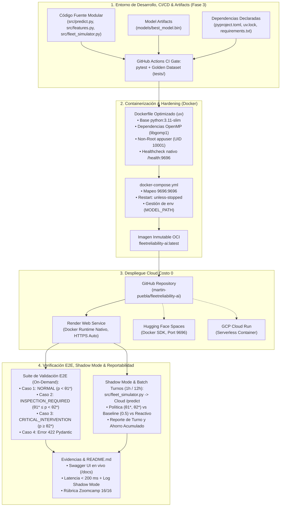
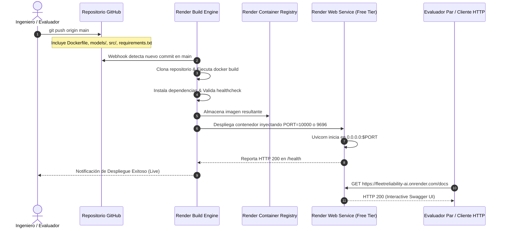
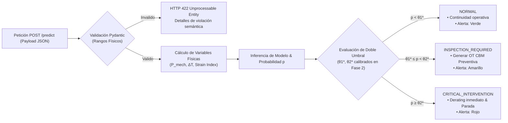

# FASE-04: Containerización de Producción, Shadow Mode y Despliegue Cloud Costo 0

> **Documento de Especificación Técnica de Desarrollo**  
> **Proyecto:** FleetReliability-AI — Sistema Predictivo CBM para Equipos Industriales y Mineros  
> **Programa:** Machine Learning Zoomcamp (Mid-Term Project)  
> **Referencias:** [PLAN.md](../PLAN.md) | [00_transversal_standards.md](./00_transversal_standards.md)

---

## 1. Metadatos y Control de Fase

### 1.1 Ficha de Control

| Atributo | Especificación Técnica |
| :--- | :--- |
| **Identificador** | `FASE-04` |
| **Título** | Containerización de Producción, Shadow Mode y Despliegue Cloud Costo 0 |
| **Responsable / Rol** | Principal Platform Engineer & Cloud Architect |
| **Versión y Estado** | `1.0.0` — `BLOQUEADO POR FASE 3` |
| **Pre-requisitos Bloqueantes** | Fase 3 ([03_refactor_and_service_api.md](./03_refactor_and_service_api.md)) completada: código refactorizado en `src/`, microservicio FastAPI operativo, `src/fleet_simulator.py` implementado, artefacto serializado en `models/`, Golden Dataset y suite `pytest` pasando al 100% en CI/CD. |
| **Entregables Clave** | 1. `Dockerfile` endurecido (`python:3.11-slim`, usuario no-root, healthcheck).<br/>2. `docker-compose.yml` para orquestación local.<br/>3. Servicio Cloud activo Costo 0 (Render / Hugging Face Spaces / GCP Cloud Run).<br/>4. `scripts/test_e2e_cloud.sh` y reporte Shadow Mode (`reports/cloud_shadow_report.json`).<br/>5. `README.md` final con URLs, Swagger UI y evidencias. |
| **Entorno y Stack** | Docker, Docker Compose, Python 3.11-slim, Uvicorn (ASGI), libgomp1 (OpenMP), Render / HF Spaces / GCP Cloud Run, Bash / `curl` / `jq` |
| **Impacto en Rúbrica Zoomcamp** | Containerization (2/2 pts), Cloud Deployment (2/2 pts) y Validación MLOps en Despliegue (Cierre consolidado 16/16 pts) |

### 1.2 Objetivo Técnico y Alcance

La Fase 4 representa la culminación del ciclo de ingeniería de software y operaciones de Machine Learning (MLOps) de **FleetReliability-AI**. En esta fase se transforma la aplicación modular de inferencia FastAPI (`src.predict:app`) en un artefacto de despliegue inmutable, altamente seguro, reproducible y desacoplado de la máquina host mediante **Docker**, se publica en una plataforma cloud bajo un esquema de **Costo \$0 USD (Free Tier)**, y se valida operacionalmente mediante **Shadow Mode** y **reportabilidad por turnos** usando `src/fleet_simulator.py`.



### 1.3 Entregables Específicos
1. `Dockerfile` de producción endurecido (multi-stage o single-layer ultra optimizado), con OpenMP, usuario no privilegiado (`appuser`), healthcheck contra `/health` y puerto configurable.
2. `docker-compose.yml` para arranque local reproducible en un solo comando (`docker compose up --build`).
3. Guía de aprovisionamiento paso a paso para **Render** (opción primaria recomendada) con fallback a **Hugging Face Spaces** y **GCP Cloud Run**, precedida por el *gate* de GitHub Actions (Golden Dataset).
4. Script de validación automatizada End-to-End (`scripts/test_e2e_cloud.sh`) con validación de estados operacionales y medición de latencia HTTP.
5. Ejecución documentada de **Evaluación Online Simulada / Shadow Mode** y **Reportabilidad Operacional por Turnos** mediante `src/fleet_simulator.py` contra el servicio desplegado.
6. Sección de despliegue en `README.md` auditada con URL pública activa, documentación Swagger interactiva, evidencias de ejecución y separación explícita entre validación estadística y operacional.
7. Checklist de Definition of Done (DoD) para garantizar el 100% de la rúbrica de evaluación de pares.

---

## 2. Especificación Técnica del Contenedor Docker (Rúbrica: 2 Puntos)

### 2.1 Justificación Arquitectónica de la Imagen Base

> [!IMPORTANT]
> **Por qué `python:3.11-slim` y no Alpine ni Ubuntu Full:**
> - **Alpine Linux (`python:3.11-alpine`):** Utiliza `musl libc` en lugar de `glibc`. Las librerías de alto rendimiento de Machine Learning (`scikit-learn`, `numpy`, `lightgbm`, `xgboost`) no distribuyen wheels binarios precompilados para musl, lo que obliga a compilar código C++/Fortran en tiempo de build, disparando los tiempos de construcción de 40 segundos a más de 18 minutos y generando artefactos inestables propensos a *segmentation faults*.
> - **Ubuntu Base (`ubuntu:22.04` + Python):** Genera imágenes sobredimensionadas (> 1.2 GB) con decenas de paquetes de sistema innecesarios que aumentan la superficie de ataque y ralentizan los cold starts en la nube.
> - **`python:3.11-slim` (Debian Bookworm):** Balance perfecto (~150 MB base). Utiliza `glibc`, es compatible directamente con wheels manylinux optimizados y solo requiere la instalación de la librería de paralelismo OpenMP (`libgomp1`).

### 2.2 Principios de Hardening y Seguridad Operacional

1. **Variables de Entorno Estándar para Python y `uv` en Contenedores:**
   - `PYTHONUNBUFFERED=1`: Fuerza a Python a enviar inmediatamente los streams de `stdout` y `stderr` a los pipes del sistema operativo sin pasar por el buffer de memoria. Esto garantiza que los logs estructurados de `logging` y FastAPI/Uvicorn se emitan en tiempo real en `docker logs` y en la consola del proveedor Cloud.
   - `PYTHONDONTWRITEBYTECODE=1`: Instruye al intérprete a no escribir archivos `.pyc` en disco dentro del contenedor, reduciendo escrituras innecesarias en el sistema de archivos de capas (*overlayfs*).
   - `UV_COMPILE_BYTECODE=1` y `UV_LINK_MODE=copy`: Optimizan la instalación determinista con `uv sync --frozen --no-dev --no-install-project` dentro de `/app/.venv`.
2. **Dependencias de Sistema Críticas:**
   - `libgomp1`: Requisito indispensable para que las rutinas multihilo de OpenMP en `LightGBM` y `XGBoost` funcionen correctamente sin arrojar `ImportError: libgomp.so.1: cannot open shared object file`.
   - Limpieza de listas APT en la misma capa (`rm -rf /var/lib/apt/lists/*`) para que los índices temporales no queden guardados en el historial de la imagen.
3. **Principio de Menor Privilegio (Non-Root User):**
   - Ejecutar contenedores como `root` representa una vulnerabilidad de severidad crítica (posible *container breakout*).
   - Se crea un grupo y usuario del sistema dedicado:
     ```bash
     groupadd -g 10001 -r appgroup && \
     useradd -u 10001 -r -g appgroup -d /app -s /sbin/nologin -c "Docker Application User" appuser
     ```
   - Todos los archivos del código y modelos se transfieren con propiedad `appuser:appgroup`.
4. **Healthcheck Nativo de Docker:**
   - Se configura una instrucción `HEALTHCHECK` que consulta el endpoint `/health` de FastAPI en el puerto `9696` cada 30 segundos. Si el servicio sufre un bloqueo o *deadlock*, Docker marca el contenedor como `unhealthy`, permitiendo el reinicio automático.
   - Para no depender de herramientas externas como `curl` o `wget` dentro del contenedor (reduciendo vulnerabilidades), se utiliza el módulo estándar `urllib.request` de Python.
5. **Servidor ASGI de Grado de Producción (Uvicorn):**
   - Concurrencia balanceada: `uvicorn src.predict:app --host 0.0.0.0 --port ${PORT:-9696} --workers 2 --access-log`.
   - Dos *worker processes* asíncronos permiten atender peticiones concurrentes de inferencia maximizando la utilización de vCPUs en tiers gratuitos (típicamente 1 a 2 vCPUs) sin saturar la memoria RAM.

---

### 2.3 `Dockerfile` de Producción Endurecido

Este es el archivo canónico que debe situarse en la raíz del repositorio (`/home/Martin/Repos_Git/fleetreliability-ai/Dockerfile`):

```dockerfile
# ==============================================================================
# FleetReliability-AI — Production Dockerfile (Powered by Astral uv)
# ==============================================================================
FROM python:3.11-slim

# Prevent Python from writing .pyc files and buffer stdout/stderr
ENV PYTHONDONTWRITEBYTECODE=1 \
    PYTHONUNBUFFERED=1 \
    UV_COMPILE_BYTECODE=1 \
    UV_LINK_MODE=copy \
    PATH="/app/.venv/bin:$PATH" \
    PORT=9696 \
    MODEL_PATH=models/best_model.bin

WORKDIR /app

# Install system-level OpenMP runtime required by LightGBM and XGBoost
RUN apt-get update && apt-get install -y --no-install-recommends \
    libgomp1 \
    && rm -rf /var/lib/apt/lists/*

# Copy uv binary directly from official Astral image
COPY --from=ghcr.io/astral-sh/uv:latest /uv /bin/uv

# Create a non-root user for security best practices
RUN groupadd -g 10001 -r appgroup && \
    useradd -u 10001 -r -g appgroup -d /app -s /sbin/nologin appuser

# Install dependencies using uv into the container environment
COPY pyproject.toml uv.lock ./
RUN uv sync --frozen --no-dev --no-install-project

# Copy application source code and serialized model artifact
COPY src/ ./src/
COPY models/ ./models/

# Ensure proper permissions for non-root execution
RUN chown -R appuser:appgroup /app
USER appuser

# Expose port 9696 as standard in ML Zoomcamp
EXPOSE 9696

# Healthcheck against the FastAPI /health endpoint
HEALTHCHECK --interval=30s --timeout=5s --start-period=10s --retries=3 \
    CMD python -c "import os, urllib.request; port = os.getenv('PORT', '9696'); urllib.request.urlopen(f'http://localhost:{port}/health')" || exit 1

# Run FastAPI application via pre-synced virtualenv uvicorn with dynamic $PORT
CMD ["sh", "-c", "exec uvicorn src.predict:app --host 0.0.0.0 --port ${PORT:-9696} --workers 2 --access-log"]
```

> [!TIP]
> **Compatibilidad Dual con Cloud y Local:**  
> La instrucción `CMD ["sh", "-c", "exec uvicorn ... --port ${PORT:-9696} ..."]` es una de las mejores prácticas de ingeniería cloud: si la plataforma inyecta una variable `$PORT` (como lo hace Render o Google Cloud Run dinámicamente), Uvicorn la toma automáticamente; si se corre localmente en Docker o Docker Compose, toma por defecto el puerto `9696`.

---

### 2.4 Especificación Técnica de `docker-compose.yml`

Para permitir a cualquier evaluador par ejecutar la solución completa con un único comando (`docker compose up`), se define la especificación de orquestación local en `/home/Martin/Repos_Git/fleetreliability-ai/docker-compose.yml`:

```yaml
services:
  fleetreliability-api:
    build:
      context: .
      dockerfile: Dockerfile
    container_name: fleetreliability-api
    ports:
      - "9696:9696"
    environment:
      - PYTHONUNBUFFERED=1
      - PORT=9696
      - MODEL_PATH=models/best_model.bin
      - LOG_LEVEL=info
    healthcheck:
      test: ["CMD-SHELL", "python -c \"import urllib.request; urllib.request.urlopen('http://localhost:9696/health')\" || exit 1"]
      interval: 20s
      timeout: 5s
      retries: 3
      start_period: 10s
    restart: unless-stopped
```

---

### 2.5 Guía de Comandos para Verificación Local de Contenedor

El evaluador o desarrollador debe poder ejecutar los siguientes comandos y validar el ciclo de vida completo del contenedor:

```bash
# 1. Construir la imagen Docker localmente
docker build -t fleetreliability-ai:1.0.0 -t fleetreliability-ai:latest .

# 2. Verificar el tamaño optimizado de la imagen
docker images | grep fleetreliability-ai

# 3. Ejecutar el contenedor en segundo plano con mapeo de puerto 9696
docker run -d \
  --name fleet-api-test \
  -p 9696:9696 \
  -e PYTHONUNBUFFERED=1 \
  fleetreliability-ai:latest

# 4. Verificar logs de inicialización de Uvicorn
docker logs -f fleet-api-test

# 5. Verificar que el proceso corre bajo el usuario no-root 'appuser' (UID 10001)
docker top fleet-api-test -o user,pid,comm

# 6. Consultar el estado del Healthcheck nativo
docker inspect --format='{{json .State.Health.Status}}' fleet-api-test
# Salida esperada: "healthy"

# 7. Detener y limpiar el contenedor de prueba
docker stop fleet-api-test && docker rm fleet-api-test

# 8. Comprobar la orquestación con Docker Compose
docker compose up -d --build
docker compose ps
docker compose logs fleetreliability-api
docker compose down
```

---

## 3. Protocolo de Despliegue en Cloud Costo 0 (Rúbrica: 2 Puntos)

### 3.1 Análisis Comparativo de Proveedores Cloud Free-Tier

Para cumplir con el requerimiento de desplegar en la nube con un costo total de **\$0.00 USD**, se analizan las tres alternativas más reconocidas de la industria para proyectos de Machine Learning Zoomcamp:

| Criterio de Selección | Opción A: Render (Recomendada) | Opción B: Hugging Face Spaces | Opción C: Google Cloud Run |
| :--- | :--- | :--- | :--- |
| **Modelo de Servicio** | PaaS Web Service (Docker Nativo) | AI Community Space (Docker SDK) | CaaS Serverless Container |
| **Requiere Tarjeta de Crédito** | **No** (Registro con cuenta de GitHub) | **No** (Cuenta gratuita de HF) | **Sí** (Cuenta de GCP requerida) |
| **Soporte de Dockerfile** | Nativo (Construye desde el repo) | Nativo (`sdk: docker` en README) | Nativo (Vía Artifact Registry) |
| **Recursos Gratuitos** | 0.5 CPU, 512 MB RAM, 750 hrs/mes | 2 vCPU, 16 GB RAM | 2M requests/mes, 360k GB-s/mes |
| **HTTPS y Dominio Público** | Automático (`*.onrender.com`) | Automático (`*.hf.space`) | Automático (`*.run.app`) |
| **Comportamiento ante Inactividad** | *Spin down* tras 15 min de inactividad (Cold start de ~40s en el primer request) | No se apaga inmediatamente en repos activos | Escala a cero instancias (Cold start de ~3-5s) |
| **Idoneidad para Revisión Pares** | **Máxima:** Los evaluadores prueban el endpoint HTTPS sin fricción alguna. | **Alta:** Muy visual para la comunidad ML, pero la URL de la API API queda embebida en un iframe si se consulta por browser. | **Media:** Excelente rendimiento pero la exigencia de tarjeta de crédito excluye a ciertos alumnos. |

> [!IMPORTANT]
> **Decisión Arquitectónica:**  
> Se selecciona **Render** como la plataforma primaria de producción para FleetReliability-AI debido a su despliegue continuo directo desde GitHub, su soporte transparente de Dockerfile y la ausencia absoluta de barreras de pago. Se provee **Hugging Face Spaces** como alternativa complementaria de alta visibilidad en portafolios de IA.

---

### 3.2 Guía de Despliegue Paso a Paso en Render (Opción A - Primaria)



#### Paso 1: Verificación de Integridad del Repositorio
Asegúrese de que todos los artefactos críticos estén versionados y subidos a la rama `main` de GitHub:
- `Dockerfile` en la raíz.
- `pyproject.toml`, `uv.lock` y `requirements.txt`.
- Directorio `src/` con `predict.py`, `features.py`, `train.py`, `fleet_simulator.py`.
- Artefacto campeón `models/best_model.bin` (el archivo `.gitignore` mantiene ignorados otros `models/*.bin` / `*.pkl` / `*.joblib`, pero incluye explícitamente `!models/best_model.bin` para que CI/CD y Render dispongan del modelo entrenado).

```bash
git status
git add Dockerfile docker-compose.yml pyproject.toml uv.lock requirements.txt src/ models/best_model.bin
git commit -m "feat(deploy): prepare production container for cloud deployment"
git push origin main
```

#### Paso 2: Creación del Servicio en Render
1. Iniciar sesión en [Render Dashboard](https://dashboard.render.com/) mediante su cuenta de **GitHub**.
2. Hacer clic en el botón superior **"New +"** y seleccionar **"Web Service"**.
3. Seleccionar la opción **"Build and deploy from a Git repository"** y hacer clic en **"Next"**.
4. Buscar y conectar el repositorio `fleetreliability-ai`.
5. Configurar los parámetros exactos del servicio:
   - **Name:** `fleetreliability-ai` (determinará la URL: `https://fleetreliability-ai.onrender.com`).
   - **Region:** `Oregon (US West)` o `Frankfurt (EU Central)` (elegir la región con menor latencia estimada).
   - **Branch:** `main`.
   - **Runtime:** `Docker` (Render detecta automáticamente el `Dockerfile` en la raíz).
   - **Instance Type:** `Free` (0.5 CPU, 512 MB RAM).

#### Paso 3: Configuración de Variables de Entorno y Health Check
En la sección **Advanced** del formulario de creación:
- **Health Check Path:** `/health` *(Render consultará periódicamente este endpoint para validar la operatividad del contenedor)*.
- **Auto-Deploy:** `Yes` *(Cualquier nuevo push a `main` desencadenará un despliegue sin intervención manual)*.
- **Environment Variables:**
  - `PYTHONUNBUFFERED`: `1`
  - `LOG_LEVEL`: `info`
  - `MODEL_PATH`: `models/best_model.bin`

#### Paso 4: Despliegue y Monitoreo de Logs en Vivo
1. Hacer clic en **"Create Web Service"**.
2. Observar la consola de build en tiempo real. Render ejecutará las instrucciones del `Dockerfile`:
   ```text
   ==> Building service with Docker
   ==> Step 1/11 : FROM python:3.11-slim
   ==> Step 3/11 : RUN apt-get update && apt-get install -y --no-install-recommends libgomp1 ...
   ==> Step 7/11 : RUN uv sync --frozen --no-dev --no-install-project ...
   ==> Step 10/11 : USER appuser
   ==> Step 11/11 : CMD ["sh", "-c", "exec uvicorn src.predict:app --host 0.0.0.0 --port ${PORT:-9696} --workers 2 --access-log"]
   ==> Uploading build...
   ==> Build successful!
   ==> Deploying...
   ==> Starting service with 'sh -c exec uvicorn src.predict:app --host 0.0.0.0 --port ${PORT:-9696} --workers 2 --access-log'
   INFO:     Started server process [1]
   INFO:     Waiting for application startup.
   INFO:     Model artifact loaded successfully from models/best_model.bin
   INFO:     Application startup complete.
   INFO:     Uvicorn running on http://0.0.0.0:10000 (Press CTRL+C to quit)
   ==> Service is live at https://fleetreliability-ai.onrender.com
   ```

#### Paso 5: Gestión de "Cold Starts" en Render Free Tier
> [!NOTE]
> Los Web Services gratuitos de Render entran en suspensión (*spin down*) tras 15 minutos sin tráfico entrante. Cuando llega una nueva solicitud, el contenedor tarda entre 30 y 50 segundos en despertar.
> - **Recomendación para la evaluación de pares:** Se debe incluir una nota explicativa en el `README.md` advirtiendo que la primera petición puede demorar ~40s debido al cold start del Free Tier, tras lo cual la API responde en < 150 ms.
> - Opcionalmente, se puede utilizar un monitor de uptime gratuito (como *UptimeRobot* o *Cron-Job.org*) consultando `/health` cada 10 minutos para mantener el contenedor activo durante el periodo de evaluación.

---

### 3.3 Guía de Despliegue en Hugging Face Spaces (Opción B - Alternativa)

Para desplegar en Hugging Face Spaces utilizando el mismo contenedor Docker:

1. Crear un nuevo Space en [huggingface.co/spaces](https://huggingface.co/spaces).
2. Asignar el nombre: `fleetreliability-ai`.
3. Seleccionar **Space SDK:** `Docker` (Blank).
4. En el archivo `README.md` del Space, configurar el encabezado YAML con el puerto de la aplicación:
   ```yaml
   ---
   title: FleetReliability AI
   emoji: 🚜
   colorFrom: blue
   colorTo: gray
   sdk: docker
   app_port: 9696
   ---
   ```
5. Clonar el repositorio del Space o configurarlo como remote secundario de git:
   ```bash
   git remote add space https://huggingface.co/spaces/<tu-usuario>/fleetreliability-ai
   git push space main
   ```
6. Hugging Face compilará el `Dockerfile` y expondrá la API en:  
   `https://<tu-usuario>-fleetreliability-ai.hf.space/docs`.

---

## 4. Protocolo de Validación End-to-End (E2E)

Para garantizar que el servicio en producción responde con estricta adherencia a la lógica de negocio y que cualquier revisor par pueda auditar el comportamiento del modelo, se define la siguiente suite de pruebas basada en el dataset *AI4I 2020 Predictive Maintenance*.

### 4.1 Definición de Escenarios de Negocio de Prueba



---

### 4.2 Comandos `curl` de Validación con Payloads Reales

> [!TIP]
> Reemplace `https://fleetreliability-ai.onrender.com` por `http://localhost:9696` si ejecuta las pruebas contra el contenedor local.

#### Caso 0: Verificación de Disponibilidad (Health Check)
```bash
curl -s -X GET "https://fleetreliability-ai.onrender.com/health" \
  -H "Accept: application/json" | jq .
```
**Respuesta HTTP 200 OK esperada (`HealthResponse`):**
```json
{
  "status": "HEALTHY",
  "model_loaded": true,
  "model_version": "0.1.0",
  "thresholds": {
    "theta_warning": 0.12,
    "theta_critical": 0.45
  },
  "uptime_seconds": 124.5
}
```

---

#### Caso 1: Maquinaria en Condición Normal (`NORMAL`)
- **Condición física:** Equipo operando a velocidad nominal moderada, par motor estándar (38.5 Nm), desgaste de herramienta incipiente (18 min) y gradiente térmico de 9.8 K.
- **Comportamiento esperado:** Riesgo bajo ($p < \theta_1^*$), estado operacional `NORMAL`, sin acción correctiva requerida.

```bash
curl -s -X POST "https://fleetreliability-ai.onrender.com/predict" \
  -H "Content-Type: application/json" \
  -d '{
    "machine_id": "PUMP-SAG-01",
    "machine_type": "M",
    "air_temperature_k": 298.2,
    "process_temperature_k": 308.0,
    "rotational_speed_rpm": 1520.0,
    "torque_nm": 38.5,
    "tool_wear_min": 18.0
  }' | jq .
```

**Respuesta HTTP 200 OK esperada (`PredictionResponse`):**
```json
{
  "machine_id": "PUMP-SAG-01",
  "failure_risk_score": 0.0241,
  "operational_status": "NORMAL",
  "recommended_cbm_action": "Continue normal operation. Maintain standard shift lubrication and routine inspection schedule.",
  "criticality_level": "LOW",
  "derived_physics": {
    "mechanical_power_kw": 6.128,
    "temperature_difference_k": 9.8,
    "strain_index_min_nm": 693.0,
    "heat_stress_ratio": 6.447
  },
  "model_version": "0.1.0",
  "timestamp": "2026-11-10T19:15:32.124567Z"
}
```

---

#### Caso 2: Advertencia Temprana CBM (`INSPECTION_REQUIRED`)
- **Condición física:** Equipo de alta criticidad (`Type H`) con sobrecalentamiento moderado ($\Delta T = 11.2\text{ K}$), torque elevado (52.0 Nm) y desgaste acumulado considerable (145 min).
- **Comportamiento esperado:** Riesgo moderado ($\theta_1^* \le p < \theta_2^*$), estado operacional `INSPECTION_REQUIRED`, emisión de Orden de Trabajo para inspección no destructiva por termografía/vibraciones en el próximo cambio de turno.

```bash
curl -s -X POST "https://fleetreliability-ai.onrender.com/predict" \
  -H "Content-Type: application/json" \
  -d '{
    "machine_id": "HAUL-TRUCK-MILL-03",
    "machine_type": "H",
    "air_temperature_k": 300.5,
    "process_temperature_k": 311.7,
    "rotational_speed_rpm": 1340.0,
    "torque_nm": 52.0,
    "tool_wear_min": 145.0
  }' | jq .
```

**Respuesta HTTP 200 OK esperada (`PredictionResponse`):**
```json
{
  "machine_id": "HAUL-TRUCK-MILL-03",
  "failure_risk_score": 0.3820,
  "operational_status": "INSPECTION_REQUIRED",
  "recommended_cbm_action": "Preventive CBM alert for Class H asset. Issue a non-destructive inspection work order for the next shift handover (bearing vibration analysis and component thermography).",
  "criticality_level": "HIGH",
  "derived_physics": {
    "mechanical_power_kw": 7.297,
    "temperature_difference_k": 11.2,
    "strain_index_min_nm": 7540.0,
    "heat_stress_ratio": 8.358
  },
  "model_version": "0.1.0",
  "timestamp": "2026-11-10T19:16:10.871234Z"
}
```

---

#### Caso 3: Maquinaria en Sobrecarga Crítica (`CRITICAL_INTERVENTION`)
- **Condición física:** Equipo de criticidad media (`Type M`) en condiciones severas: velocidad anormalmente baja (1210 rpm) con torque extremo (76.8 Nm) y desgaste muy elevado (215 min), simulando un atascamiento mecánico inminente (*Overstrain Failure* / *Power Failure*).
- **Comportamiento esperado:** Riesgo extremo ($p \ge \theta_2^*$), estado operacional `CRITICAL_INTERVENTION`, recomendación de *derating* inmediato y parada programada coordinada para evitar parada catastrófica no programada.

```bash
curl -s -X POST "https://fleetreliability-ai.onrender.com/predict" \
  -H "Content-Type: application/json" \
  -d '{
    "machine_id": "CRUSHER-PRIM-02",
    "machine_type": "M",
    "air_temperature_k": 302.1,
    "process_temperature_k": 313.9,
    "rotational_speed_rpm": 1210.0,
    "torque_nm": 76.8,
    "tool_wear_min": 215.0
  }' | jq .
```

**Respuesta HTTP 200 OK esperada (`PredictionResponse`):**
```json
{
  "machine_id": "CRUSHER-PRIM-02",
  "failure_risk_score": 0.8914,
  "operational_status": "CRITICAL_INTERVENTION",
  "recommended_cbm_action": "IMMINENT FAILURE RISK on critical Class M asset. Execute immediate load derating (reduce RPM by 50%) and coordinate an immediate planned shutdown with the shift supervisor to prevent catastrophic damage.",
  "criticality_level": "CRITICAL",
  "derived_physics": {
    "mechanical_power_kw": 9.731,
    "temperature_difference_k": 11.8,
    "strain_index_min_nm": 16512.0,
    "heat_stress_ratio": 9.752
  },
  "model_version": "0.1.0",
  "timestamp": "2026-11-10T19:17:01.345678Z"
}
```

---

#### Caso 4: Resiliencia ante Payload Inválido (HTTP 422 Unprocessable Entity)
- **Condición física:** Payload con violación física de rangos (ej. temperatura ambiental física imposible de 150 K, fuera del rango admisible `ge=250.0, le=350.0` modelado en Pydantic).
- **Comportamiento esperado:** Código de estado HTTP 422 con mensaje semántico claro indicando el campo y la regla violada, sin provocar una caída (`crash`) del servidor.

```bash
curl -s -i -X POST "https://fleetreliability-ai.onrender.com/predict" \
  -H "Content-Type: application/json" \
  -d '{
    "machine_id": "PUMP-FAULTY-DATA",
    "machine_type": "L",
    "air_temperature_k": 150.0,
    "process_temperature_k": 308.0,
    "rotational_speed_rpm": 1500.0,
    "torque_nm": 40.0,
    "tool_wear_min": 50.0
  }'
```

**Respuesta HTTP 422 esperada:**
```text
HTTP/1.1 422 Unprocessable Entity
content-type: application/json

{
  "detail": [
    {
      "type": "greater_than_equal",
      "loc": ["body", "air_temperature_k"],
      "msg": "Input should be greater than or equal to 250",
      "input": 150.0,
      "ctx": {"ge": 250.0}
    }
  ]
}
```

---

### 4.3 Script de Validación Automatizada E2E y Latencia

Se implementa el script ejecutable `scripts/test_e2e_cloud.sh` para auditar cualquier despliegue (local o remoto) midiendo automáticamente los tiempos de respuesta:

```bash
#!/usr/bin/env bash
# ==============================================================================
# FleetReliability-AI — Automated Cloud & Local E2E Validation Suite
# ==============================================================================
set -euo pipefail

TARGET_URL="${1:-https://fleetreliability-ai.onrender.com}"
echo "========================================================================"
echo "Starting E2E Validation Suite against: ${TARGET_URL}"
echo "========================================================================"

# Helper function for timed HTTP assertions against canonical Pydantic v2 schemas
execute_test() {
    local test_name="$1"
    local endpoint="$2"
    local method="$3"
    local payload="$4"
    local expected_code="$5"
    local jq_check="${6:-}"

    echo ""
    echo ">> Running: ${test_name}"

    local response_file
    response_file=$(mktemp)

    local http_code
    local latency

    if [ "${method}" = "GET" ]; then
        http_code=$(curl -s -o "${response_file}" -w "%{http_code}" -X GET "${TARGET_URL}${endpoint}")
        latency=$(curl -s -o /dev/null -w "%{time_total}s" -X GET "${TARGET_URL}${endpoint}")
    else
        http_code=$(curl -s -o "${response_file}" -w "%{http_code}" -X POST "${TARGET_URL}${endpoint}" \
            -H "Content-Type: application/json" -d "${payload}")
        latency=$(curl -s -o /dev/null -w "%{time_total}s" -X POST "${TARGET_URL}${endpoint}" \
            -H "Content-Type: application/json" -d "${payload}")
    fi

    echo "   HTTP Status Code: ${http_code} (Expected: ${expected_code})"
    echo "   Total Latency:    ${latency}"
    echo "   Server Response:"
    if command -v jq &> /dev/null; then
        cat "${response_file}" | jq -C . || cat "${response_file}"
    else
        cat "${response_file}"
    fi
    echo ""

    if [ "${http_code}" != "${expected_code}" ]; then
        echo "[FAIL] HTTP status (${http_code}) does not match expected (${expected_code})."
        rm -f "${response_file}"
        exit 1
    fi

    if [ -n "${jq_check}" ] && command -v jq &> /dev/null; then
        if ! jq -e "${jq_check}" "${response_file}" > /dev/null; then
            echo "[FAIL] Schema/contract assertion failed: ${jq_check}"
            rm -f "${response_file}"
            exit 1
        fi
    fi

    echo "[PASS] ${test_name} passed."
    rm -f "${response_file}"
}

# 1. Healthcheck (HealthResponse)
execute_test "Health Check (/health)" "/health" "GET" "" "200" \
    '.status == "HEALTHY" and .model_loaded == true and (.thresholds | has("theta_warning") and has("theta_critical"))'

# 2. Normal condition (PredictionResponse)
NORMAL_PAYLOAD='{"machine_id":"TEST-NORMAL","machine_type":"L","air_temperature_k":298.1,"process_temperature_k":308.2,"rotational_speed_rpm":1550.0,"torque_nm":32.0,"tool_wear_min":15.0}'
execute_test "Predict: Normal Condition" "/predict" "POST" "${NORMAL_PAYLOAD}" "200" \
    '.operational_status == "NORMAL" and (.failure_risk_score >= 0 and .failure_risk_score <= 1) and (.derived_physics | has("mechanical_power_kw") and has("temperature_difference_k") and has("strain_index_min_nm") and has("heat_stress_ratio"))'

# 3. CBM Inspection warning (PredictionResponse)
CBM_PAYLOAD='{"machine_id":"TEST-CBM","machine_type":"H","air_temperature_k":301.0,"process_temperature_k":312.0,"rotational_speed_rpm":1380.0,"torque_nm":50.0,"tool_wear_min":160.0}'
execute_test "Predict: CBM Inspection Warning" "/predict" "POST" "${CBM_PAYLOAD}" "200" \
    '(.operational_status == "INSPECTION_REQUIRED" or .operational_status == "CRITICAL_INTERVENTION") and (.derived_physics | has("mechanical_power_kw"))'

# 4. Critical intervention (PredictionResponse)
CRITICAL_PAYLOAD='{"machine_id":"TEST-CRITICAL","machine_type":"M","air_temperature_k":303.0,"process_temperature_k":315.0,"rotational_speed_rpm":1180.0,"torque_nm":78.0,"tool_wear_min":225.0}'
execute_test "Predict: Critical Intervention" "/predict" "POST" "${CRITICAL_PAYLOAD}" "200" \
    '.operational_status == "CRITICAL_INTERVENTION" and (.failure_risk_score >= 0 and .failure_risk_score <= 1)'

# 5. Physical validation error (HTTP 422)
INVALID_PAYLOAD='{"machine_id":"TEST-ERR","machine_type":"L","air_temperature_k":100.0,"process_temperature_k":308.2,"rotational_speed_rpm":1550.0,"torque_nm":32.0,"tool_wear_min":15.0}'
execute_test "Physical Integrity Validation (HTTP 422)" "/predict" "POST" "${INVALID_PAYLOAD}" "422" \
    '.detail | length > 0'

echo "========================================================================"
echo "All E2E tests completed successfully with exit code 0."
echo "========================================================================"
```

---

## 5. Validación MLOps en Despliegue: Shadow Mode y Reportabilidad Operacional

### 5.1 Gate Pre-despliegue con Golden Dataset en CI/CD
Antes de promover cualquier commit hacia el build de Docker o al despliegue automático en Render:
- GitHub Actions ejecuta `uv run pytest tests/ -v`, validando el **Golden Dataset** (`tests/golden_dataset.json` via `tests/test_golden.py`) junto con `test_features.py` y `test_api.py`.
- Si una modificación en `src/predict.py` altera el contrato JSON, rompe la validación Pydantic o desvía las decisiones de la política tri-umbral $(\theta_1^*, \theta_2^*)$, el *pipeline* CI bloquea el despliegue.

### 5.2 Paradigmas de Operación en Producción
El servicio desplegado opera bajo dos modalidades complementarias:
1. **Inferencia Bajo Demanda (On-Demand API):** Consultas unitarias síncronas desde operadores o integraciones hacia `POST /predict` o `GET /docs`.
2. **Monitoreo por Turnos / Batch (Reportabilidad Periódica):** Consolidación periódica cada **1 hora** o al cierre de **turno de 12 horas** consumiendo la API en modo lote para emitir el semáforo de flota (`NORMAL`, `INSPECTION_REQUIRED`, `CRITICAL_INTERVENTION`) y las órdenes de trabajo preventivas.

### 5.3 Evaluación Online Simulada / Shadow Mode (`src/fleet_simulator.py`)
Una vez que el servicio está activo (localmente en Docker o en Render HTTPS), se ejecuta el simulador estocástico en **Shadow Mode** sobre el stream sintético (degradación Random Walk / Proceso de Wiener para $N=5$ bombas SAG):

```bash
# Ejecutar evaluación Shadow Mode contra el despliegue Cloud en vivo (2 turnos de 12h)
uv run python src/fleet_simulator.py \
  --api-url https://fleetreliability-ai.onrender.com \
  --num-machines 5 \
  --shift-hours 12 \
  --num-shifts 2 \
  --interval-hours 1 \
  --seed 42 \
  --report-path reports/cloud_shadow_report.json
```

**Qué evalúa el modo Shadow / Comparación Paralela:**
- Registra en paralelo sobre exactamente el mismo flujo de telemetría sintética las decisiones tomadas por:
  1. **Modelo Calibrado Multi-Umbral $(\theta_1^*, \theta_2^*)$** (en producción vía `/predict`).
  2. **Baseline Estático (`0.5`)** (en sombra / shadow evaluation).
  3. **Política Reactiva ("Fallar y Reparar")**.
- Consolida en `reports/cloud_shadow_report.json` el **reporte de reportabilidad por turno** (alertas emitidas, OTs de termografía/vibraciones generadas, recomendaciones de *derating*) y la **diferencia de costos acumulados** (ahorro estimado USD usando la matriz Monte Carlo).

> [!IMPORTANT]
> **Separación Estadística vs. Operacional:**
> La **validación estadística de generalización** (PR-AUC, $F_2$-Score, Brier Score) se realiza **exclusivamente** sobre datos reales históricos (UCI AI4I 2020 — Stratified 5-Fold OOF y Holdout 20% bloqueado en `data/processed/`). El simulador en Shadow Mode valida **exclusivamente** la arquitectura MLOps desplegada, la disponibilidad/latencia bajo consultas periódicas, la generación de reportabilidad operacional y el impacto económico comparativo de los umbrales $(\theta_1^*, \theta_2^*)$ frente al baseline `0.5`.

---

## 6. Requerimientos Transversales y Sincronización del Repositorio

### 6.1 Actualización Definitiva del `README.md` Principal

Para asegurar la calificación perfecta de los evaluadores pares según la rúbrica oficial, el archivo `README.md` en la raíz del proyecto debe estructurar la sección de ejecución y despliegue con las siguientes subsecciones obligatorias:

1. **Badge de Despliegue en Vivo:**
   ```markdown
   [](https://fleetreliability-ai.onrender.com/docs)
   [](Dockerfile)
   ```
2. **URLs Públicas de Producción:**
   - **Interactive API Documentation (Swagger UI):** [`https://fleetreliability-ai.onrender.com/docs`](https://fleetreliability-ai.onrender.com/docs)
   - **Alternative Documentation (ReDoc):** [`https://fleetreliability-ai.onrender.com/redoc`](https://fleetreliability-ai.onrender.com/redoc)
   - **Service Healthcheck:** [`https://fleetreliability-ai.onrender.com/health`](https://fleetreliability-ai.onrender.com/health)
   - **Inference Endpoint:** `POST https://fleetreliability-ai.onrender.com/predict`
3. **Instrucciones de Reproducción de Tres Niveles para Evaluadores Pares:**
   - **Nivel 1 (Zero-Install / Cloud Direct):** Instrucciones directas con un comando `curl` para probar inmediatamente la API en la nube sin clonar el repositorio.
   - **Nivel 2 (Container / Docker Compose):** Instrucciones para clonar y ejecutar con `docker compose up --build`.
   - **Nivel 3 (Native Python / uv o requirements.txt):** Instrucciones para correr localmente con virtualenv tradicional y ejecutar el simulador de flota en Shadow Mode.
4. **Evidencias Gráficas, Shadow Mode y Terminal Logs:**
   - Captura de pantalla de la interfaz interactiva de Swagger UI ejecutándose sobre el dominio público HTTPS.
   - Bloque de salida de terminal mostrando la ejecución del script `scripts/test_e2e_cloud.sh` contra el servidor en la nube con latencias inferiores a 200 ms.
   - Extracto del reporte de turno y tabla comparativa de costos acumulados generados por `src/fleet_simulator.py` en Shadow Mode ($(\theta_1^*, \theta_2^*)$ vs. `0.5` vs. reactivo), aclarando la separación entre validación estadística (UCI AI4I 2020) y validación operacional (simulador).

---

## 7. Definition of Done (DoD) Auditable para Fase 4

La siguiente lista de control (*checklist*) debe ser validada rigurosamente por el desarrollador antes de dar por concluida la **FASE-04** y someter el proyecto a la revisión de pares (16/16 pts):

### 7.1 Containerization & CI Gate (2 / 2 Puntos)
- [ ] **CI/CD Golden Dataset Gate:** GitHub Actions ejecuta `uv run pytest tests/ -v` (incluyendo `test_golden.py`) con 100% de éxito antes del despliegue.
- [ ] **Dockerfile Completo y Operativo:** Existe un archivo `Dockerfile` en la raíz del repositorio que construye la imagen sin errores ni advertencias (`docker build -t fleetreliability-ai .`).
- [ ] **Base Ligera y Segura:** Está fundamentado en `python:3.11-slim` con instalación exclusiva de librerías del sistema necesarias (`libgomp1`) y limpieza de cache de APT en la misma capa.
- [ ] **Hardening de Seguridad:** El contenedor crea y cambia la ejecución al usuario no privilegiado `appuser` (UID 10001). No corre como `root`.
- [ ] **Healthcheck Nativo:** Se incluye una directiva `HEALTHCHECK` que monitorea el endpoint `/health` periódicamente sin requerir paquetes de red adicionales.
- [ ] **Servidor ASGI Concurrente:** El comando de arranque invoca Uvicorn con 2 workers, logging activo y soporte para la variable de entorno `$PORT`.
- [ ] **Orquestación con Docker Compose:** Existe un archivo `docker-compose.yml` que permite levantar el servicio localmente en el puerto `9696` con `docker compose up --build -d`.
- [ ] **Documentación en README:** El `README.md` describe con precisión los comandos necesarios para construir, correr y detener el contenedor Docker tanto de forma individual como con Compose.

### 7.2 Cloud Deployment, Shadow Mode & Reportabilidad (2 / 2 Puntos)
- [ ] **Despliegue Cloud Costo 0 Activo:** El microservicio se encuentra desplegado y accesible públicamente en una plataforma de la nube (Render o Hugging Face Spaces) bajo el plan gratuito.
- [ ] **Dominio Público HTTPS:** El servicio cuenta con un certificado SSL válido y responde peticiones HTTP/HTTPS seguras en su URL pública asignada.
- [ ] **Swagger UI Accesible en Producción:** La documentación interactiva OpenAPI en `/docs` y `/redoc` carga de forma inmediata y permite realizar inferencias interactivas desde el navegador.
- [ ] **Variables de Entorno Configuradas:** Las variables de entorno de producción (`PYTHONUNBUFFERED`, `PORT`, rutas de modelo) se encuentran configuradas en el panel del proveedor Cloud.
- [ ] **Resiliencia ante Cold Starts:** El `README.md` incluye una advertencia técnica explicando el tiempo de arranque en frío (~40s) del Free Tier de Render tras inactividad.
- [ ] **Suite E2E Exitosa en la Nube:** Las cuatro pruebas funcionales (`NORMAL`, `INSPECTION_REQUIRED`, `CRITICAL_INTERVENTION`, `HTTP 422`) se ejecutan contra el host público y devuelven las respuestas esperadas con latencia estable (< 200 ms una vez activo).
- [ ] **Evaluación Online Simulada / Shadow Mode:** `src/fleet_simulator.py` ejecutado contra el servicio desplegado generando reporte operacional por turnos (`reports/cloud_shadow_report.json`) y registrando el diferencial de costos acumulados entre $(\theta_1^*, \theta_2^*)$, baseline `0.5` y política reactiva.
- [ ] **Separación Metodológica Explícita:** El `README.md` deja explícito que la validación estadística de generalización se mide exclusivamente en UCI AI4I 2020 y que el simulador valida arquitectura MLOps, reportabilidad e impacto económico.
- [ ] **Evidencias en Documentación:** El `README.md` incluye enlaces directos, ejemplos de payloads, respuestas JSON formateadas, log de Shadow Mode y capturas de pantalla que demuestran la operatividad de la nube para los evaluadores pares.

### 7.3 Matriz Consolidada de la Rúbrica Global (Meta: 16 / 16 Puntos)

| Criterio de la Rúbrica ML Zoomcamp | Puntaje Máximo | Evidencia Técnica Requerida | Fase Fuente |
| :--- | :---: | :--- | :---: |
| **1. Problem Description** | 2 / 2 pts | Contexto industrial minero detallado, cálculo físico CBM y justificación de costos operacionales en `README.md` y `docs/PLAN.md`. | `FASE-01` / `PLAN` |
| **2. EDA** | 2 / 2 pts | Análisis univariado, distribuciones de fallas, matrices de correlación e importancia de variables físicas en `notebooks/notebook.ipynb`. | `FASE-01` |
| **3. Model Training** | 3 / 3 pts | Modelos múltiples (Logistic Regression, Random Forest, LightGBM, XGBoost), curvas PR-AUC, tuning vía Stratified 5-Fold OOF y calibración Monte Carlo. | `FASE-02` |
| **4. Exporting to Script** | 1 / 1 pt | Lógica de entrenamiento exportada a pipeline ejecutable en `src/train.py` respetando holdout bloqueado y serializando artefactos. | `FASE-03` |
| **5. Reproducibility** | 1 / 1 pt | Instrucciones paso a paso, descarga automática de datos y reproducibilidad determinista vía `uv.lock` y `requirements.txt`. | `STD-TRV-00` / `FASE-01` |
| **6. Model Deployment** | 1 / 1 pt | Servicio web modular implementado con FastAPI en `src/predict.py`, esquemas Pydantic, política multi-umbral y Golden Dataset CI/CD. | `FASE-03` |
| **7. Dependency Management** | 2 / 2 pts | Gestión dual de dependencias: Astral `uv` (`pyproject.toml`, `uv.lock`) y `requirements.txt` sincronizado. | `STD-TRV-00` |
| **8. Containerization** | 2 / 2 pts | `Dockerfile` seguro basado en `python:3.11-slim`, non-root user, healthcheck `/health` y `docker-compose.yml` funcional. | `FASE-04` |
| **9. Cloud Deployment** | 2 / 2 pts | Despliegue en Render Cloud con URL HTTPS activa, Swagger UI, suite `curl` E2E y reporte Shadow Mode documentados. | `FASE-04` |
| **TOTAL CONSOLIDADO** | **16 / 16 pts** | **Cobertura integral verificada contra Definition of Done de todas las fases.** | **Meta Final** |

---

## 8. Cierre del Proyecto y Validación de Entrega

Al completarse al 100% los criterios del presente documento, se actualiza el estado de la **FASE-04** a `COMPLETADO` en [PLAN.md](../PLAN.md) y el proyecto queda listo para su envío y evaluación por pares en el Machine Learning Zoomcamp.
